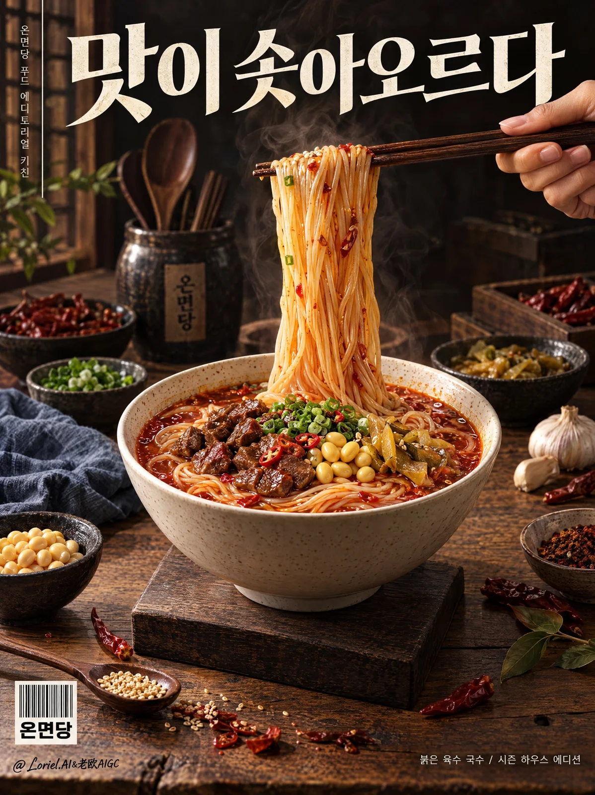

# Korean Noodle Brand Editorial Food Poster

**中文标题：** 韩式拉面品牌杂志感美食海报  
**ID:** `gi25-x-949` · **Mode:** `generate`  
**Categories:** `ecommerce`, `poster-typography`  
**Tags:** `x-twitter`, `community`, `gpt-image-2.5`, `x-direct`, `en`



### Korean Noodle Brand Editorial Food Poster

```text
Create a Cannes-level commercial poster for a fictional premium Korean noodle brand, designed as a high-impact editorial food ad where a real bowl of spicy broth noodles is fused with a refined magazine-cover layout. Preserve the exact chiaroscuro hierarchy, tabletop staging, hand-lifted noodle action, prop rhythm, negative-space structure, and typographic architecture of a premium food editorial poster. The noodle bowl must remain the absolute hero, with every surrounding element serving appetite, brand identity, and compositional tension.

Vertical 2:3 full-bleed poster. A large white ceramic bowl sits slightly below center on a dark square wooden riser over a warm wood table. A right hand enters from the upper-right holding dark wooden chopsticks, lifting a tight vertical bundle of noodles so the strands form a clean glowing column in the center-right upper zone. Reserve the upper third for a large bold Korean headline spanning most of the width. Keep a thin vertical editorial strip along the far left edge, a barcode-style brand block near the lower-left corner, and a line of fine Korean microcopy near the lower-right edge. The tabletop contains supporting bowls, cloth, spices, garlic, dried chilies, scattered leaves, and utensils arranged in deliberate editorial rhythm, never stealing focus from the hero dish.

Invent the brand as 온면당 and the hero dish as 붉은 육수 국수. The bowl contains glossy thin noodles in a rich red-orange chili broth, topped with braised diced meat, yellow soybeans, chopped scallion, red chili bits, and small golden pickled vegetables. The lifted noodles must look supple, elastic, smooth, and intensely appetizing, with subtle broth sheen and believable weight. The bowl should be off-white ceramic with delicate speckling and a soft matte glaze. The wooden riser should feel dense, dark, and precisely crafted. Every ingredient must look edible, premium, and intentionally styled.

Freeze one decisive serving moment: the hand grips the chopsticks naturally, fingers anatomically correct, wrist relaxed, chopsticks angled slightly downward from right to left, lifting a compact curtain of noodles high above the bowl. The lifted noodles form the visual bridge between headline and bowl. The bowl anchors the lower center, while the hand acts as the upper-right counterweight. Supporting bowls and props should be distributed across left, rear, and lower corners to create depth and editorial richness without clutter. Nothing may break the clarity of the noodle lift.

Foreground: warm wooden table with visible grain, a few scattered chili pieces, a spoon with sesame seeds, and restrained ingredient accents. Midground: the hero bowl on its riser, with nearby condiment bowls, folded blue-gray cloth, garlic cloves, and dried leaves. Background: darker table extensions, a soft black-brown upper field, a ceramic utensil holder, hanging wooden spoons, and small spice bowls receding into shadow. Keep the space tangible, layered, and realistic, but controlled like a styled magazine cover rather than a casual kitchen scene.

Preserve the original light-dark hierarchy: a deep near-black upper background, warm directional light across the tabletop and bowl, bright highlights on the lifted noodles, glossy accents on the broth surface, and soft sculpting light on the hand and chopsticks. Build contrast to emphasize heat, ingredient gloss, ceramic form, and tabletop texture without muddy shadows or dead black patches. Main palette: roasted brown, walnut wood, off-white ceramic, chili red, broth amber, soybean gold, herb green, charcoal shadow, and muted slate cloth blue. The mood should feel rich, savory, editorial, and premium.

Render as ultra-real luxury food photography fused with high-end print editorial design. The broth must show depth, oil shimmer, suspended spice, and realistic reflections. Noodles should display fine strand separation, slight edge translucency, and soft elasticity. Meat must look caramelized and tender. Ceramic should show subtle glaze pooling and tactile thickness. Wood must feel dry, dense, and natural. Cloth should have soft folds and matte woven texture. Small props such as chilies, garlic, sesame, and leaves should be believable but not overemphasized.

Use Korean typography only. Set a large bold headline across the top:
맛이 솟아오르다
Add a thin vertical strip along the far left margin:
온면당 푸드 에디토리얼 키친
Place a barcode-style brand block in the lower-left:
온면당
Include restrained footer microcopy at the lower-right:
붉은 육수 국수 / 시즌 하우스 에디션
Typography must be crisp, beautifully spaced, and harmonized with the poster grid, with the headline in warm ivory or soft white, never covering the lifted noodles or bowl.

Luxury commercial food poster, product-first, ultra-clean, no extra hands, no malformed fingers, no broken chopstick perspective, no noodle duplication, no floating garnish, no muddy broth, no cheap CGI gloss, no cartoon styling, no unreadable typography, no clutter overload, no random packaging, no dead black blocks, no low-detail props, no messy background, no style drift, no topology collapse.
```

- **Recommended model:** `gpt-image-2.5-sunburst`
- **Settings:** _(defaults)_
- **Source:** [community](https://x.com/ou_zhen599/status/2112586881762508812) — @ou_zhen599
- **License note:** Original public X post; quoted with attribution — remix with attribution
- **Notes:** Collected directly from X; original post https://x.com/ou_zhen599/status/2112586881762508812; post text names GPT Image 2.5; discovered via X search, prompt re-verified against the original X post via api.fxtwitter.com; verified=True; original post compares GPT Image 2.5 (left) with Nano Banana 2.1 (right) on the same prompt; the brand is fictional
- **Preview:** `previews/gi25-x-949.webp`
