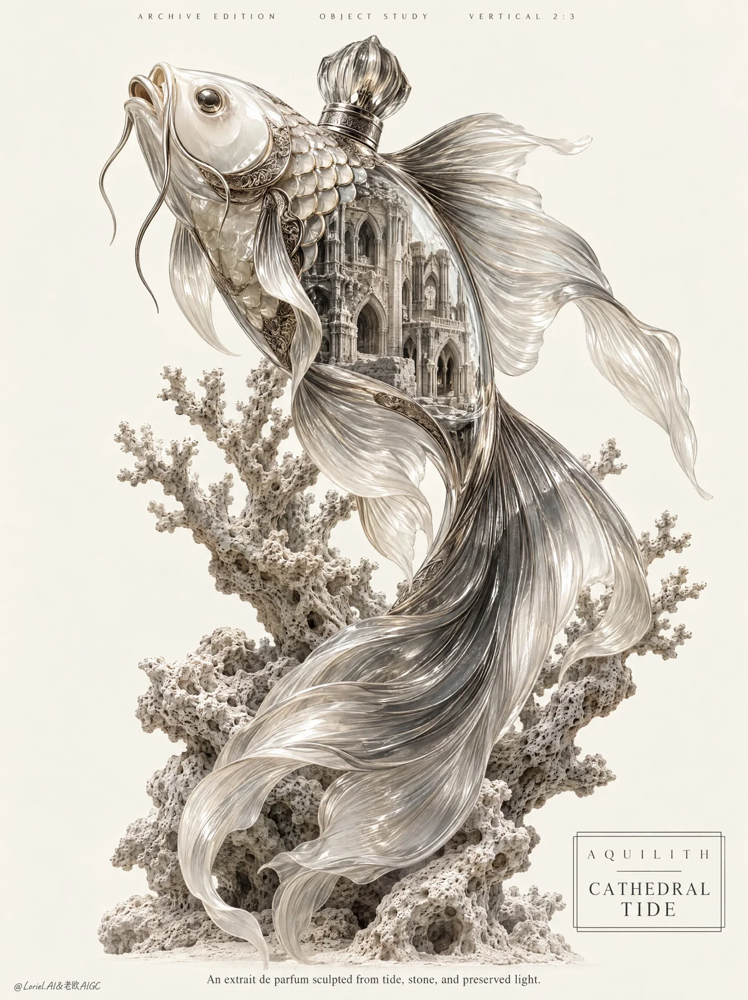

# Goldfish-Relic Perfume Decanter Luxury Poster

**中文标题：** 金鱼遗珍造型香水瓶奢华海报  
**ID:** `gi25-x-950` · **Mode:** `generate`  
**Categories:** `ecommerce`, `poster-typography`  
**Tags:** `x-twitter`, `community`, `gpt-image-2.5`, `x-direct`, `en`



### Goldfish-Relic Perfume Decanter Luxury Poster

```text
Create a Cannes-level commercial poster for a fictional luxury fragrance house, built as a product-first hero image in which a collectible perfume decanter takes the form of a monumental long-finned goldfish relic. Preserve the original structural force of a single ascending marine figure on a quiet ivory field: the same upward thrust, asymmetrical balance, negative-space discipline, engraved elegance, and exact chiaroscuro hierarchy. The surreal concept and the real product must fuse into one believable luxury object, with the product unquestionably dominant.

Vertical 2:3 full-bleed poster. One solitary central subject occupies most of the frame, rising diagonally toward the upper left while the tail falls in a controlled S-curve through the lower half. Keep the silhouette tall, sculptural, and breathable, with generous empty ivory space around it. Coral branches cradle the lower and middle body to support composition without competing with the hero. Typography is minimal and architectural: a thin micro-text line across the top edge, a restrained caption near the lower center, and a minimal outlined brand cartouche in the lower right.

Invent the brand as AQUILITH and the product as CATHEDRAL TIDE, an extrait de parfum housed in a museum-grade fish-shaped decanter. The object must read as a real premium fragrance bottle with credible industrial design: thick artisanal crystal walls, subtle seam engineering, concealed spray mechanism, precise cap logic, and collector-grade authority. The form follows a long-finned goldfish, but the torso opens into a visible internal sanctuary, a weathered stone-like micro-architecture preserved inside the body as if memory, salt, and architecture were sealed in glass. Blend smoked crystal transparency, pale porcelain-like body clarity, and restrained palladium or silver etched detailing along scale edges and structural contours. The result should feel ancient, precious, and contemporary at once.

The bottle appears suspended in a silent upward drift: head slightly lifted, mouth gently parted, barbels extending forward, body subtly arched, fins unfurling in layered ribbons, tail sweeping downward with gravity-aware elegance. Coral branches intersect selected parts of the body, reinforcing depth, stability, and cadence. The internal architecture must align with the bottle curvature and feel physically housed inside the form, never floating or pasted on.

Background is a nearly empty warm ivory field with no scene clutter. Depth comes from only three restrained layers: clean foreground air, the central decanter and coral network in the midground, and quiet negative space behind. The image should feel like an engraved collector plate, a luxury product campaign, and a contemporary exhibition poster merged into one controlled surface. Remove unnecessary particles, haze, and ornamental noise.

Preserve the full tonal hierarchy with extreme discipline. Use a pale ivory ground, bone-white highlights on the upper head, scale ridges, glass edges, and fin crests, then deepen the underside into graphite and charcoal through the jaw, belly, coral recesses, fin folds, and inner architectural cavities. Increase contrast to enhance volume and legibility, but avoid dirty blacks or crushed dead zones. Keep the palette nearly monochrome and curator-clean: ivory, bone, chalk stone, smoked gray, graphite, faint oxidized silver, with only the slightest mineral coolness in selected edges. Light should feel like diffused museum illumination shaped by engraved-print tonal logic.

Render the image as a fusion of hyper-real luxury product photography, archival intaglio engraving, and collector-edition object illustration. Glass must show believable thickness, refraction, internal reflections, density shifts, and premium polish. Porcelain-like passages should feel smooth, luminous, and mineral. Metallic etched lines should feel fine, noble, and precise. Fins should read as thin translucent material with silky vein-like striations and soft edges. Coral must appear porous, chalky, and tactile. The internal sanctuary should feel carved from pale weathered stone with arches, columns, apertures, and shadow pockets full of age and silence. The image must carry the emotional curve of a relic preserved by time, but executed with absolute commercial sharpness.

Use only English typography. Top micro line in restrained spaced editorial sans:
ARCHIVE EDITION    OBJECT STUDY    VERTICAL 2:3
Lower-right outlined cartouche:
A Q U I L I T H
CATHEDRAL
TIDE
Lower caption in elegant small serif:
An extrait de parfum sculpted from tide, stone, and preserved light.
Typography must be refined, dark graphite on ivory, beautifully kerned, aligned with the composition, and treated as part of the visual system.

Luxury commercial poster, product-first, ultra-clean, highly realistic, no human figures, no additional animals, no random props, no decorative clutter, no muddy texture, no dirty background, no fantasy chaos. Avoid malformed anatomy, broken fins, duplicated coral, unreadable typography, warped logo box, floating internal architecture, inconsistent bottle mechanics, weak silhouette, cheap glossy plastic, oversaturated color, cartoon styling, low-detail rendering, messy collage seams, topology collapse, and style drift.
```

- **Recommended model:** `gpt-image-2.5-sunburst`
- **Settings:** _(defaults)_
- **Source:** [community](https://x.com/ou_zhen599/status/2112576009807839502) — @ou_zhen599
- **License note:** Original public X post; quoted with attribution — remix with attribution
- **Notes:** Collected directly from X; original post https://x.com/ou_zhen599/status/2112576009807839502; post text names GPT Image 2.5; discovered via X search, prompt re-verified against the original X post via api.fxtwitter.com; verified=True; original post compares GPT Image 2.5 (left) with Nano Banana 2.1 (right) on the same prompt; the brand is fictional
- **Preview:** `previews/gi25-x-950.webp`
