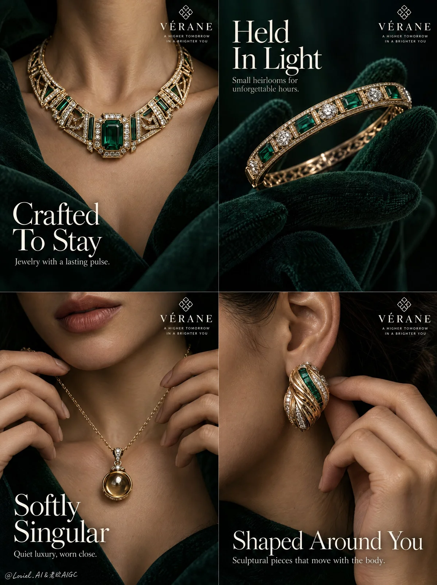

# Emerald Jewelry Four-Panel Campaign Poster

**中文标题：** 祖母绿珠宝四格广告海报  
**ID:** `gi25-x-951` · **Mode:** `generate`  
**Categories:** `ecommerce`, `poster-typography`  
**Tags:** `x-twitter`, `community`, `gpt-image-2.5`, `x-direct`, `en`



### Emerald Jewelry Four-Panel Campaign Poster

```text
A Cannes-level luxury jewelry campaign poster for the fictional maison VÉRANE, designed as a product-first four-panel editorial campaign. Preserve a full-bleed 2x2 grid with no outer border or margin. Each quadrant presents one jewel-led close crop from the same maison collection, unified by deep emerald-black tonality, antique champagne-gold metal, noble emerald gemstone depth, and elegant editorial typography. Jewelry must remain the absolute hero in every frame, while skin, velvet, fabric, and gesture act only as premium staging.

Square full-bleed 2x2 layout with four equal panels and crisp seams. Top-left: female neck and upper chest framed by dark emerald couture fabric, featuring an architectural gold necklace with a large emerald center stone; headline large in the lower-left. Top-right: a deep emerald velvet-gloved hand delicately holding a refined gold bracelet or bangle toward camera; headline large in the upper-left. Bottom-left: lower face, lips, neck, collarbone, and both hands lightly lifting a pendant necklace; headline large in the lower-left. Bottom-right: close-cropped ear, neck edge, and hand adjusting a sculptural gold earring; headline low and wide. Every panel repeats the maison mark “VÉRANE” near the upper edge with a minimal floral-geometric emblem. The four panels should feel like one coherent salon campaign with escalating intimacy from collar to hand to pendant to ear.

Create one unified VÉRANE collection in antique champagne-gold with deep emerald accents and restrained diamond-white highlights. Top-left necklace: couture geometric collar with fine open gold structures and a large octagonal emerald with subtle side-diamond clusters. Top-right bracelet: slim heirloom-like bangle with alternating emerald and diamond-like stones, presented by a velvet atelier glove. Bottom-left pendant: delicate gold chain with a single suspended rounded drop pendant, a warm polished gold orb or amber-gold cabochon in a minimal setting. Bottom-right earring: compact sculptural statement earring with woven or ribbed gold relief, dense and custom to the ear. All four jewels must clearly belong to the same maison language: noble, restrained, modern, collectible, and physically believable.

Top-left shows only neck, collarbones, and upper chest, with emerald fabric forming a dark cradle around the necklace. Top-right uses velvet-gloved fingers to hold the bracelet with atelier-level care, jewel closest to the lens and glove secondary. Bottom-left shows only the lower half of the face and hands, fingers lightly lifting the chain with graceful tension and believable anatomy. Bottom-right shows ear and cheek edge in a tight crop, one hand adjusting the earring with minimal gesture and precise fingertip placement. No full face, no eye contact, no extra accessories, no visual noise.

Keep the world intimate and non-scenic. Backgrounds are deep emerald-black gradients, velvety shadow, and soft localized warm falloff. Top-left and bottom-left lean more skin-close and emotionally intimate; top-right feels atelier-ritual and object-led; bottom-right feels sculptural and bodily. Depth comes from shadow layering, fabric framing, skin-plane transition, glove softness, and gemstone light behavior, never busy set dressing.

Use a disciplined palette: 50% deep emerald and black-green shadow, 25% warm skin and velvet neutrals, 20% antique champagne-gold metal and emerald gemstone depth, 5% ivory typography and diamond-white accents. Use soft directional key light from upper-left or upper-front, with restrained fill and delicate rim separation. Jewelry carries the highest highlight discipline in every panel: clean edge light on gold, deep translucent glow in emeralds, subtle diamond points, and controlled reflection bands. Skin should feel warm and breathable, velvet rich and light-absorbing, shadows deep but soft, never muddy or dead black. The tone should feel like a private high-jewelry presentation under quiet salon lighting.

Hyper-real luxury product photography with museum-grade detail. Gold must show believable density, crisp polish, subtle engraved or faceted articulation, and refined tonal variation from antique warmth to brighter edges. Emerald stones must show thickness, internal depth, clean cut geometry, glass-face reflection, and dark green luminosity. Velvet glove and fabric should feel dense, matte, and tactile. Skin must retain pores, natural tonal transitions, and soft real sheen without over-retouching. Lips remain understated and real. No waxy skin, plastic metal, costume-jewelry feel, or cheap gemstone shine.

Use elegant editorial English typography only. Brand in each panel: “VÉRANE” with a minimal maison emblem. Top-left headline: “Crafted To Stay” with the subline “Jewelry with a lasting pulse.” Top-right headline: “Held In Light” with the subline “Small heirlooms for unforgettable hours.” Bottom-left headline: “Softly Singular” with the subline “Quiet luxury, worn close.” Bottom-right headline: “Shaped Around You” with the subline “Sculptural pieces that move with the body.” Typography must be airy, premium, serif-led, softly ivory or muted chartreuse-ivory, integrated into each panel’s negative space, and never cross the key jewelry silhouette.

Full-bleed four-panel luxury jewelry campaign, product-dominant, hyper-real, editorial, unified maison identity, no outer border, no empty margin, no gibberish text, no malformed fingers, no broken chain physics, no warped ear anatomy, no duplicated jewelry, no inconsistent collection language, no plastic-looking gold, no muddy emeralds, no over-smoothed skin, no dead black patches, no clutter, no random props, no style drift, no topology collapse.
```

- **Recommended model:** `gpt-image-2.5-sunburst`
- **Settings:** _(defaults)_
- **Source:** [community](https://x.com/ou_zhen599/status/2112526802178727969) — @ou_zhen599
- **License note:** Original public X post; quoted with attribution — remix with attribution
- **Notes:** Collected directly from X; original post https://x.com/ou_zhen599/status/2112526802178727969; post text names GPT Image 2.5; discovered via X search, prompt re-verified against the original X post via api.fxtwitter.com; verified=True; original post compares GPT Image 2.5 (left) with Nano Banana 2.1 (right) on the same prompt; the brand is fictional
- **Preview:** `previews/gi25-x-951.webp`
