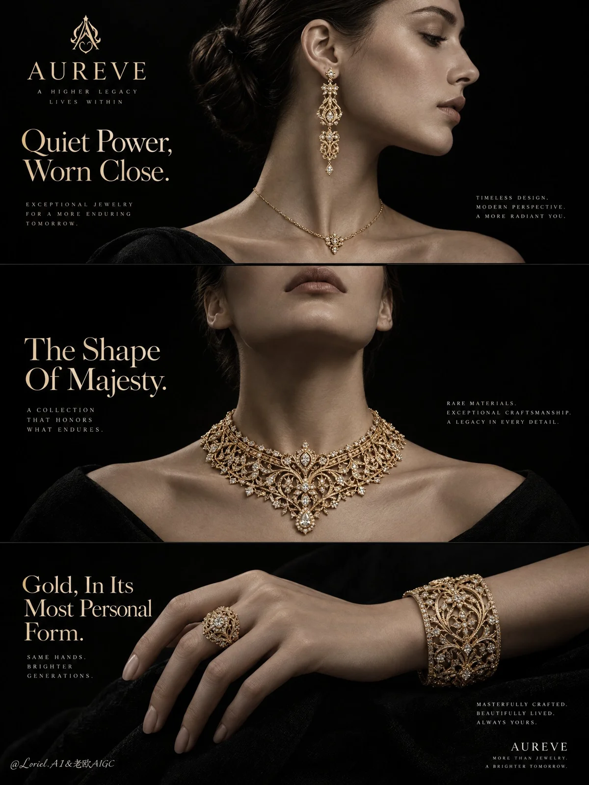

# High-Jewelry Stacked Triptych Campaign Poster

**中文标题：** 高级珠宝竖排三联广告海报  
**ID:** `gi25-x-952` · **Mode:** `generate`  
**Categories:** `ecommerce`, `poster-typography`  
**Tags:** `x-twitter`, `community`, `gpt-image-2.5`, `x-direct`, `en`



### High-Jewelry Stacked Triptych Campaign Poster

```text
A Cannes-level luxury jewelry campaign poster for the fictional high-jewelry house AUREVE, designed as a product-first triptych editorial ad that fuses sculptural atmosphere, heirloom-grade material precision, and curator-level restraint. Preserve three vertically stacked portrait panels on a pure black field: the upper panel shows a poised right-facing female side profile wearing a long statement earring and a fine necklace; the middle panel shows a more frontal sculptural portrait centered on a regal statement necklace; the lower panel shows an elegant hand and wrist composition with a bold ring and ornate cuff bracelet. Jewelry remains the absolute hero across all three panels, while the human figure functions as refined display architecture rather than celebrity portraiture.

Use a vertical poster layout with three clearly separated horizontal image bands floating on a deep black background, clean gaps between panels, and precise editorial hierarchy. Upper panel: portrait on the right half, leaving upper-left negative space for brand mark and opening headline, with a small descriptor block near the lower-right. Middle panel: neck and collar composition dominates, with headline on the left and a small supporting text block on the right. Lower panel: hand and partial forearm stretch across the frame with graceful spacing, left side for the closing headline and right side for a short craftsmanship note. The full structure should read as one unified luxury collection story told through ear, neck, and hand.

Create one coherent AUREVE collection in antique champagne-gold to rich yellow-gold tones, combining intricate filigree geometry, openwork lattice, delicate relief engraving, and restrained diamond-like micro highlights. The upper-panel earring is elongated, architectural, and highly collectible, built from repeating ornamental modules with refined vertical cadence. The upper necklace is fine and secondary. The middle-panel necklace is the central hero, wider, denser, and more ceremonial, hugging the neckline with layered mesh, articulated filigree, nested geometry, and a sculptural center structure suggesting modern royalty. The lower-panel ring is bold and rounded with a crown-like face, while the cuff bracelet is richly pierced and layered, showing depth, handcraft, and museum-grade precision. Every piece must feel physically real and unmistakably premium.

The same woman appears in the upper and middle panels, hair in a sleek low bun with clean hairline control. In the upper panel, her right-facing profile emphasizes ear, jawline, neck, and the earring’s elegant fall. In the middle panel, the chin lifts slightly and the shoulders open just enough to stage the necklace without becoming a fashion pose. In the lower panel, the hand is relaxed yet sculptural, fingers softly bent with believable anatomy, holding no object, so the ring and bracelet read clearly. The three panels must feel emotionally linked, revealing the collection with quiet authority.

Keep the environment radically minimal and editorial: deep black with controlled graphite separation, faint panel-specific falloff, and soft volumetric darkness that lets the gold emerge like lit artifacts in a salon exhibition. No scenery, props, architecture, or decorative particles. Depth comes only from sculptural lighting, skin-plane transitions, jewelry layering, and black-level discipline.

Use a disciplined palette of 85% black, graphite, and softly desaturated monochrome skin tones, 10% antique champagne-gold to rich yellow-gold, and 5% diamond-white micro highlights. Build a soft upper-left studio key with controlled frontal fill and delicate rim separation so face, neck, hand, and jewelry stay dimensional without beauty-editorial gloss. Skin and hand should read nearly monochrome and velvety, while the jewelry carries the warmest luminance. Increase the light hierarchy in the middle necklace panel so it becomes the emotional summit, with the upper earring and lower hand jewels as refined echoes. Maintain luxurious contrast without dead black collapse, muddy shadows, or blown speculars.

Render with hyper-real luxury photography, immaculate tonal control, natural refined skin texture, velvety black styling, crisp gold reflections, believable metal weight, and museum-grade finish. Gold must show polished edges, tiny recess shadows, layered openwork depth, engraved micro detail, and subtle tonal variation from antique champagne warmth to richer yellow highlights. Diamond-like accents remain restrained, precise, and elegant, never glittery. Skin stays natural, softly detailed, and non-plastic.

Place an original luxury wordmark AUREVE with a minimal refined emblem in the upper-left region. Use elegant editorial English typography only. Main top headline: Quiet Power, Worn Close. Middle headline: The Shape Of Majesty. Bottom headline: Gold, In Its Most Personal Form. Add short refined descriptor lines near each panel focused on craftsmanship, heirloom detail, and contemporary elegance. Typography must be integrated into the black negative space with couture serif-led hierarchy, soft ivory-to-warm-gold coloring, graceful spacing, and alignment that follows the original poster rhythm. Text must never cross jewelry recognition zones.

Luxury jewelry campaign poster, product-dominant, hyper-real, editorial, black-background precision, no clutter, no extra accessories, no malformed hands, no broken anatomy, no duplicated jewelry, no warped facial structure, no muddy shadows, no dead black patches, no blown gold highlights, no gibberish text, no cheap glitter, no inconsistent collection design, no topology collapse, no style drift, no flat catalog lighting.
```

- **Recommended model:** `gpt-image-2.5-sunburst`
- **Settings:** _(defaults)_
- **Source:** [community](https://x.com/ou_zhen599/status/2112171810443923892) — @ou_zhen599
- **License note:** Original public X post; quoted with attribution — remix with attribution
- **Notes:** Collected directly from X; original post https://x.com/ou_zhen599/status/2112171810443923892; post text names GPT Image 2.5; discovered via Bin0754/gpt-image-gallery index, prompt re-verified against the original X post via api.fxtwitter.com; verified=True; original post compares GPT Image 2.5 (left) with Nano Banana 2.1 (right) on the same prompt; the brand is fictional
- **Preview:** `previews/gi25-x-952.webp`
