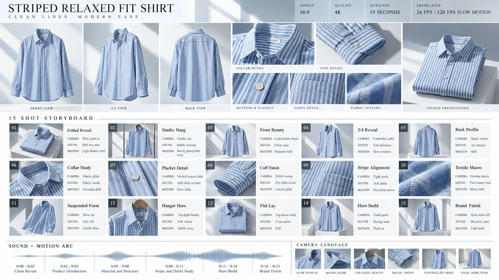

# Product Sheet + Cinematic Storyboard Board for a Fashion Ad

**中文标题：** 服装广告产品表+电影分镜板  
**ID:** `gi25-x-964` · **Mode:** `edit`  
**Categories:** `ecommerce`, `character-consistency`  
**Tags:** `x-twitter`, `community`, `gpt-image-2.5`, `x-direct`, `en`



### Product Sheet + Cinematic Storyboard Board for a Fashion Ad

```text
Create a high-end cinematic product sheet and storyboard board in 16:9 landscape format for a 15-second premium fashion commercial featuring the reference shirt: a blue-and-white striped relaxed fit long-sleeve button-up shirt. Use Image A / the uploaded shirt image as the exact product reference and keep the shirt highly accurate and visually consistent throughout the entire board. Preserve the blue-and-white stripe pattern, relaxed silhouette, standard collar, front button placket, long sleeves, cuff construction, hem shape, and overall proportions. The board should look like a premium creative direction sheet made by a fashion ad agency, not a simple collage.

Use a bright editorial visual language with crisp white, soft sky blue, pale grey, brushed silver, and subtle neutral shadow tones. The styling should feel refined, modern, clean, and commercial, with elegant spacing, minimal typography, polished product photography, and premium studio presentation. The overall mood should feel like a contemporary Zara-style menswear campaign with bright controlled lighting and geometric shadow play.

The top section should function as a product sheet and show the shirt from multiple precise views so the video model has strong consistency guidance. Include a clean front view, a slight 3/4 hero angle, a clean back view, a collar close-up, a cuff close-up, a close-up of the buttons and placket, a close-up of the chest area showing stripe alignment, a macro fabric texture panel, and a folded-shirt presentation. Add a premium header with a main title such as “STRIPED RELAXED FIT SHIRT”, a refined subtitle such as “CLEAN LINES. MODERN EASE.”, and a small specs panel reading ASPECT 16:9, QUALITY 4K, DURATION 15 SECONDS, FRAME RATE 24 FPS / 120 FPS SLOW MOTION. The design should feel elevated, editorial, and suitable for a premium modern fashion campaign.

The lower section should be a 15-shot storyboard arranged in a 5 by 3 grid, with each frame representing around one second of the commercial. Every frame should contain a realistic cinematic image, a short scene title, and three small production note labels: CAMERA, SOUND, and MOTION. Keep every frame product-only with no humans so the film remains clean and stable. The environments should stay inside a bright editorial studio with smooth white surfaces, geometric shadows, diffused daylight-style lighting, subtle reflections, and precise fashion-photography aesthetics.

The sequence should begin with a tasteful reveal of the folded shirt or shirt hanging in a bright studio, followed by a clean introduction of the full shirt. Then move into refined product cinematography: a front beauty shot, a slight 3/4 reveal, close glides over the collar shape, buttons, cuffs, and stripe pattern, plus multiple macro detail shots showing the fabric weave and alignment of the stripes. Continue with elegant angle changes, a suspended or hanger-based presentation, a premium folded flat-lay composition, and a final hero frame with a clean end card. The full visual progression should emphasize simplicity, structure, texture, and modern style.

At the bottom, add a slim cinematic strip labeled “SOUND + MOTION ARC” with a tasteful horizontal waveform divided into six segments: 0:00 - 0:02 Clean Reveal, 0:02 - 0:05 Product Introduction, 0:05 - 0:08 Material and Structure, 0:08 - 0:11 Stripe and Detail Study, 0:11 - 0:14 Hero Build, and 0:14 - 0:15 Brand Finish. Add a small “CAMERA LANGUAGE” panel with labels such as SLOW PUSH-IN, MACRO GLIDE, TOP-LIGHT BEAUTY, DETAIL SWEEP, CONTROLLED ORBIT, FINAL HERO PUSH.

The entire board must feel like a premium fashion campaign treatment with sharp editorial composition, realistic fabric rendering, visible textile texture, beautiful geometric light-and-shadow patterns, strong product consistency, and clean professional layout. The shirt must remain the single hero object throughout.
```

- **Recommended model:** `gpt-image-2.5-sunburst`
- **Settings:** _(defaults)_
- **Source:** [community](https://x.com/HeyAbhishek/status/2112492617699348933) — @HeyAbhishek
- **License note:** Original public X post; quoted with attribution — remix with attribution
- **Notes:** Collected directly from X; original post https://x.com/HeyAbhishek/status/2112492617699348933; post text names GPT Image 2.5; discovered via X search, prompt re-verified against the original X post via api.fxtwitter.com; verified=True; posted in the author's own thread https://x.com/HeyAbhishek/status/2112492599038853469; the board is then used for a Seedance 2.5 video
- **Preview:** `previews/gi25-x-964.webp`
