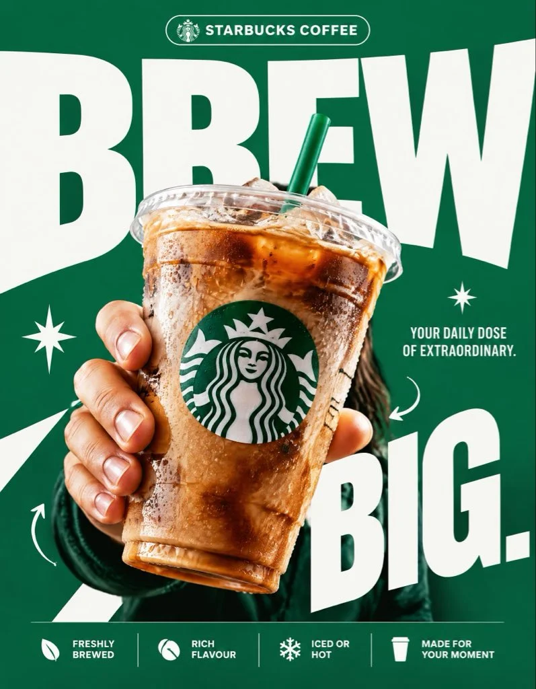

# “Brew Big” Coffee-Cup Bold Typography Poster

**中文标题：** “BREW BIG”咖啡杯大字报广告海报  
**ID:** `gi25-x-984` · **Mode:** `generate`  
**Categories:** `ecommerce`, `poster-typography`  
**Tags:** `x-twitter`, `community`, `gpt-image-2.5`, `x-direct`, `en`



### “Brew Big” Coffee-Cup Bold Typography Poster

```text
STARBUCKS — “BREW BIG.”

4:5 vertical premium poster, 8K, exaggerated bold typography × high-impact commercial art direction × photorealistic product advertising

🧠 CORE IDEA:
“BREW BIG.”

🎬 LAYOUT:

BACKGROUND BLOCK:
Solid, vivid Starbucks green background with oversized graphic shapes and strong contrast.

GIANT TYPOGRAPHY:
“BREW”
Extremely bold, oversized, tightly cropped typography dominating almost the entire composition. Letters extend beyond the canvas edges, with the Starbucks cup overlapping the text.

👤 SUBJECT:

A hand holding an iced Starbucks drink directly toward the camera, extreme forced perspective, cup dramatically enlarged in the foreground, realistic condensation, crisp ice, natural lighting.

☕ PRODUCT + VISUAL TWIST:

The Starbucks cup becomes the centerpiece of the typography. The oversized word “BREW” appears to wrap behind the cup, creating striking depth through scale, layering, and composition. Keep the cup, logo, and beverage completely photorealistic.

✨ GRAPHIC ELEMENTS:

* Oversized green and white shapes
* Sharp contrasting shadows
* Minimal starburst accents
* Small directional arrows
* Bold editorial layering

✍️ TEXT SYSTEM:

Top pill:
“STARBUCKS COFFEE”

Main headline:
“BREW BIG.”

Supporting text:
“YOUR DAILY DOSE OF EXTRAORDINARY.”

BOTTOM FEATURE STRIP:

* Freshly Brewed
* Rich Flavour
* Iced or Hot
* Made for Your Moment

ANTI-SLOP DIRECTION:
Typography is the main design feature, not a small decorative element. Extreme scale, aggressive cropping, strong visual hierarchy, deliberate overlap, premium print-ad finish. No floating coffee beans, no miniature landscapes, no random surreal objects, no excessive particles, no cluttered layouts, no generic gradients. The final poster should feel like a bold global advertising campaign with unmistakable graphic impact.
```

- **Recommended model:** `gpt-image-2.5-sunburst`
- **Settings:** _(defaults)_
- **Source:** [community](https://x.com/Diplomeme/status/2113124509477998992) — @Diplomeme
- **License note:** Original public X post; quoted with attribution — remix with attribution
- **Notes:** Collected directly from X; original post https://x.com/Diplomeme/status/2113124509477998992; post text names GPT Image 2.5; discovered via Bin0754/gpt-image-gallery index, prompt re-verified against the original X post via api.fxtwitter.com; verified=True; author made it with GPT Image 2.5 on PolloAI; the brand named in the prompt is a real coffee chain, used here as a fan-made ad concept
- **Preview:** `previews/gi25-x-984.webp`
