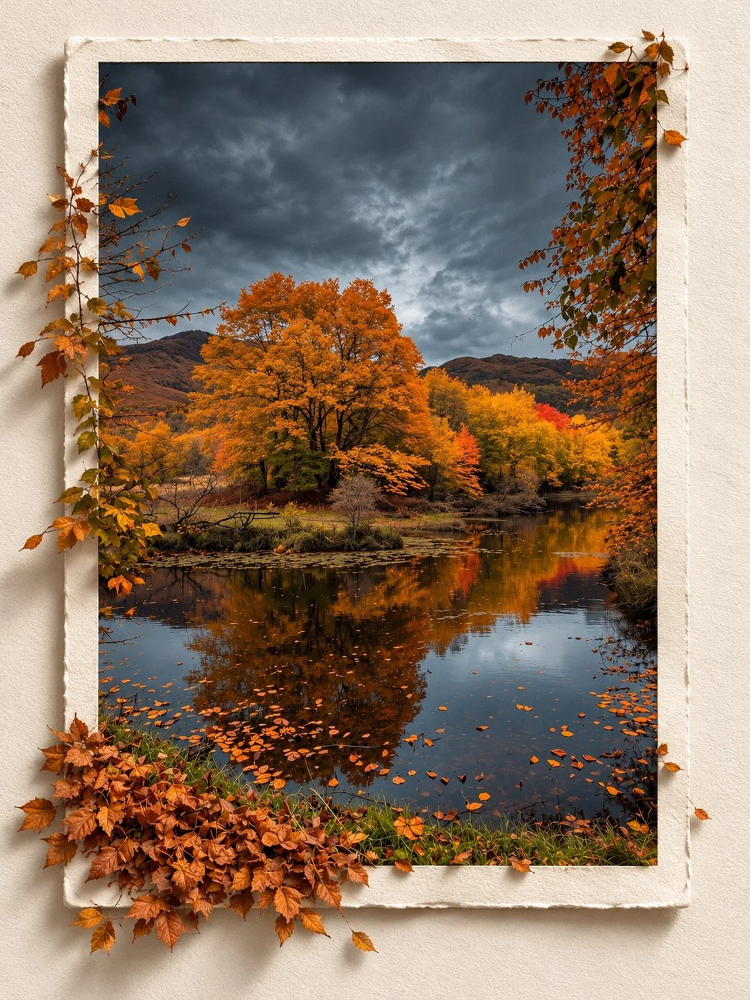

# Framed Photo 3D Pop-Out Editorial

**中文标题：** 照片相框 3D 出框效果  
**ID:** `gi25-x-1002` · **Mode:** `edit`  
**Categories:** `edit-change-preserve`  
**Tags:** `x-twitter`, `community`, `gpt-image-2.5`, `x-direct`, `en`



### Framed Photo 3D Pop-Out Editorial

```text
Transform the reference photo into a premium 3D pop-out editorial photograph with a sophisticated, minimalist art direction.

COMPOSITION & BACKGROUND
Place the original photograph within a vertical rectangular photo frame on a warm, off-white, subtly textured paper background. Maintain a clean, elegant composition with balanced spacing and refined editorial aesthetics.

3D POP-OUT EFFECT
Create a convincing three-dimensional illusion in which the main subject and selected foreground elements naturally extend beyond the frame’s borders, as if emerging from the photograph into the viewer’s space. Preserve realistic proportions, natural contours, and seamless transitions between the framed image and the protruding elements. Ensure the depth effect feels physically believable rather than artificial or exaggerated.

PRESERVE THE ORIGINAL
Maintain the subject’s exact identity, facial features, expression, pose, clothing, original environment, colors, lighting characteristics, and all defining details. Do not alter, reinterpret, or replace any essential elements of the reference photo.

LIGHTING & REALISM
Use soft, natural lighting with realistic directional shadows cast by the frame and protruding elements onto the paper surface. Incorporate subtle contact shadows, authentic depth cues, delicate film grain, and highly detailed, photorealistic textures. Ensure the entire composition feels like a professionally photographed physical artwork.

FINAL STYLE & FORMAT
Premium editorial photography, minimalist luxury art direction, warm neutral tones, refined composition, seamless 3D depth illusion, photorealistic rendering, and exceptional detail. Vertical 3:4 aspect ratio.

STRICT RESTRICTIONS: No text, typography, logos, watermarks, decorative graphics, additional objects, or unnecessary embellishments. Keep the focus entirely on the original photograph and its realistic 3D pop-out effect.
```

- **Recommended model:** `gpt-image-2.5-sunburst`
- **Settings:** _(defaults)_
- **Source:** [community](https://x.com/Goodmanprotocol/status/2113219932087624109) — @Goodmanprotocol
- **License note:** Original public X post; quoted with attribution — remix with attribution
- **Notes:** Collected directly from X; original post https://x.com/Goodmanprotocol/status/2113219932087624109; post text names GPT Image 2.5; discovered via Bin0754/gpt-image-gallery index, prompt re-verified against the original X post via api.fxtwitter.com; verified=True
- **Preview:** `previews/gi25-x-1002.webp`
