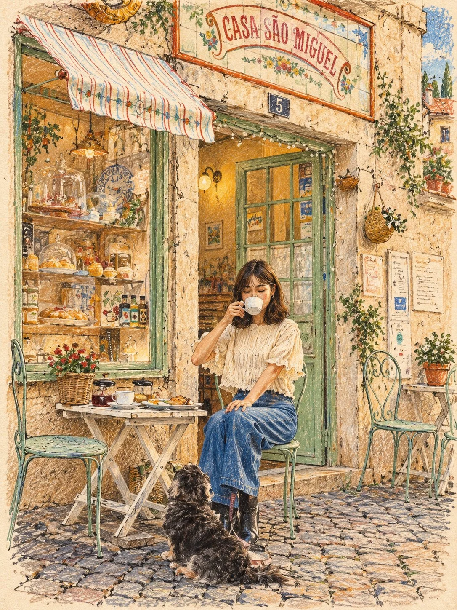

# Photo-to-Colored-Pencil Storybook Travel Illustration

**中文标题：** 照片→彩铅童话风旅行插画  
**ID:** `gi25-x-1005` · **Mode:** `edit`  
**Categories:** `edit-change-preserve`  
**Tags:** `x-twitter`, `community`, `gpt-image-2.5`, `x-direct`, `en`



### Photo-to-Colored-Pencil Storybook Travel Illustration

```text
Transform the uploaded photo into a beautiful, hand-drawn editorial travel illustration with a charming vintage storybook aesthetic.

STYLE: Traditional colored-pencil and wax-crayon illustration on warm, textured paper. Visible sketch strokes, grainy pigment, imperfect hand-drawn outlines, subtle cross-hatching, and a soft matte finish. A blend of European travel-journal art and modern illustrated storytelling.

SUBJECT: Preserve the recognizable identity, facial features, hairstyle, clothing, pose, and essential details of the original subject. Use elegant simplified shapes, expressive features, delicate linework, rosy cheeks, and natural proportions with a slightly whimsical illustrated appearance.

BACKGROUND: Recreate the original environment using painterly architectural details, scenic landscapes, charming buildings, blue skies, rolling hills, or cobblestone streets as appropriate. Maintain depth and perspective while simplifying details into expressive hand-drawn forms.

COLOR PALETTE: Warm cream, terracotta red, dusty blue, muted olive green, charcoal black, and soft beige. Use harmonious colors, gentle contrast, and subtle vintage color variation.

TEXTURE & DETAILS: Add visible pencil scratches, rough crayon marks, uneven color fills, delicate hatching, and natural paper grain throughout the image. Keep the artwork tactile, organic, and authentically handmade. Optional tiny hand-drawn hearts or playful accents when appropriate.

COMPOSITION: Vertical 3:4 portrait format, balanced framing, full-bleed illustration with subtly irregular paper edges. Keep the subject prominent and the background visually engaging without overwhelming the main scene.

FINAL RESULT: A sophisticated, nostalgic travel-journal illustration that feels genuinely hand-drawn by a professional editorial illustrator. Avoid photorealism, glossy digital rendering, 3D effects, excessive smoothness, and generic anime styling.
```

- **Recommended model:** `gpt-image-2.5-sunburst`
- **Settings:** _(defaults)_
- **Source:** [community](https://x.com/Ziha_ai/status/2114187192637718615) — @Ziha_ai
- **License note:** Original public X post; quoted with attribution — remix with attribution
- **Notes:** Collected directly from X; original post https://x.com/Ziha_ai/status/2114187192637718615; post text names GPT Image 2.5; discovered via Bin0754/gpt-image-gallery index, prompt re-verified against the original X post via api.fxtwitter.com; verified=True
- **Preview:** `previews/gi25-x-1005.webp`
