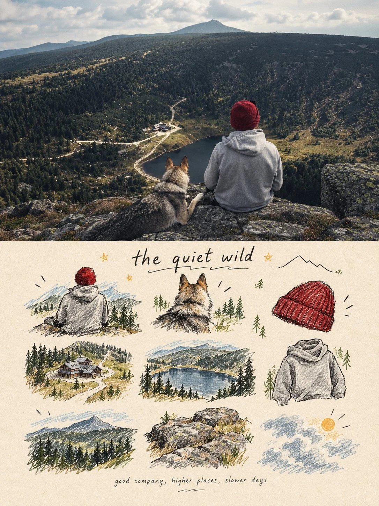

# Photo + Illustrated Memory Collection Split Poster

**中文标题：** 照片+插画回忆合集对半海报  
**ID:** `gi25-x-1013` · **Mode:** `edit`  
**Categories:** `edit-change-preserve`, `poster-typography`  
**Tags:** `x-twitter`, `community`, `gpt-image-2.5`, `x-direct`, `en`



### Photo + Illustrated Memory Collection Split Poster

```text
turn each photo I upload into a separate, high-end design poster. Do not combine multiple photos into a collage. Each photo must be processed and output individually.
1. Overall Layout and Composition
Use a 3:4 vertical aspect ratio.
Divide the canvas into two equal horizontal sections, with a strict 1:1 height ratio: the top half occupies exactly 50% of the canvas, and the bottom half occupies the remaining 50%.
2. Top Half — Original Photography
Preserve the original photograph in the upper section. Maintain the subject’s identity, structure, pose, realistic textures, natural lighting, shadows, and original color atmosphere. Apply only subtle, sophisticated color grading to achieve the aesthetic of an art magazine, independent publication, or gallery exhibition image.
You may naturally extend the environmental background to fit the composition, but never stretch, distort, or alter the subject.
3. Bottom Half — A Visual Memory Collection
Extract the most recognizable subjects, distinctive details, action cues, objects, and narrative relationships from the photograph. Reinterpret them as a visual system combining a modular 3×3 icon grid, naïve hand-drawn doodle illustrations, crayon/p colored-pencil textures, and handwritten typography.
Do not reproduce the original photograph in full detail, and do not create realistic illustrations. Instead, simplify the complex visual information into nine memorable visual elements. These may include:
The main subject
Distinctive physical or visual features
Personal belongings or objects
Plants or food
Modes of transportation
Poses or gestures
Emotional symbols
Small memorable details from the surrounding scene
Every element must be a semantic extension of the same photograph above, creating a cohesive “memory checklist” that clearly belongs to that specific image.
4. Grid System and Visual Arrangement
Use an implicit, loosely arranged 3×3 grid. The nine-cell structure should serve as an underlying compositional framework rather than a rigid, visible grid.
Slightly vary the position, scale, angle, and placement of each icon to create an organic, imperfect arrangement that feels structured but never mechanical. Aim for a natural loose grid / organic grid aesthetic.
At the top of the lower section, you may add a short handwritten title, accompanied by a few playful wavy lines, tiny stars, or decorative symbols.
At the bottom, include a very small handwritten caption, making the overall design feel like a page from a personal journal, visual diary, or curated collection sheet.
Maintain generous negative space. The layout should feel relaxed, cute, restrained, and visually balanced rather than cluttered.
5. Illustration Style and Texture
Use a Naïve Hand-Drawn Doodle Illustration style.
Keep shapes simple, slightly childlike, and intentionally imperfect.
Use subtly shaky outlines with irregular line thickness.
Allow contours to remain partially open rather than perfectly closed.
Preserve a sense of deliberate imperfection and handmade character.
Avoid overly dense coloring. Let the paper texture, white grain, and rough edges remain visible.
Combine fine black outlines with colored-pencil or crayon fills and a few selective blocks of color.
Use flat color / spot color to establish visual relationships instead of relying on realistic lighting and shading.
If grid guidelines are included, keep them extremely faint, as if lightly sketched in pencil, rather than using clean, computer-generated table lines.
Final Art Direction
The finished poster should feel like a sophisticated independent art publication blended with a playful, handmade visual diary. The upper half should preserve the beauty and authenticity of the original photograph, while the lower half transforms its most meaningful details into nine charming, hand-drawn visual memories.
The final result must be a separate 3:4 vertical poster for each uploaded photograph, with an exact 50/50 split between the original photograph and the illustrated memory collection.
```

- **Recommended model:** `gpt-image-2.5-sunburst`
- **Settings:** _(defaults)_
- **Source:** [community](https://x.com/Ziha_ai/status/2112887743168831601) — @Ziha_ai
- **License note:** Original public X post; quoted with attribution — remix with attribution
- **Notes:** Collected directly from X; original post https://x.com/Ziha_ai/status/2112887743168831601; post text names GPT Image 2.5; discovered via Bin0754/gpt-image-gallery index, prompt re-verified against the original X post via api.fxtwitter.com; verified=True
- **Preview:** `previews/gi25-x-1013.webp`
