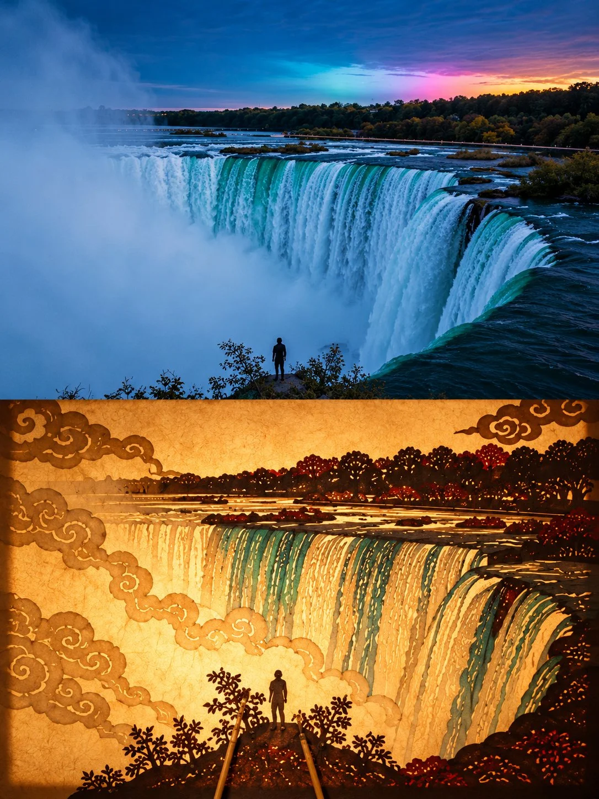

# Photo + Shadow-Puppet Art Split Poster

**中文标题：** 照片+皮影戏艺术对半海报  
**ID:** `gi25-x-1017` · **Mode:** `edit`  
**Categories:** `edit-change-preserve`, `poster-typography`  
**Tags:** `x-twitter`, `community`, `gpt-image-2.5`, `x-direct`, `en`



### Photo + Shadow-Puppet Art Split Poster

```text
Create a premium 3:4 vertical shadow-puppet art poster from the uploaded photograph.

COMPOSITION:
Divide the canvas into two equal horizontal halves.

TOP HALF:
Preserve the original photograph’s subject, identity, pose, proportions, composition, textures, and natural lighting. Apply only subtle, refined color grading for an elegant fine-art exhibition aesthetic. Extend the background if necessary, without distorting the subject.

BOTTOM HALF:
Reinterpret the same subject as an authentic traditional Chinese shadow puppet, performing against warmly illuminated, translucent rice paper. Translate its defining silhouette, posture, and character into a flat, handcrafted leather-cutout figure with articulated joints, tiny connecting rivets, decorative perforations, intricate cloud motifs, and delicate geometric carvings. Use restrained translucent pigments inspired by traditional shadow-puppet craftsmanship.

Add one or two slender bamboo control rods entering naturally from the bottom edge. Create realistic paper translucency, warm backlighting, subtle shadows, and exquisite handcrafted details.

CREATIVE DIRECTION:
The puppet must remain instantly recognizable as the original subject, whether it is a person, animal, building, plant, object, or landscape. Adapt the traditional shadow-puppet construction intelligently to the subject rather than forcing every image into a human-shaped figure.

Make the transition between photography and traditional folk art visually meaningful, refined, and museum-worthy.

Avoid photorealistic puppets, cartoon styling, excessive ornamentation, unrelated elements, distorted features, text, logos, and watermarks.

FORMAT: 3:4 vertical, exact 50/50 horizontal split.
```

- **Recommended model:** `gpt-image-2.5-sunburst`
- **Settings:** _(defaults)_
- **Source:** [community](https://x.com/Goodmanprotocol/status/2113563234238386322) — @Goodmanprotocol
- **License note:** Original public X post; quoted with attribution — remix with attribution
- **Notes:** Collected directly from X; original post https://x.com/Goodmanprotocol/status/2113563234238386322; post text names GPT Image 2.5; discovered via Bin0754/gpt-image-gallery index, prompt re-verified against the original X post via api.fxtwitter.com; verified=True
- **Preview:** `previews/gi25-x-1017.webp`
