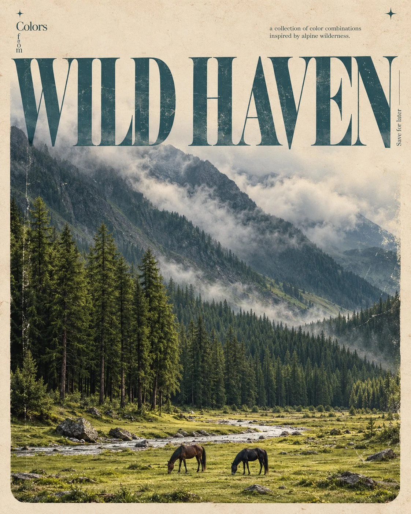

# Vintage Magazine Editorial Poster from an Image

**中文标题：** 图片→复古杂志编辑海报  
**ID:** `gi25-x-1020` · **Mode:** `edit`  
**Categories:** `edit-change-preserve`, `poster-typography`  
**Tags:** `x-twitter`, `community`, `gpt-image-2.5`, `x-direct`, `en`



### Vintage Magazine Editorial Poster from an Image

```text
Create a sophisticated, vintage-inspired editorial poster in a 4:5 vertical aspect ratio, using the uploaded image as the primary visual reference.

UPLOADED IMAGE: Use the uploaded image to determine the subject, theme, and visual inspiration automatically. Identify its main subject and create a beautiful, photorealistic cinematic scene that represents it. Preserve the essential identity and meaning of the subject while artistically adapting the composition to match the poster design.

POSTER DESIGN & LAYOUT:

Create a warm, pale beige, aged-paper background with subtle paper fibers, fine grain, and authentic vintage print imperfections. Place a large rectangular photographic panel across most of the canvas, leaving a narrow beige border. Give the panel softly rounded bottom corners and a faded analog-film appearance.

OVERSIZED TYPOGRAPHY:

Automatically determine a short, elegant title based on the uploaded image's subject. Display that title in enormous, high-contrast serif typography across the upper third of the poster, stretching almost edge to edge. Use tall, refined letterforms, dramatic thick-and-thin strokes, and tight spacing.

Color the headline muted dusty turquoise-blue with subtle photographic texture and weathered ink. Allow the letters to overlap the sky or upper portion of the photograph, blending typography and imagery into a sophisticated editorial composition.

SMALL EDITORIAL DETAILS:

Near the upper-left part of the title, add the small heading “Colors” with “from” arranged vertically underneath.

Near the upper-right side, add a tiny, understated subtitle reading “a collection of color combinations / inspired by [DETECTED SUBJECT].”

Add the vertical annotation “Save for later” beside the right edge of the headline.

Place two tiny four-pointed turquoise star symbols near the top-left and top-right corners of the beige background.

PHOTOGRAPHIC STYLE:

Create a cinematic, photorealistic image inspired by the uploaded subject, with natural lighting, atmospheric depth, authentic textures, muted colors, subtle 35mm film grain, softly faded contrast, and a nostalgic analog-film finish.

Automatically choose the appropriate environment, composition, colors, and atmosphere based on the uploaded image. Keep the main subject visually compelling and the photograph integrated naturally with the oversized typography.

COLOR PALETTE:

Warm cream, dusty turquoise-blue, muted sky blue, and naturally derived earthy tones that complement the uploaded image. Preserve the understated, timeless aesthetic of a premium independent design magazine.

STRICT REQUIREMENTS:

- Use the uploaded image as the subject reference; do not require the user to type a subject name.
- Automatically detect the subject and generate a suitable title.
- Create a new, theme-appropriate cinematic composition rather than simply placing the original image inside a frame.
- Maintain the same vintage poster layout, oversized typography, beige margins, small annotations, and subtle decorative stars.
- Keep the composition balanced, artistic, and uncluttered.
- Avoid watermarks, glossy digital effects, oversaturation, and unnecessary decorative elements.
- Render all typography as accurately as possible.

OUTPUT: A high-resolution, photorealistic editorial poster in a vertical 4:5 aspect ratio, inspired by the uploaded image and styled consistently with premium vintage magazine art direction.
```

- **Recommended model:** `gpt-image-2.5-sunburst`
- **Settings:** _(defaults)_
- **Source:** [community](https://x.com/Goodmanprotocol/status/2114267817340264470) — @Goodmanprotocol
- **License note:** Original public X post; quoted with attribution — remix with attribution
- **Notes:** Collected directly from X; original post https://x.com/Goodmanprotocol/status/2114267817340264470; post text names GPT Image 2.5; discovered via Bin0754/gpt-image-gallery index, prompt re-verified against the original X post via api.fxtwitter.com; verified=True
- **Preview:** `previews/gi25-x-1020.webp`
