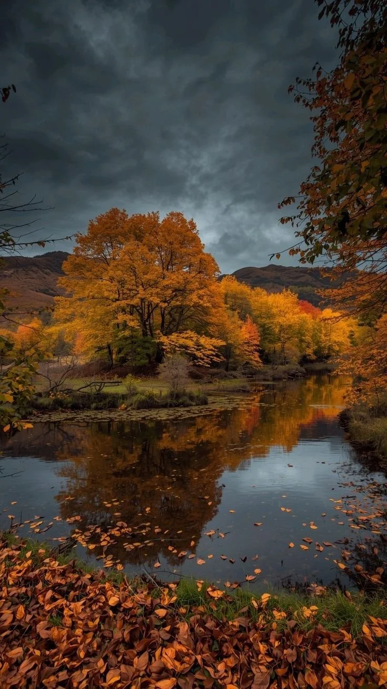

# Photo-to-Cyanotype Sun Print Artwork

**中文标题：** 照片→蓝晒印相实物作品  
**ID:** `gi25-x-1027` · **Mode:** `edit`  
**Categories:** `edit-change-preserve`  
**Tags:** `x-twitter`, `community`, `gpt-image-2.5`, `x-direct`, `en`



### Photo-to-Cyanotype Sun Print Artwork

```text
Transform the attached photograph into a single, authentic cyanotype sun print, photographed as a physical artwork. Vertical 4:5 composition.

THE SHEET

A handmade cyanotype on thick cotton rag paper, lying on a plain, pale surface in soft natural daylight. The image fills most of the sheet, leaving visible white margins on all four sides. Keep the entire sheet inside the frame, with at least three edges clearly visible and one edge preferably showing a fibrous tear. The paper has subtle cockling from washing and drying, with realistic surface texture and a soft shadow along one side.

HAND-BRUSHED COATING

The photosensitive coating is applied by hand. Blue boundaries are naturally irregular, with visible brushstroke endings, small uncoated patches, uneven edges, and a few stray blue flecks on the white margins. Avoid perfectly straight, mechanical borders on all four sides.

CYANOTYPE TONES

Use only authentic cyanotype colours:

- Shadows: Deep Prussian blue.
- Midtones: Pale to medium cyan.
- Highlights: Completely bare, raw white paper with no blue pigment.

Maintain strong contrast and abrupt transitions between blue and white where appropriate, as in a traditional contact print. Fine paper fibres should remain visible through the blue. No grey, black, sepia, or additional colours. The result must look like a chemically produced cyanotype, not a blue filter over a photograph.

PRESERVE THE ORIGINAL IMAGE

Use the attached photograph as the sole source. Preserve the exact number, identity, position, proportions, silhouettes, poses, and arrangement of all subjects. Do not add, remove, duplicate, or rearrange people, animals, vehicles, or environmental details.

Translate the original photograph into cyanotype tones only: bright areas become bare paper white, midtones become cyan, and dark areas become deep Prussian blue. Preserve the original composition and recognisable facial and body shapes.

PHYSICAL PRESENTATION

Photograph the finished print as a real object resting on a plain, pale surface. Use soft directional daylight, realistic paper fibres, subtle shadows, and natural surface imperfections. Keep the entire sheet visible within the vertical 4:5 frame.

STRICT NEGATIVE CONSTRAINTS

- No text, letters, numbers, signatures, logos, stamps, or watermarks.
- No additional or missing subjects.
- No grids, graph lines, measuring scales, or blueprint-style graphics.
- No blue tint in the brightest highlights; they must be raw paper white.
- No extra colours, decorative effects, or artificial distressing.
- No hands, clips, frames, tools, props, or additional sheets.
- No cropping of the sheet or digitally flat presentation.

PRIORITIES

If every detail cannot be achieved simultaneously, prioritise preserving the exact original subjects and making the brightest highlights completely paper white. Next, maintain realistic physical paper texture and visible sheet edges. If necessary, simplify the brushed margins to one irregular edge and leave the other three edges cleanly cut.

Final result: A realistic, handmade cyanotype sun print with deep Prussian-blue shadows, cyan midtones, pure white paper highlights, organic brushed edges, and authentic cotton-rag texture, photographed as a physical object in soft daylight. Vertical 4:5 aspect ratio.
```

- **Recommended model:** `gpt-image-2.5-sunburst`
- **Settings:** _(defaults)_
- **Source:** [community](https://x.com/Goodmanprotocol/status/2112933265242046740) — @Goodmanprotocol
- **License note:** Original public X post; quoted with attribution — remix with attribution
- **Notes:** Collected directly from X; original post https://x.com/Goodmanprotocol/status/2112933265242046740; post text names GPT Image 2.5; discovered via Bin0754/gpt-image-gallery index, prompt re-verified against the original X post via api.fxtwitter.com; verified=True
- **Preview:** `previews/gi25-x-1027.webp`
