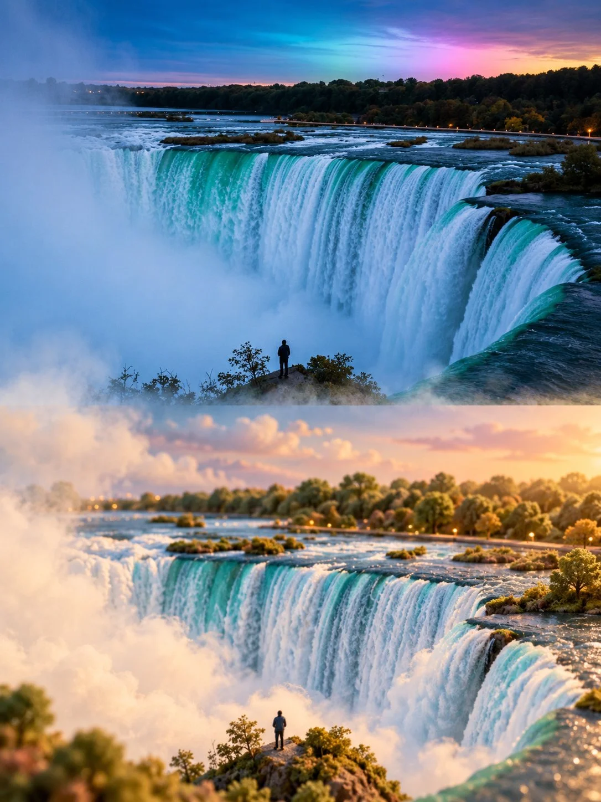

# Photo + Dreamy Miniature World Split

**中文标题：** 照片+梦幻微缩世界对半  
**ID:** `gi25-x-1037` · **Mode:** `edit`  
**Categories:** `edit-change-preserve`  
**Tags:** `x-twitter`, `community`, `gpt-image-2.5`, `x-direct`, `en`



### Photo + Dreamy Miniature World Split

```text
Create a 3:4 vertical dreamy miniature-world transformation of the uploaded photograph.

COMPOSITION:
Divide the image into two equal horizontal sections. The upper half preserves the original photograph’s realistic appearance, composition, perspective, colors, and recognizable details. The lower half reimagines the exact same scene as a soft, whimsical miniature landscape.

MINIATURE WORLD:
Transform the original scenery into rounded, delicate forms with a subtle velvety texture and fine tactile grain. Preserve the subject’s identity and spatial arrangement while simplifying details into an enchanting miniature environment. Everything should feel handcrafted, tiny, and gently sculpted rather than cartoonish.

ATMOSPHERE:
Use muted natural colors, creamy ivory tones, soft warm sunlight, delicate highlights, and layers of floating mist. Let fog flow naturally between the two halves, gradually blending the realistic photograph into the miniature world with softly dissolving edges.

ART DIRECTION:
Dreamlike, peaceful, airy, understated, and poetic. Combine photographic realism with refined miniature diorama aesthetics, realistic depth, subtle shadows, and beautifully controlled textures.

Automatically adapt the miniature transformation to the uploaded photograph. Preserve its defining features and composition; do not introduce unrelated objects or change the scene’s identity.

Avoid harsh transitions, oversaturated colors, excessive fantasy, plastic-looking surfaces, heavy blur, text, titles, logos, and watermarks.

FORMAT: 3:4 vertical, exact 50/50 horizontal split, high resolution.
```

- **Recommended model:** `gpt-image-2.5-sunburst`
- **Settings:** _(defaults)_
- **Source:** [community](https://x.com/Goodmanprotocol/status/2113342391776383472) — @Goodmanprotocol
- **License note:** Original public X post; quoted with attribution — remix with attribution
- **Notes:** Collected directly from X; original post https://x.com/Goodmanprotocol/status/2113342391776383472; post text names GPT Image 2.5; discovered via Bin0754/gpt-image-gallery index, prompt re-verified against the original X post via api.fxtwitter.com; verified=True
- **Preview:** `previews/gi25-x-1037.webp`
