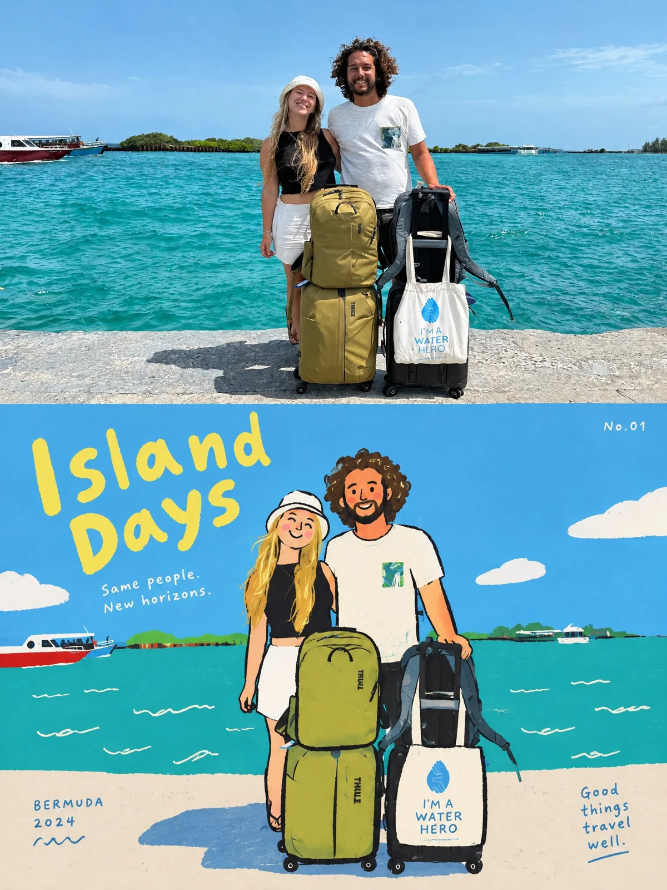

# Travel Photo-to-Adventure Diary Cover Poster

**中文标题：** 旅行照片→冒险日记封面海报  
**ID:** `gi25-x-1067` · **Mode:** `edit`  
**Categories:** `edit-change-preserve`, `poster-typography`  
**Tags:** `x-twitter`, `community`, `gpt-image-2.5`, `x-direct`, `en`



### Travel Photo-to-Adventure Diary Cover Poster

```text
Create one independent high-end editorial poster for each uploaded photo. Process each photo separately. Never combine photos into a collage, grid, split-screen, or multi-photo composition.

FORMAT
Strict 3:4 vertical composition, horizontally divided into two exactly equal 50/50 sections. Top 50% = original photography; bottom 50% = flat editorial illustration. Keep the overall design premium, clean, art-directed, visually balanced, and rich in negative space.

TOP 50% — ORIGINAL PHOTO
Treat the uploaded photo as the single source of truth. Preserve the original subject, identity, facial features, body proportions, pose, expression, clothing, objects, environment, composition, colors, spatial relationships, lighting, shadows, depth, and photographic texture. Do not redesign, replace, beautify, distort, stretch, duplicate, or reinterpret the subject. Only subtle professional color grading is allowed, with the feel of an independent art magazine, premium travel editorial, or exhibition photograph. If more space is needed, naturally extend the existing background without altering the subject.

BOTTOM 50% — FLAT EDITORIAL ILLUSTRATION
Reinterpret the same photograph as a playful, slightly awkward Korean-inspired flat editorial illustration. Identify and preserve the most recognizable subject, silhouette, pose, action, key relationships, and narrative of the original scene. Simplify them into rounded, slightly exaggerated geometric shapes with clean solid fills and rough, imperfect black hand-drawn outlines featuring subtle wobble, uneven thickness, broken edges, and imperfect contours. Remove photorealistic lighting, shadows, perspective, and material textures. Avoid conventional cartoon or photorealistic styles. Aim for a contemporary Korean children's book, independent magazine graphic, or playful editorial artwork.

COMPOSITION
Keep one dominant focal point with secondary objects used only as accents. Create relaxed visual rhythm through varied scale, slight misalignment, overlaps, partial cropping, irregular spacing, and subtle asymmetry. Allow some shapes to extend beyond or overlap the composition. Use bold color blocks and generous negative space. Preserve key visual relationships without reproducing every detail. The illustration should feel designed, relaxed, and intentionally imperfect, never mechanically traced or cluttered.

COLOR
Extract the photograph's most distinctive colors and reinterpret them as a limited palette of high-purity, high-saturation flat colors. Use bold, clean color blocks and bright youthful contrasts. No gradients, realistic shadows, muddy gray tones, glossy effects, complex blending, or excessive texture. The palette should feel cheerful, energetic, childlike, warm, and visually confident.

TYPOGRAPHY & EDITORIAL TEXT
Generate English text inspired by the photo's theme, action, emotion, atmosphere, or story. Integrate typography naturally into the illustration.

MAIN TITLE: 2–4 English words, placed near the upper illustration area. Use playful, slightly handwritten, imperfect lettering; irregular alignment or capitalization is allowed.

SUBTAGLINE: One short, restrained English phrase below the title.

LOCATION / YEAR: Small editorial line in the lower-middle area. Use a verified location/year when known; otherwise use the subject, activity, event, or travel theme. Never invent a location.

POETIC MICRO-CAPTION: A short 1–2 line poetic or playful phrase, placed naturally within negative space, beside a color block, along an edge, or on the visual axis.

SERIES NUMBER: Small, subtle editorial numbering such as “No.01” in a corner.

Typography may follow subject contours, align with color blocks, occupy negative space, overlap shapes slightly, rotate subtly, or use irregular spacing/cropping. Readability must remain strong. Title can be expressive; supporting text should stay clean and restrained.

ART DIRECTION
Combine real travel photography × playful flat illustration × premium editorial design × Korean graphic sensibility × travel diary aesthetics. The result should feel bright, youthful, cheerful, warm, playful, slightly quirky, sophisticated, and collectible—like a limited-edition travel art print or contemporary illustrated travel diary, not a generic tourist poster.
```

- **Recommended model:** `gpt-image-2.5-sunburst`
- **Settings:** _(defaults)_
- **Source:** [community](https://x.com/AJMorales73/status/2113583559986278871) — @AJMorales73
- **License note:** Original public X post; quoted with attribution — remix with attribution
- **Notes:** Collected directly from X; original post https://x.com/AJMorales73/status/2113583559986278871; post text names GPT Image 2.5; discovered via Bin0754/gpt-image-gallery index, prompt re-verified against the original X post via api.fxtwitter.com; verified=True; post text is in Spanish; prompt is in English
- **Preview:** `previews/gi25-x-1067.webp`
