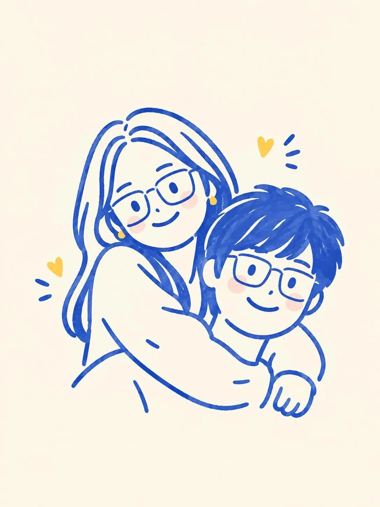

# Photo to Cute Minimalist Doodle Illustration

**中文标题：** 照片→可爱极简手绘涂鸦插画  
**ID:** `gi25-x-1071` · **Mode:** `edit`  
**Categories:** `edit-change-preserve`  
**Tags:** `x-twitter`, `community`, `gpt-image-2.5`, `x-direct`, `en`



### Photo to Cute Minimalist Doodle Illustration

```text
Transform the uploaded photo into a cute minimalist hand-drawn doodle illustration. Preserve the original people, pose, composition, and recognizable facial characteristics, but simplify them into charming cartoon forms.

Use a naive handmade sketchbook aesthetic with bold, slightly wobbly cobalt-blue brush-pen outlines, simple rounded shapes, minimal details, and imperfect hand-drawn strokes. Add subtle warm peach/pink blush on the cheeks and small golden-yellow heart accents around the characters.

Keep the illustration clean and airy with a warm cream/off-white paper background. Use flat, very limited colors, no realistic shading, no gradients, and no complex textures. The overall feeling should be sweet, wholesome, playful, cozy, and romantic, like a handmade children's doodle or personal notebook drawing.

Style keywords: minimalist doodle, folk-inspired hand drawing, blue ink illustration, cute couple illustration, naive art, imperfect brush strokes, simple cartoon, handmade sketchbook aesthetic, warm cream paper, subtle blush, tiny heart doodles, charming imperfections, clean composition.
```

- **Recommended model:** `gpt-image-2.5-sunburst`
- **Settings:** _(defaults)_
- **Source:** [community](https://x.com/Ciri_ai/status/2114588014034948562) — @Ciri_ai
- **License note:** Original public X post; quoted with attribution — remix with attribution
- **Notes:** Collected directly from X; original post https://x.com/Ciri_ai/status/2114588014034948562; post text names GPT Image 2.5; discovered via Bin0754/gpt-image-gallery index, prompt re-verified against the original X post via api.fxtwitter.com; verified=True
- **Preview:** `previews/gi25-x-1071.webp`
