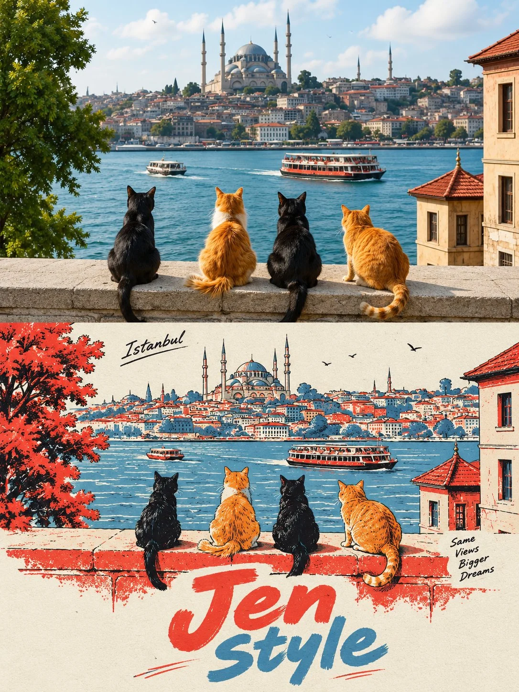

# Photo-vs-Japanese Comic Split Comparison Poster

**中文标题：** 照片/日漫上下对比海报  
**ID:** `gi25-x-1078` · **Mode:** `edit`  
**Categories:** `edit-change-preserve`, `poster-typography`  
**Tags:** `x-twitter`, `community`, `gpt-image-2.5`, `x-direct`, `en`



### Photo-vs-Japanese Comic Split Comparison Poster

```text
UNIVERSAL PROMPT JAPANESE COMIC POSTER | 3:4

Create a 3:4 vertical comparison image divided into two equal horizontal halves, seamlessly joined without borders or gaps.

TOP HALF: Display the uploaded photograph exactly as it is, without editing, recoloring, or adding text. Preserve proportions; crop only peripheral background if necessary.

BOTTOM HALF: Redraw the same subject as a Japanese hand-drawn comic poster with minimalist, limited-color screen-print aesthetics. Preserve the subject's recognizable features, pose, proportions, colors, and relationships between objects. Adapt naturally to people, animals, objects, or landscapes. Keep the essential scenery and add nothing absent from the original photograph.

ART STYLE: Delicate, slightly irregular ink-black outlines (#02030B), simplified shapes, clean opaque color blocks, and minimal hard-edged shadows. Use warm red (#E9444B), muted gray-blue (#5296BD), and off-white paper (#ECEDE5), with red dominant over blue. Avoid photorealistic textures, dense hatching, 3D effects, and excessive details.

LAYOUT & TEXT: Position the illustration in the upper-middle of the bottom half, with generous negative space and bold, hand-carved typography below. Add a small handwritten, subject-related caption at the top and a short handwritten annotation beside the subject, both in black. The main headline reads “Jen” in warm red on the first line and “Style” in gray-blue on the second. Each appears once. Keep all text within the bottom half, fully legible and uncropped. Replace sample text only when the user provides alternatives.

FINAL RESULT: One complete 3:4 image, with the untouched original photograph above and its Japanese hand-drawn, limited-color poster interpretation below. No extra borders, watermarks, invented elements, or decorative clutter.
```

- **Recommended model:** `gpt-image-2.5-sunburst`
- **Settings:** _(defaults)_
- **Source:** [community](https://x.com/Goodmanprotocol/status/2114688658746028256) — @Goodmanprotocol
- **License note:** Original public X post; quoted with attribution — remix with attribution
- **Notes:** Collected directly from X; original post https://x.com/Goodmanprotocol/status/2114688658746028256; post text names GPT Image 2.5; discovered via Bin0754/gpt-image-gallery index, prompt re-verified against the original X post via api.fxtwitter.com; verified=True
- **Preview:** `previews/gi25-x-1078.webp`
