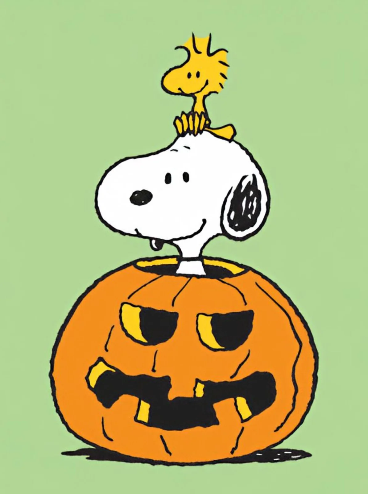

# Peanuts-Style Jack-o'-Lantern Stand-In from Two References

**中文标题：** 双参考图→花生漫画风南瓜灯合影  
**ID:** `gi25-x-1079` · **Mode:** `edit`  
**Categories:** `edit-change-preserve`, `character-consistency`  
**Tags:** `x-twitter`, `community`, `gpt-image-2.5`, `x-direct`, `en`



### Peanuts-Style Jack-o'-Lantern Stand-In from Two References

```text
Keeping the exact art style, pose and color pallete from the first image create a new image Using my uploaded photo (reference image 2), turn me into a fun Peanuts-inspired version of myself. Popping my head out of the top of a jack-o-lantern with a tiny adorable Boston Terrier sitting on my head. Make it in the identical art style from the first reference image, fun, and high quality. 8k resolution, 2:3 format, octane render.
```

- **Recommended model:** `gpt-image-2.5-sunburst`
- **Settings:** _(defaults)_
- **Source:** [community](https://x.com/SethCritchley/status/2114692879633600755) — @SethCritchley
- **License note:** Original public X post; quoted with attribution — remix with attribution
- **Notes:** Collected directly from X; original post https://x.com/SethCritchley/status/2114692879633600755; post text names GPT Image 2.5; discovered via Bin0754/gpt-image-gallery index, prompt re-verified against the original X post via api.fxtwitter.com; verified=True; the author's referral-code and call-to-action lines after the prompt are omitted
- **Preview:** `previews/gi25-x-1079.webp`
