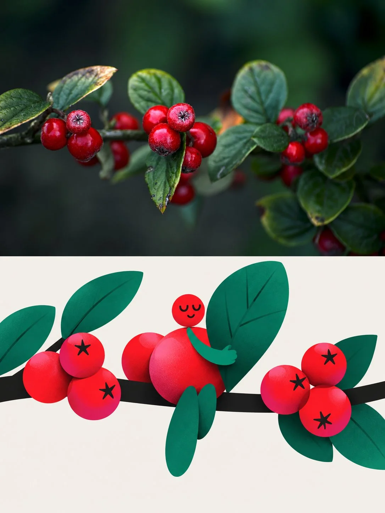

# Photo-to-Flat-Geometric Illustration Split Comparison Poster

**中文标题：** 照片→2D 扁平几何插画对比海报  
**ID:** `gi25-x-1083` · **Mode:** `edit`  
**Categories:** `edit-change-preserve`, `poster-typography`  
**Tags:** `x-twitter`, `community`, `gpt-image-2.5`, `x-direct`, `zh`



### Photo-to-Flat-Geometric Illustration Split Comparison Poster

```text
将上传的每一张照片转化为独立的高级编辑比照海报。不要将多张照片合在一起；在上传顺序中，单独处理每张照片。使用严格的3:4垂直画布，分为两个完全相同的部分，每个部分占总高度的50%。不要使用横向的对齐布局，添加第三部分，折叠线，分隔线，边框，框架，箭头或不必要的装饰。上半部分：忠实地保留原始照片作为真实的摄影图片，保持主题身份、可识别的特征、结构、比例、姿势、物体排列、真实的纹理、自然的照明、阴影、原始的色彩氛围和视觉的氛围。只应用极其微妙、精致的编辑色调评估，适合艺术杂志、展览或独立出版。如果需要，自然扩展周围背景区域，但不要伸展、扭曲、重新绘制、替换或改变主体。上半部分中没有文字。在设计下半部分之前：分析源头照片并识别出它的三个最强大的视觉记忆点：（1）主要的主题或人物，（2）最可识别的姿势，手势，互动或结构排列，以及（3）最具特征的物体，轮廓，配饰或场景元素。使用这些三个点作为转变的基础。下半部分：重新解释图片作为完成的高级平面几何性角色海报。不要应用简单的滤镜，字面翻译每个物体或替换它，或者重新绘制整个场景。从最可识别的主题、轮廓、结构节奏、姿势逻辑和叙事感中取出60-90%的次要细节，并重建构图，使用干净、精致的几何形状。 创造一个由原图灵感的成人角色，构成由几种超大非对称几何形状、一个小头、延长的胶囊形状、简单的手套风格和一个超大物体自然融入姿势和整体轮廓中。保留可识别的身份、重要的视觉特征、相关的服装提示、姿势逻辑和情感角色，同时简化形象为大胆的图形。如果源中没有人物，重新定义其主要主题为角色类的编辑形象，同时保留其定义结构、轮廓逻辑和关键视觉记忆点。风格：使用精致的现代平面几何编辑插图，采用非对称比例、清晰的色彩分隔、宽松的空白空间、柔和的空气涂抹、在形状重叠的地方只有微妙的深色到色彩的涂抹渐变。面部：只使用极简的平面几何编辑插图，包括简单的半月眼和极简的嘴唇。避免详细的面部渲染；通过轮廓、姿势、手势和完整的身体语言表达情感。色彩：严格使用温暖的白色 #F3F1EB，近黑色 #10100F，热粉色 #F553D2，温暖的红色 #F42726，碳酸 #293EA1，以及祖母绿 #13785D。保持颜色平坦、图形和控制，仅在形状重叠的地方使用柔和的渐变；避免喧闹或过度多彩的安排。组合：下半部分必须作为一个干净的独立编辑插图，保持与上方的原始照片显而易见的联系。保持角色作为主导的焦点，超大物体清晰可见，并自然影响轮廓，整体轮廓强烈且立即可读，且布局与宽松的空白空间保持平衡。 全球限制：不包含额外的文字、字幕、标签、标志、水印、Before/After的措辞、箭头、边框、装饰框架、底部半部分的真实主义、光泽3D、真实皮肤渲染、详细背景、杂物、额外的肢体、扭曲的解剖学，或者随机的物体。最终图片必须清楚地读成是一张高端的社交媒体友好顶级原创/底部转变的编辑比较海报。
```

- **Recommended model:** `gpt-image-2.5-sunburst`
- **Settings:** _(defaults)_
- **Source:** [community](https://x.com/leo_xiaolei/status/2114675699118473650) — @leo_xiaolei
- **License note:** Original public X post; quoted with attribution — remix with attribution
- **Notes:** Collected directly from X; prompt posted as the author's reply https://x.com/leo_xiaolei/status/2114675699118473650 to https://x.com/leo_xiaolei/status/2114675663710064898, which carries the images and names GPT Image 2.5; discovered via Bin0754/gpt-image-gallery index, prompt re-verified against the original X post via api.fxtwitter.com; verified=True
- **Preview:** `previews/gi25-x-1083.webp`
