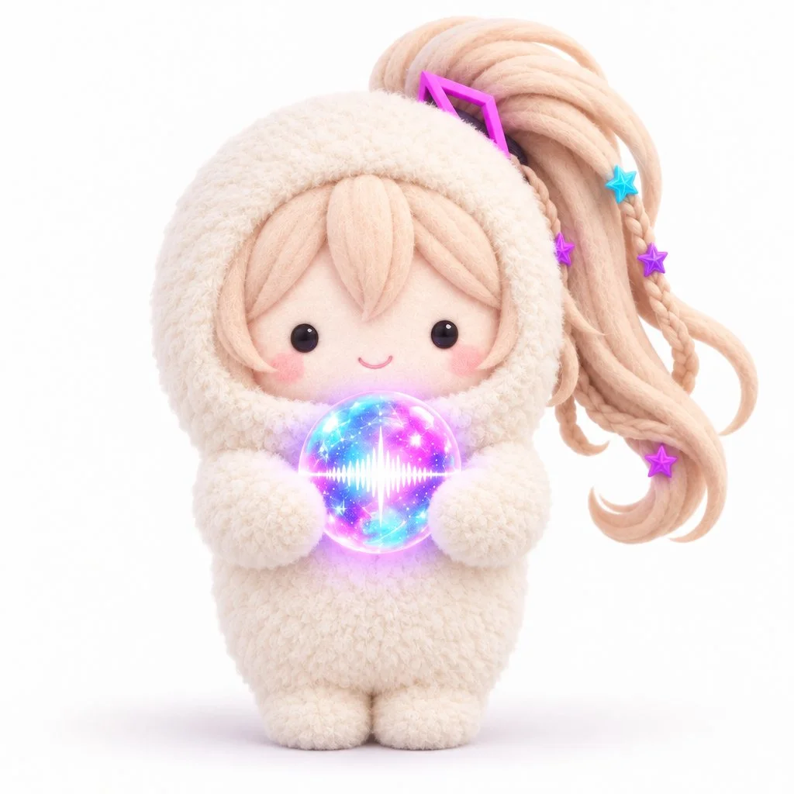

# Turn Your Character into a Fluffy Plush-Suit Icon

**中文标题：** 自家角色→毛茸茸玩偶装头像  
**ID:** `gi25-x-1106` · **Mode:** `edit`  
**Categories:** `edit-change-preserve`, `character-consistency`  
**Tags:** `x-twitter`, `community`, `gpt-image-2.5`, `x-direct`, `ja`



### Turn Your Character into a Fluffy Plush-Suit Icon

```text
■ オプション

もこもこ着ぐるみの色：キャラクターにあったパステルカラー
虹色の球体：なし

■ 基本事項

添付画像のキャラクターを、全身一体型のもこもこスーツに包まれた、ころんと愛らしい3Dマスコットへと変換する。

■ キャラクター変換

元キャラクターの種族・顔立ち・髪型・髪色・象徴的なアクセサリーや小物など、識別に重要な特徴を優先して残す。特徴的なシルエットは維持しつつ、複雑な衣装や細かな装飾は大胆に簡略化する。ただし目は小さな真円の黒いビーズ状の瞳で、黒目のみ、白目なし、まつ毛なし。

キャラクターを象徴する特徴的な衣装がある場合は、その一部をスカーフ・リボン・襟飾りなどのシンプルなアクセントとして残してよい。ただし、もこもこスーツの一体感や基本シルエットを崩さない範囲に留める。

人間以外のキャラクターは人間の顔立ちに変えず、動物特有の毛並み・模様・鼻・マズル・ひげ・耳・尻尾など、種族を識別する特徴を小さくデフォルメして維持する。

顔や髪は元の色と質感を活かし、ボア素材には置き換えない。元画像にない耳・角・装飾は追加しない。

■ 全身フォルム

約2.5頭身。全身一体型のもこもこスーツを着ており、頭頂から足元まで凹凸の少ない、縦長の楕円柱状のフォルム。

頭・首・肩・胸・腰の区切りや膨らみをほぼ作らず、全身がひとつの柔らかな筒状の塊としてつながっている。頭部だけを大きく膨らませない。

肩から腕にかけては左右にわずかに張り出し、短く丸い腕が胴体の側面に自然につながる。手先は小さなミトン状で、腕と胴体の境界に柔らかな丸みを持たせる。

脚はスーツの下端から短く太い2つの丸い足が自然に分かれた形状。全体の寸胴型シルエットを維持しながら、手足には控えめな立体感を残す。

■ 顔の構造

スーツは頭部まで完全につながっており、顔の中心部分だけが小さな横長の楕円形にくり抜かれている。開口部から元画像で露出している顔のパーツだけがちょこんと見える。

開口部の縁は顔の輪郭に隙間なく密着し、フードのような厚い縁や独立した頭部構造を作らない。顔はもこもこの表面に埋め込まれたように見せる。

髪は顔周辺では最小限に抑え、元キャラクターを象徴する髪型の特徴は必要に応じてスーツの外側に残す。

■ 表情

小さな黒いビーズ状の瞳、短く緩やかな微笑み、淡いピンクの頬。人間型の顔では鼻・眉毛を描かない。顔のパーツを中央に小さく集め、素朴で穏やかなかわいらしさを表現する。

動物型の顔では、種族固有の鼻・口元・マズル・ひげ・毛色や模様を簡潔に残し、人間の顔に置き換えない。

元画像で隠れている顔のパーツは新たに描かない。マスクや前髪などで口・目・頬が隠れている場合は、その状態を維持し、覆っているアイテムの上に顔のパーツを追加しない。

■ ポーズとアイテム

「虹色の球体：なし」の場合は、短く丸い両腕を体の左右に自然に下ろす。

「虹色の球体：あり」の場合は、丸い両手で虹色に輝く球体を胸の前に抱える。球体の内部にはピンク・シアン・紫の幻想的な光が混ざり合う。

■ 素材と画像表現

スーツ全体は密度の高い極細のボア素材。繊細な毛並みと柔らかな起毛感を持ち、縫い目や衣服の切り替えは見せない。顔は元キャラクターの肌や毛並みの質感を活かした、柔らかなマット仕上げ。

高品質な3Dぬいぐるみレンダリング。温かく柔らかなスタジオ照明、自然な接地影、無地の白背景。

正面を向いてちょこんと立つ全身像を中央に大きく配置。正方形1:1、文字・ロゴなし。
```

- **Recommended model:** `gpt-image-2.5-sunburst`
- **Settings:** _(defaults)_
- **Source:** [community](https://x.com/projectmuse_ai/status/2114913435125461274) — @projectmuse_ai
- **License note:** Original public X post; quoted with attribution — remix with attribution
- **Notes:** Collected directly from X; original post https://x.com/projectmuse_ai/status/2114913435125461274; post text names GPT Image 2.5; discovered via X search, prompt re-verified against the original X post via api.fxtwitter.com; verified=True; author says all attached examples were made with GPT Image 2.5
- **Preview:** `previews/gi25-x-1106.webp`
