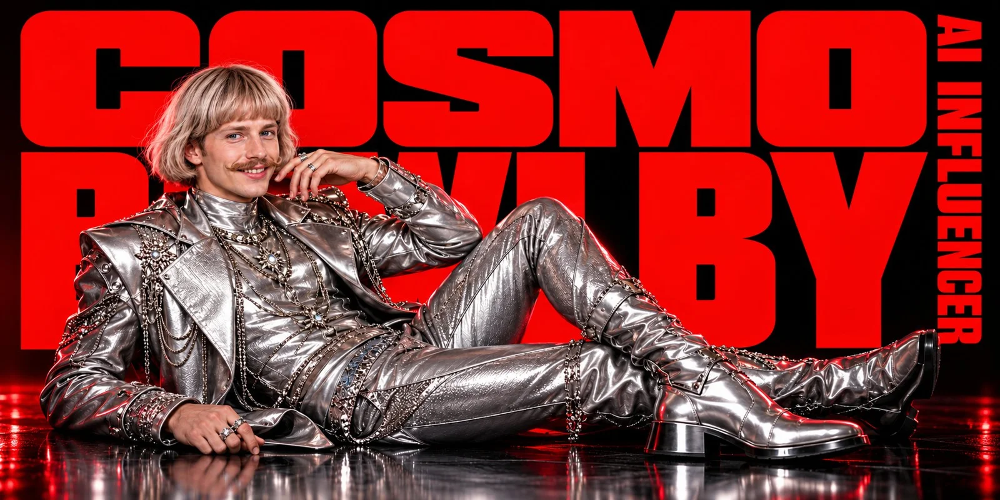

# Cinematic Fashion Poster with Two References

**中文标题：** 双参考图电影感时尚海报  
**ID:** `gi25-x-1120` · **Mode:** `edit`  
**Categories:** `edit-change-preserve`, `poster-typography`  
**Tags:** `x-twitter`, `community`, `gpt-image-2.5`, `x-direct`, `en`



### Cinematic Fashion Poster with Two References

```text
Create a high end cinematic fashion poster in a 2:1 wide format featuring Cosmo Bowlby, the AI influencer.
Use a luxury black studio background with a glossy reflective floor and dramatic red rim lighting for a premium editorial photoshoot mood.
Cosmo Bowlby is a stylish futuristic male influencer with:

light skin
blue eyes
a curled moustache
a confident charming smile
medium-length fashionable blond / ash-blond bob haircut with bangs
He is wearing an extravagant futuristic silver fashion outfit, much more luxurious and fashionable than a basic suit — metallic couture styling, embellished details, layered chains, decorative textures, statement boots, and a polished editorial look. The image should feel like a real luxury fashion photoshoot, not like an illustration.
Pose Cosmo Bowlby in a relaxed, confident reclining editorial pose, similar to a magazine campaign image, with his body stretched across the lower half of the frame. He should be the clear hero of the composition.

Text Layout
Use only these two texts:
“COSMO BOWLBY”
“AI INFLUENCER”
Do not include any other text.
Do not include BMX.
Do not include MEN ARE.
Do not include any bicycle.
Text Style
Make the text style match the 2nd reference image:
huge bold red typography
strong graphic impact
modern brutalist poster style
clean, sharp, oversized letters
high contrast against black background
Place “COSMO BOWLBY” as the main large red text in the background, oversized and dramatic, integrated into the composition behind or beside the character.
Place “AI INFLUENCER” as smaller red text in a matching bold graphic style, preferably vertical on the right side or positioned like a secondary title.
Visual Style
photorealistic
cinematic lighting
luxury fashion campaign
premium editorial photography
bold graphic poster
glossy metallic outfit
black and red color palette
dramatic contrast
modern fashion branding aesthetic
Important Requirements
Keep Cosmo Bowlby as the only subject
No bicycle
No BMX text
No MEN ARE text
No extra people
No extra props
Only text should be: COSMO BOWLBY and AI INFLUENCER
Text must be bold red and visually similar in style to the second reference image
Real fashion photoshoot look
Clean premium composition
```

- **Recommended model:** `gpt-image-2.5-sunburst`
- **Settings:** _(defaults)_
- **Source:** [community](https://x.com/bmx_ai13/status/2114745116866826648) — @bmx_ai13
- **License note:** Original public X post; quoted with attribution — remix with attribution
- **Notes:** Collected directly from X; prompt posted as the author's reply https://x.com/bmx_ai13/status/2114745116866826648 to https://x.com/bmx_ai13/status/2114745115721806110, which carries the images and names GPT Image 2.5; discovered via X search, prompt re-verified against the original X post via api.fxtwitter.com; verified=True; author says it was made with GPT Image 2.5 via SocialSight
- **Preview:** `previews/gi25-x-1120.webp`
