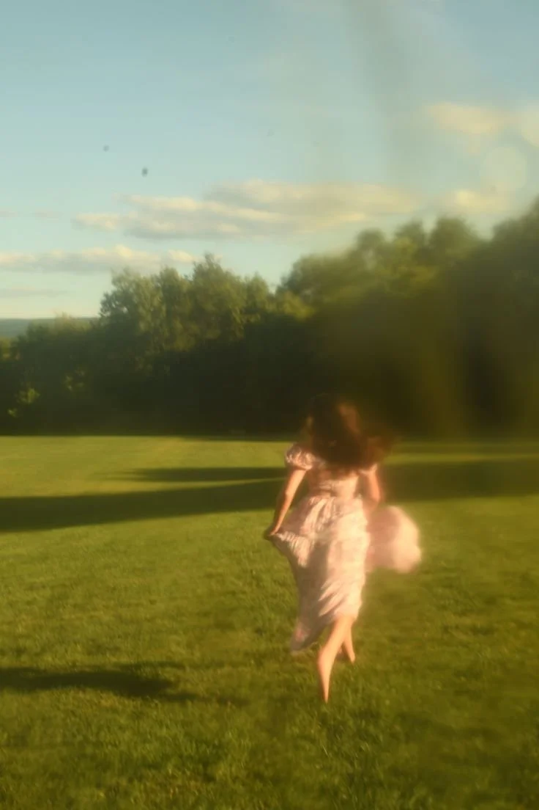

# Photo to Layered Paper-Cut Split Editorial Poster

**中文标题：** 照片→分层纸雕上下分屏杂志海报  
**ID:** `gi25-x-1135` · **Mode:** `edit`  
**Categories:** `edit-change-preserve`, `poster-typography`  
**Tags:** `x-twitter`, `community`, `gpt-image-2.5`, `x-direct`, `en`



### Photo to Layered Paper-Cut Split Editorial Poster

```text
UNIVERSAL PROMPT - PREMIUM MINIMALIST LAYERED PAPER-CUT EDITORIAL POSTER | 3:4

Use the uploaded photograph as the sole source of the subject. Create a premium editorial poster, with each photograph processed and exported individually. Do not combine multiple images into a collage.

COMPOSITION & LAYOUT: Use a 3:4 vertical aspect ratio. Divide the canvas into two equal horizontal sections, each occupying exactly 50% of the total height. Position the dividing line precisely at the vertical midpoint. The two sections must meet seamlessly, with no borders, gaps, or spacing between them.

PHOTO PRESERVATION: Preserve the original subject's identity, pose, architectural structures, natural lighting, realistic textures, and overall color atmosphere. Apply only subtle, art-directed color grading worthy of a high-end editorial magazine. If necessary, naturally extend the environmental background to fit the horizontal composition. Never stretch the subject, alter its proportions, or crop out important narrative elements.

LAYERED PAPER-CUT REINTERPRETATION: Extract the photograph's most recognizable subject, silhouette, pose, and narrative relationships, then reinterpret them as minimalist, handcrafted layered paper-cut art and sculptural paper relief. Establish one central focal subject, simplifying the surrounding environment into distinct foreground, midground, and background paper layers.

PAPERCRAFT & DEPTH: Create visual depth through precise cutting, folding, overlapping, masking, positive and negative space, and intentional use of whitespace. Preserve the subject's recognizability without mechanically reproducing every original detail. The result should feel artistically constructed by hand, with sophisticated dimensionality and a refined minimalist aesthetic.

COLOR PALETTE & MATERIALS: Extract a limited, harmonious color palette from the original photograph. Use warm ivory paper as the base, complemented by the dominant colors of the scene, deeper structural tones, and a restrained accent color. Render matte cardstock, delicate paper fibers, crisp cut edges, convincing physical thickness, and soft contact shadows under natural diffused lighting. The final artwork should feel tactile, realistic, and exquisitely crafted.

TYPOGRAPHY & EDITORIAL DETAILS: Add typography exclusively within the lower half of the poster. Derive a short, compelling English headline from the photograph's subject or narrative. Complement it with 2–4 small supporting text elements, such as a serial number, material descriptors, category labels, or an extremely brief poetic phrase. Maintain elegant typography, deliberate spacing, and a sophisticated luxury-editorial hierarchy.

Do not add years, invented locations, fictional coordinates, or unsupported factual details.

FINAL RESULT: A premium 3:4 vertical editorial poster combining the recognizable essence of the original photograph with minimalist, handcrafted layered paper-cut artistry, tactile materials, precise composition, and restrained luxury-magazine typography. Ensure the upper and lower sections remain exactly equal in height, with the central division aligned precisely at 50% of the canvas.
```

- **Recommended model:** `gpt-image-2.5-sunburst`
- **Settings:** _(defaults)_
- **Source:** [community](https://x.com/Goodmanprotocol/status/2115316740498543016) — @Goodmanprotocol
- **License note:** Original public X post; quoted with attribution — remix with attribution
- **Notes:** Collected directly from X; original post https://x.com/Goodmanprotocol/status/2115316740498543016; post text names GPT Image 2.5; discovered via X search, prompt re-verified against the original X post via api.fxtwitter.com; verified=True
- **Preview:** `previews/gi25-x-1135.webp`
