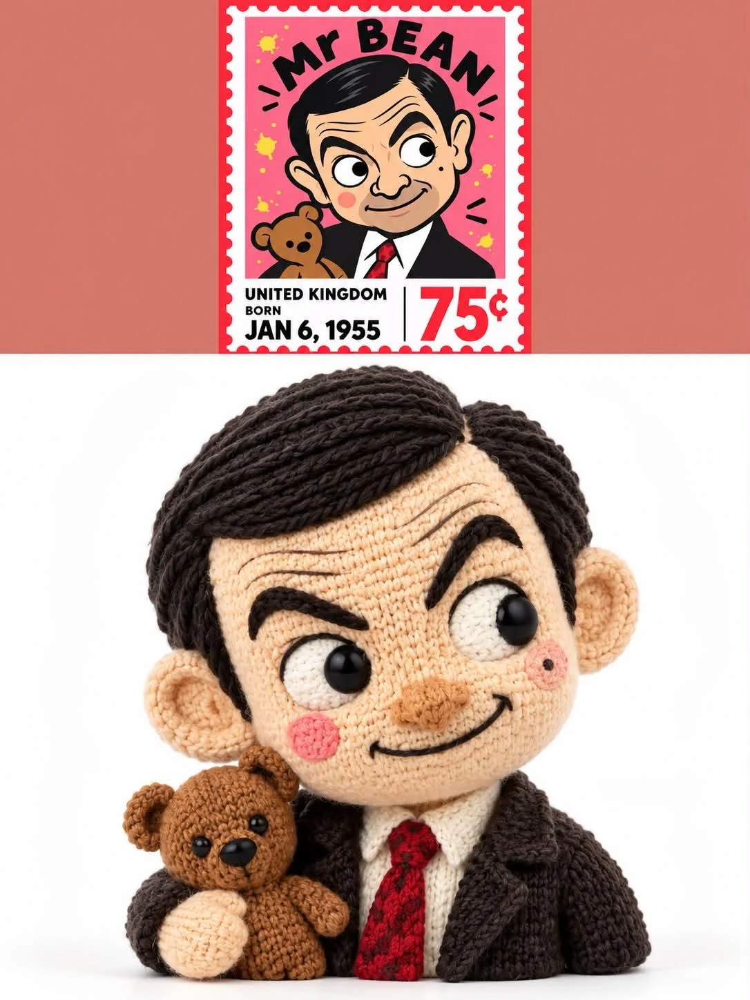

# Photo to 3D Knitted Plush Doll Comparison Poster

**中文标题：** 照片→3D 手工针织毛绒玩偶对比海报  
**ID:** `gi25-x-1136` · **Mode:** `edit`  
**Categories:** `edit-change-preserve`, `character-consistency`  
**Tags:** `x-twitter`, `community`, `gpt-image-2.5`, `x-direct`, `en`



### Photo to 3D Knitted Plush Doll Comparison Poster

```text
Transform a Real Photograph into a 3D Handmade Knitted Plush Doll Comparison Poster

Use the uploaded real photograph as the exclusive reference for the person's identity. Automatically analyze the person's facial shape, hairstyle, hair color, expression, clothing, accessories, and pose, then transform them into a cute, intricately crafted 3D handmade knitted plush doll. Create a vertical comparison poster featuring the original photograph on top and the finished knitted doll below.

01 | Layout and Composition

Use a 3:4 portrait aspect ratio, divided into two vertically stacked sections.

Upper 25% — Original Photograph

- Preserve the original photograph's authentic photographic quality, facial features, expression, clothing, and pose.
- Center the photograph and maintain its original aspect ratio. Natural cropping is permitted when necessary.
- Fill the areas on the left and right with a soft terracotta-pink color ("#D97B70").
- Do not redraw, distort, beautify, retouch, or otherwise alter the original photograph.

Lower 75% — 3D Knitted Plush Doll

- Use a pure white, seamless studio background.
- Center the doll in a bust or half-body close-up composition.
- Give the doll a large, full head with a clearly defined silhouette and moderate surrounding negative space.
- Make the two sections meet directly, without divider lines, outer frames, titles, or text.

02 | Character Design

Use exaggerated proportions with an oversized head and a tiny body. The head should occupy approximately 55–65% of the doll's visible height.

The face should be broad, plump, and softly rounded, with a rounded-square shape. The body should be small, with short, rounded limbs and the proportions of an adorable collectible designer toy.

Simplify the facial features:

- Tiny black oval bead eyes.
- A dimensional orange-brown fabric nose.
- A simple, natural mouth shape.
- Soft, pale pink blush on the cheeks.

Recreate the person's original expression, whether smiling, surprised, calm, or otherwise, while preserving their distinctive identity and personality.

03 | Materials and Yarn Details

Construct the face and body from fine, soft knitted fabric, with visible textile patterns, gentle stuffed volume, and delicate fiber details.

Create the hair entirely from sculpted yarn. Automatically reproduce the hairstyle from the original photograph, including:

- Hairstyle, hair color, length, and parting.
- Straight, curly, short, or long hair, as applicable.
- Yarn thickness, curl patterns, and layered volume.

Each hair section should display realistic yarn fibers and dimensional knitted structures.

Reinterpret clothing, hats, glasses, and other accessories using handmade knitting or textile-craft techniques. Preserve their original styles, colors, silhouettes, and recognizable details.

Only include elements that are actually visible in the source photograph.

04 | Identity and Pose Preservation

Preserve the person's defining characteristics from the original photograph, including hairstyle, accessories, clothing colors, facial expression, head angle, and primary gestures.

The doll's pose must correspond to the original person's pose. Reproduce visible hands naturally and maintain the correct number of fingers wherever they are clearly visible.

Do not invent or add hats, glasses, jewelry, accessories, or other objects that are absent from the photograph.

Maintain the relationship between the original person and the knitted doll so that the doll is immediately recognizable as a handcrafted textile interpretation of the same subject.

05 | Photography and Lighting

Use the premium product-photography aesthetic of a high-end designer collectible plush doll.

- Pure white background.
- Soft, even studio lighting.
- Natural contact shadows.
- Subtle dimensional depth and realistic fabric volume.
- An 85mm portrait-lens aesthetic.
- High-resolution macro-level textile details.
- Authentic handmade materials with clean, soft colors.

The knitted doll should look like a tangible, physically crafted object that could exist in the real world, not a conventional computer-generated character.

Emphasize the tactile qualities of the yarn, fine stitches, fabric fibers, soft stuffing, and carefully constructed facial features.

06 | Negative Constraints

Do not alter the original photograph in the upper section. Do not regenerate the real person or modify their appearance.

Avoid:

- Plastic materials or smooth, synthetic 3D skin.
- Photorealistic human facial features.
- Oversized anime eyes.
- Flat cartoon illustrations or conventional animated-character aesthetics.
- Exaggerated noses or mouths.
- Complex backgrounds.
- Additional people, body parts, or limbs.
- Incorrect finger counts or malformed hands.
- Invented accessories or props.
- Text, logos, watermarks, decorative borders, or unnecessary embellishments.

Final Output

Create a polished 3:4 portrait comparison poster with a clear visual contrast between the original photograph and its knitted interpretation.

The upper section must display the untouched original photograph. The lower section must feature a corresponding, adorable 3D handmade knitted plush doll whose hairstyle, clothing, expression, and pose closely match the original person.

Core objective: Preserve the real person's identity while translating their appearance into a beautifully crafted, tactile, oversized-head knitted collectible doll. The result should feel like professional product photography of an actual handmade textile art toy.
```

- **Recommended model:** `gpt-image-2.5-sunburst`
- **Settings:** _(defaults)_
- **Source:** [community](https://x.com/Ciri_ai/status/2115314672002076740) — @Ciri_ai
- **License note:** Original public X post; quoted with attribution — remix with attribution
- **Notes:** Collected directly from X; original post https://x.com/Ciri_ai/status/2115314672002076740; post text names GPT Image 2.5; discovered via X search, prompt re-verified against the original X post via api.fxtwitter.com; verified=True
- **Preview:** `previews/gi25-x-1136.webp`
