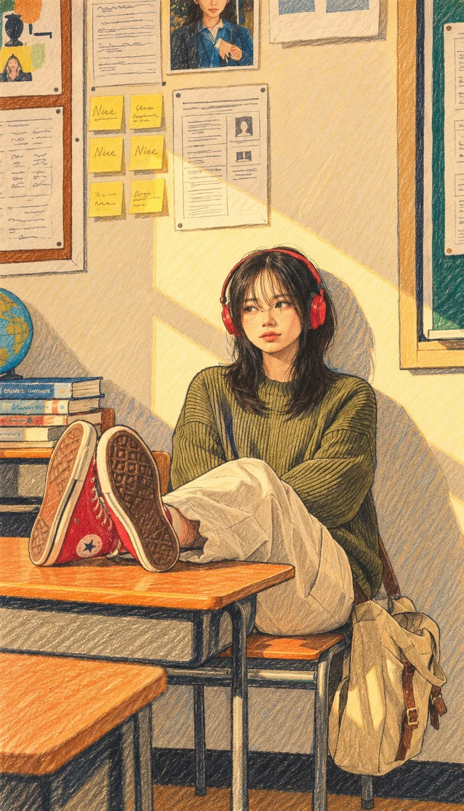

# Photo to Naïve Colored-Pencil Designer Poster Illustration

**中文标题：** 照片→彩铅稚拙风设计师海报插画  
**ID:** `gi25-x-1162` · **Mode:** `edit`  
**Categories:** `edit-change-preserve`  
**Tags:** `x-twitter`, `community`, `gpt-image-2.5`, `x-direct`, `en`



### Photo to Naïve Colored-Pencil Designer Poster Illustration

```text
Turn this photo into a contemporary, artist-made naïve illustration: minimalist and hand-drawn, with playful proportions, uneven outlines, flat colors that are soft yet contrasting, and decorative pencil strokes. No shadows, gradients, or 3D effects. Give it the feel of a high-end designer poster drawn with colored pencils. Keep it cute and cartoon-like.
```

- **Recommended model:** `gpt-image-2.5-sunburst`
- **Settings:** _(defaults)_
- **Source:** [community](https://x.com/harboriis/status/2115028772588261435) — @harboriis
- **License note:** Original public X post; quoted with attribution — remix with attribution
- **Notes:** Collected directly from X; original post https://x.com/harboriis/status/2115028772588261435; post text names GPT Image 2.5; discovered via Bin0754/gpt-image-gallery index, prompt re-verified against the original X post via api.fxtwitter.com; verified=True
- **Preview:** `previews/gi25-x-1162.webp`
