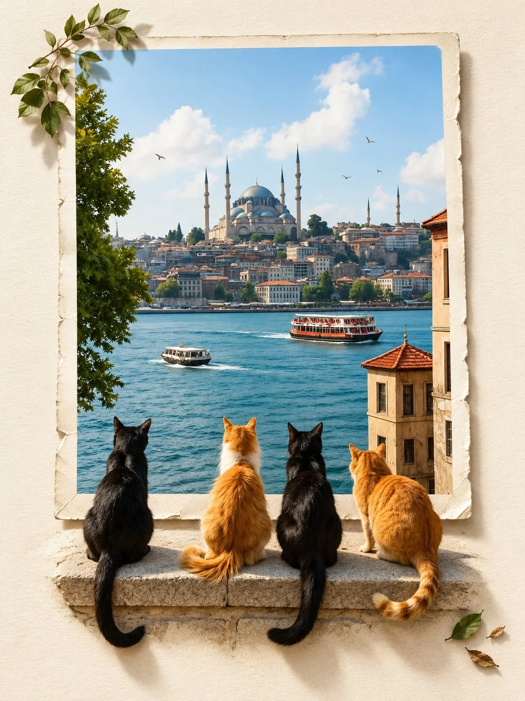

# Photo to Minimalist 3D Pop-Out Editorial Collage

**中文标题：** 照片→极简 3D 出框杂志拼贴  
**ID:** `gi25-x-1163` · **Mode:** `edit`  
**Categories:** `edit-change-preserve`, `poster-typography`  
**Tags:** `x-twitter`, `community`, `gpt-image-2.5`, `x-direct`, `en`



### Photo to Minimalist 3D Pop-Out Editorial Collage

```text
UNIVERSAL PROMPT - PREMIUM MINIMALIST EDITORIAL COLLAGE | 3:4

Upload your photo to ChatGPT, then copy and paste the prompt below.

Transform the uploaded photograph into a premium minimalist editorial collage on a warm ivory paper background, in a 3:4 vertical aspect ratio.

PHOTO PRESERVATION: Keep the original photograph and its subject completely unchanged. Preserve the subject’s identity, facial features, pose, clothing, colors, textures, lighting, and natural details. Do not redraw, retouch, distort, or alter the original image.

3D POP-OUT EFFECT: Create a sophisticated, realistic three-dimensional composition in which the subject and relevant natural elements appear to extend beyond the bottom edge of the original photo frame, breaking the boundaries of the image. Make the transition seamless and physically convincing, with precise depth, natural perspective, and soft, realistic cast shadows.

BACKGROUND & AESTHETICS: Use a warm ivory, subtly textured paper background with generous negative space. Maintain a clean, understated, luxury-magazine aesthetic with refined art direction, elegant composition, and a premium editorial finish.

LIGHTING & DEPTH: Incorporate soft, directional studio lighting, delicate shadows, realistic dimensional layering, and subtle tonal contrast to enhance the paper texture and three-dimensional effect without overwhelming the original photograph.

FINAL OUTPUT: A visually striking, photorealistic editorial collage that feels minimal, sophisticated, and art-directed for a high-end design magazine. Preserve the original photograph wherever it appears, and ensure the pop-out elements blend seamlessly into the overall composition.

Aspect ratio: 3:4 vertical.
```

- **Recommended model:** `gpt-image-2.5-sunburst`
- **Settings:** _(defaults)_
- **Source:** [community](https://x.com/Goodmanprotocol/status/2115025093277462890) — @Goodmanprotocol
- **License note:** Original public X post; quoted with attribution — remix with attribution
- **Notes:** Collected directly from X; original post https://x.com/Goodmanprotocol/status/2115025093277462890; post text names GPT Image 2.5; discovered via Bin0754/gpt-image-gallery index, prompt re-verified against the original X post via api.fxtwitter.com; verified=True
- **Preview:** `previews/gi25-x-1163.webp`
