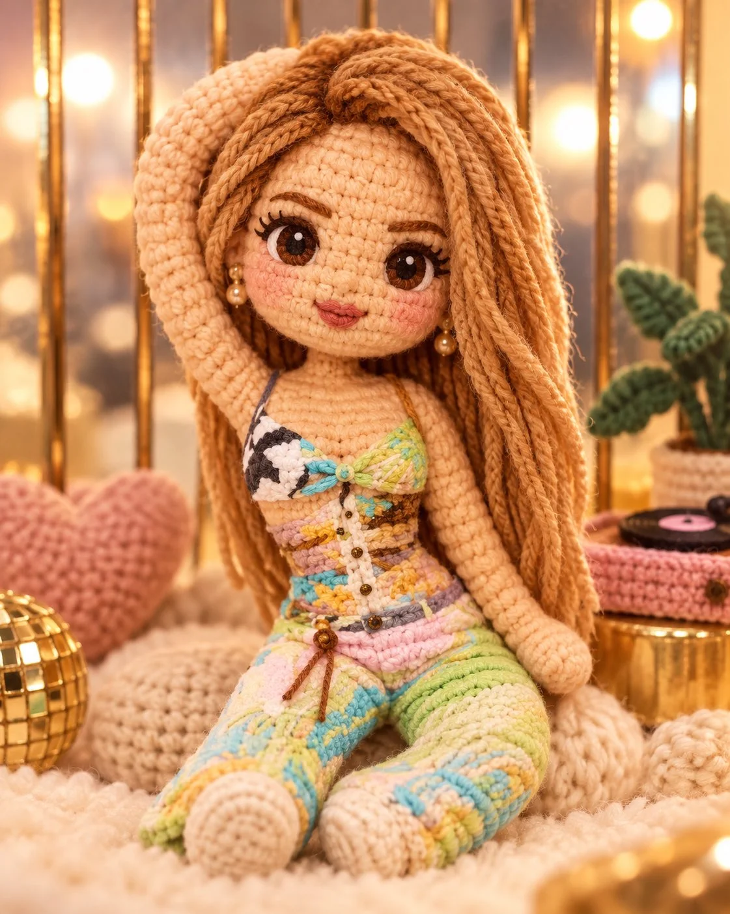

# Photo to Hand-Crocheted Amigurumi Doll Diorama

**中文标题：** 照片→手工钩织玩偶微缩场景  
**ID:** `gi25-x-1174` · **Mode:** `edit`  
**Categories:** `edit-change-preserve`, `character-consistency`  
**Tags:** `x-twitter`, `community`, `gpt-image-2.5`, `x-direct`, `en`



### Photo to Hand-Crocheted Amigurumi Doll Diorama

```text
Transform the uploaded photo into a hand-crocheted amigurumi style doll. Soft chunky yarn with visible stitches, oversized rounded head and tiny body, embroidered facial features with gentle blush, pastel color palette, cozy handmade imperfections, plush texture, sitting in a miniature diorama scene, warm soft lighting, charming stop-motion plush aesthetic.
```

- **Recommended model:** `gpt-image-2.5-sunburst`
- **Settings:** _(defaults)_
- **Source:** [community](https://x.com/MrDasCreates/status/2115351638353613255) — @MrDasCreates
- **License note:** Original public X post; quoted with attribution — remix with attribution
- **Notes:** Collected directly from X; original post https://x.com/MrDasCreates/status/2115351638353613255; post text names GPT Image 2.5; discovered via Bin0754/gpt-image-gallery index, prompt re-verified against the original X post via api.fxtwitter.com; verified=True
- **Preview:** `previews/gi25-x-1174.webp`
