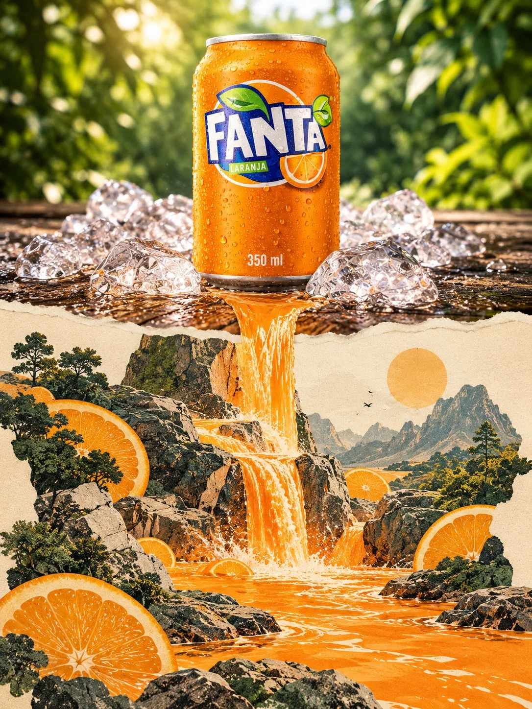

# Photo to Torn-Paper 'Second World' Split Poster

**中文标题：** 照片→撕纸分界“第二世界”上下分屏海报  
**ID:** `gi25-x-1177` · **Mode:** `edit`  
**Categories:** `edit-change-preserve`, `poster-typography`  
**Tags:** `x-twitter`, `community`, `gpt-image-2.5`, `x-direct`, `en`



### Photo to Torn-Paper 'Second World' Split Poster

```text
Upload a photograph and transform it into a single, standalone poster. Do not create a collage or combine multiple images. Use a vertical 3:4 aspect ratio, divided into two strictly equal horizontal sections, each occupying exactly 50% of the canvas. Together, the two sections must form one continuous scene: the upper half remains a realistic photograph, while the lower half becomes a “second world” that appears to grow naturally from within the original image.

UPPER HALF — FAITHFUL PHOTOGRAPHIC PRESERVATION

Faithfully preserve the original photograph’s subject identity, primary subjects, clothing, accessories, objects, environment, composition, poses, proportions, spatial relationships, perspective, materials, depth of field, natural lighting, shadows, and overall color atmosphere.

Do not redraw, replace, rearrange, or reinterpret the original elements. Only subtle cropping, background extension, and extremely light color grading are permitted to accommodate the canvas. Never stretch, distort, or alter the subject’s original movements or poses.

CONTINUITY BETWEEN THE TWO HALVES — HIGHEST PRIORITY

For each photograph, identify a natural structural element that reaches the horizontal midpoint, such as a road, body of water, tree branch, beam of light, architectural feature, or bodily gesture.

This element must align precisely at the dividing line and continue seamlessly into the lower half. The same scene should appear to cross the boundary and gradually transform, as though its physical rules change beyond the midpoint.

CENTRAL DIVIDE — NATURAL TORN-PAPER EDGE

An irregular torn-paper edge may be introduced along the center, following the source structure and the natural flow of the composition. It must never look decorative or follow a fixed template.

The torn edge must remain completely flat against the canvas, with no cast shadows, curled edges, lifted corners, or three-dimensional thickness. Original elements may touch, cross, or break through the torn boundary to create a natural, integrated transition.

LOWER HALF — THE SECOND WORLD

Use warm ivory paper with subtle visible fibers, a tactile surface, and generous negative space as the foundation.

Continue developing the scene downward from the point where the original structure meets the dividing line. Preserve the original photograph’s visual focal point, subject silhouettes, poses, perspective, inherent colors, lighting, emotional atmosphere, and narrative.

Build upon these preserved elements using restrained photographic fragments, carefully composed paper-cut shapes, and a minimal number of black hand-drawn lines. The transformation should feel like a natural extension of the original photograph rather than an unrelated illustration.

The final result should be a sophisticated, premium editorial poster in which realistic photography transitions organically into a tactile, surreal paper-cut world, maintaining visual coherence, precise spatial continuity, elegant restraint, and a strong sense of depth.
```

- **Recommended model:** `gpt-image-2.5-sunburst`
- **Settings:** _(defaults)_
- **Source:** [community](https://x.com/Goodmanprotocol/status/2115399643731526022) — @Goodmanprotocol
- **License note:** Original public X post; quoted with attribution — remix with attribution
- **Notes:** Collected directly from X; original post https://x.com/Goodmanprotocol/status/2115399643731526022; post text names GPT Image 2.5; discovered via Bin0754/gpt-image-gallery index, prompt re-verified against the original X post via api.fxtwitter.com; verified=True
- **Preview:** `previews/gi25-x-1177.webp`
