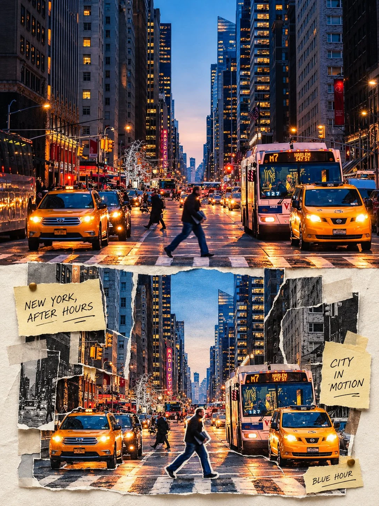

# Photo to Dimensional Paper Collage Editorial Poster

**中文标题：** 照片→立体照片拼贴杂志海报  
**ID:** `gi25-x-1179` · **Mode:** `edit`  
**Categories:** `edit-change-preserve`, `poster-typography`  
**Tags:** `x-twitter`, `community`, `gpt-image-2.5`, `x-direct`, `en`



### Photo to Dimensional Paper Collage Editorial Poster

```text
Transform the uploaded photograph into a sophisticated, premium editorial collage poster. Use the original image as the sole source of the subject, preserving its identity, distinctive features, natural colors, and recognizable details. Create one standalone artwork in a vertical 3:4 aspect ratio, divided into two precisely equal horizontal sections, each occupying 50% of the canvas.

COMPOSITION: The upper section retains the original photograph's realistic appearance, while the lower section transforms selected elements into a dimensional photographic paper collage. Connect both sections seamlessly through carefully arranged photographic slices, layered prints, and natural transitions.

PAPER COLLAGE DETAILS: Incorporate realistic paper cutouts, overlapping photographic layers, subtle paper thickness, tactile textures, and delicate cast shadows. Add cream-yellow handwritten sticky notes, small pushpins, tasteful stickers, and translucent washi tape, arranged naturally with refined artistic balance.

TYPOGRAPHY & SUBJECT ADAPTATION: Intelligently recognize the photograph's subject and generate short, relevant English phrases or handwritten annotations. Adapt the visual treatment to portraits, pets, flowers, landscapes, architecture, or any other subject while preserving the original image's defining characteristics.

ART DIRECTION: Use generous negative space, elegant minimalist magazine typography, precise composition, subtle asymmetry, and a harmonious palette that complements the original photograph. Maintain a handcrafted, three-dimensional appearance without excessive decoration or visual clutter.

FINAL QUALITY: Deliver a polished, photorealistic, gallery-quality editorial poster with crisp details, authentic paper textures, realistic shadows, and a cohesive upper-and-lower composition. No unrelated imagery, distorted subjects, duplicated elements, illegible text, watermarks, logos, or unnecessary borders. The final result should feel like a professionally designed, collectible photographic collage print.
```

- **Recommended model:** `gpt-image-2.5-sunburst`
- **Settings:** _(defaults)_
- **Source:** [community](https://x.com/Goodmanprotocol/status/2115451137746956538) — @Goodmanprotocol
- **License note:** Original public X post; quoted with attribution — remix with attribution
- **Notes:** Collected directly from X; original post https://x.com/Goodmanprotocol/status/2115451137746956538; post text names GPT Image 2.5; discovered via Bin0754/gpt-image-gallery index, prompt re-verified against the original X post via api.fxtwitter.com; verified=True
- **Preview:** `previews/gi25-x-1179.webp`
