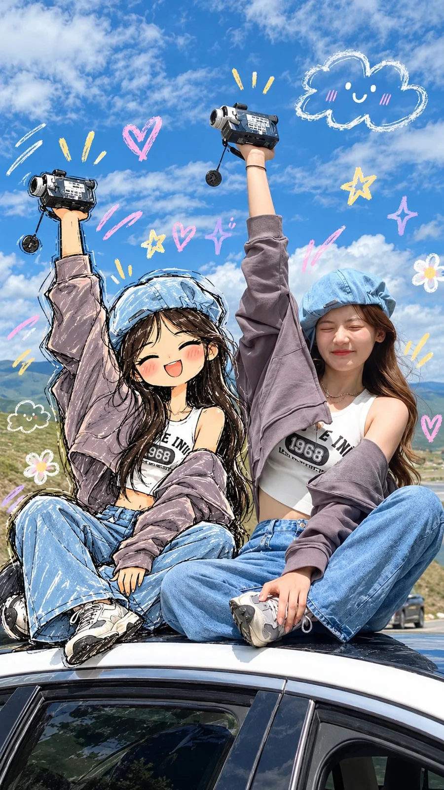

# Real Mirror Selfie Meets Hand-Drawn Anime Twin

**中文标题：** 真人镜子自拍×手绘动漫分身  
**ID:** `gi25-x-1183` · **Mode:** `edit`  
**Categories:** `edit-change-preserve`, `character-consistency`  
**Tags:** `x-twitter`, `community`, `gpt-image-2.5`, `x-direct`, `en`



### Real Mirror Selfie Meets Hand-Drawn Anime Twin

```text
Create a highly detailed, charming mixed-media illustration using a real mirror selfie as the reference. Show a young woman standing inside a modern elevator, taking a mirror selfie with her smartphone. She has long, dark hair, round glasses, a relaxed expression, and wears a light blue and white striped cropped button-up shirt, loose-fitting blue denim shorts, and chunky white sneakers.

Beside her, create a cute 2D hand-drawn anime version of the same woman, matching her hairstyle, outfit, body proportions, phone, and pose. The illustrated character should have oversized expressive eyes, round glasses, rosy cheeks, long messy black hair, and playful proportions. Both versions should pose with one arm resting over their heads in a casual, coordinated mirror-selfie pose.

Art style: A beautiful blend of realistic photography and sketchbook-style anime illustration. Use loose black ink outlines, visible pencil strokes, textured watercolor shading, soft pastel colors, hand-drawn highlights, and slightly rough sketch lines. The illustrated character should look as if she has been drawn directly over the original photograph.

Background: A realistic elevator with dark metallic walls, reflective panels, visible floor tiles, and small framed children's drawings attached to the walls. Decorate the entire scene with playful hand-drawn doodles, including pink hearts, yellow stars, purple sparkles, a smiling cloud, a cute bunny face, a little flower, and a pink ribbon. Add a black illustrated tote bag with a tiny teddy bear charm beside the cartoon character.

Lighting and details: Soft indoor lighting, natural skin tones, realistic denim texture, detailed fabric folds, subtle reflections on the elevator walls, charming imperfections in the sketch lines, and a cozy pastel aesthetic. Keep the real person photorealistic while the illustrated character remains clearly cartoon-like.

Composition: Full-body vertical portrait, 4:5 aspect ratio, both the real person and illustrated character visible from head to shoes, standing side by side with matching poses. Keep the doodles scattered naturally around the subjects without covering their faces. High detail, visually balanced, cute Japanese stationery aesthetic, creative social media art, polished mixed-media finish.

Important: Preserve the original person's facial features, hairstyle, clothing, pose, and phone placement as closely as possible. Make the cartoon character look like a hand-drawn version of the same person, not a different character. Avoid extra fingers, distorted hands, duplicated phones, blurry faces, and excessive doodles.
```

- **Recommended model:** `gpt-image-2.5-sunburst`
- **Settings:** _(defaults)_
- **Source:** [community](https://x.com/Ziha_ai/status/2115660670666682604) — @Ziha_ai
- **License note:** Original public X post; quoted with attribution — remix with attribution
- **Notes:** Collected directly from X; original post https://x.com/Ziha_ai/status/2115660670666682604; post text names GPT Image 2.5; discovered via X search, prompt re-verified against the original X post via api.fxtwitter.com; verified=True
- **Preview:** `previews/gi25-x-1183.webp`
