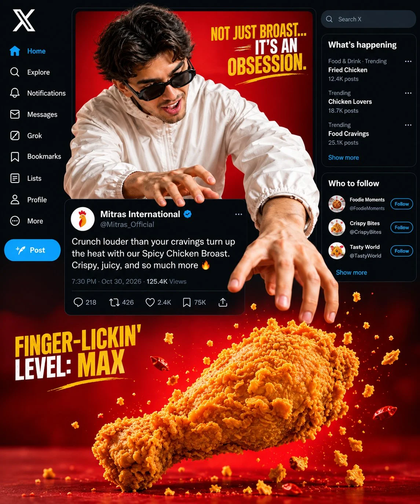

# Cinematic Ad With Centered Instagram Post Card Breakout

**中文标题：** 电影感广告×居中 Instagram 卡片破屏海报  
**ID:** `gi25-x-1196` · **Mode:** `edit`  
**Categories:** `edit-change-preserve`, `ecommerce`, `poster-typography`  
**Tags:** `x-twitter`, `community`, `gpt-image-2.5`, `x-direct`, `en`



### Cinematic Ad With Centered Instagram Post Card Breakout

```text
Cinematic Advertisement with Centered Instagram Post

Act as a professional advertising art director and create a high-quality, photorealistic commercial advertisement using the provided reference image as inspiration.

Main Scene: Preserve the main product, brand identity, people, clothing, colors, environment, and overall concept from the reference image. Enhance the scene with cinematic lighting, realistic textures, natural facial expressions, detailed product presentation, and professional commercial photography.

Instagram Interface Placement: Place a large, realistic Instagram-style post card horizontally across the middle of the entire composition, dividing the image into upper and lower visual sections. The card should feature a clean white background, circular brand profile picture, brand username, blue verification badge where appropriate, timestamp, three-dot menu, engagement icons, like count, caption text, and comment information.

Layering and Composition: The main subject should appear prominently in the upper section, while complementary characters, product details, or a continuation of the scene occupy the lower section. Allow selected elements, such as a hand, product, food item, or packaging, to extend naturally in front of or behind the central Instagram card, creating a realistic 3D depth effect. Keep the interface readable and ensure it does not unnecessarily obscure the main subject.

Branding and Text: Retain the original brand name, recognizable logo, and product identity when appropriate. Use a short, engaging promotional caption relevant to the product. Keep all text clean, legible, correctly spelled, and professionally aligned.

Visual Style: Premium commercial campaign, photorealistic rendering, cinematic lighting, realistic shadows, rich but balanced colors, shallow depth of field where appropriate, sharp product details, polished art direction, realistic perspective, and seamless compositing.

Output Requirements: Vertical 4:5 aspect ratio, high resolution, carefully balanced composition, Instagram interface centered horizontally and vertically around the middle of the image, realistic foreground-background separation, no unnecessary interface elements, no distorted hands, no duplicated objects, and no garbled text.

Originality: Create a fresh composition inspired by the reference rather than an exact reproduction of an existing advertisement. Preserve the general creative concept while using original layouts, supporting details, and promotional copy.
```

- **Recommended model:** `gpt-image-2.5-sunburst`
- **Settings:** _(defaults)_
- **Source:** [community](https://x.com/meng_dagg695/status/2116058024527958508) — @meng_dagg695
- **License note:** Original public X post; quoted with attribution — remix with attribution
- **Notes:** Collected directly from X; original post https://x.com/meng_dagg695/status/2116058024527958508; post text names GPT Image 2.5; discovered via X search, prompt re-verified against the original X post via api.fxtwitter.com; verified=True; post says it was made with GPT Image 2.5 on ImagineArt
- **Preview:** `previews/gi25-x-1196.webp`
