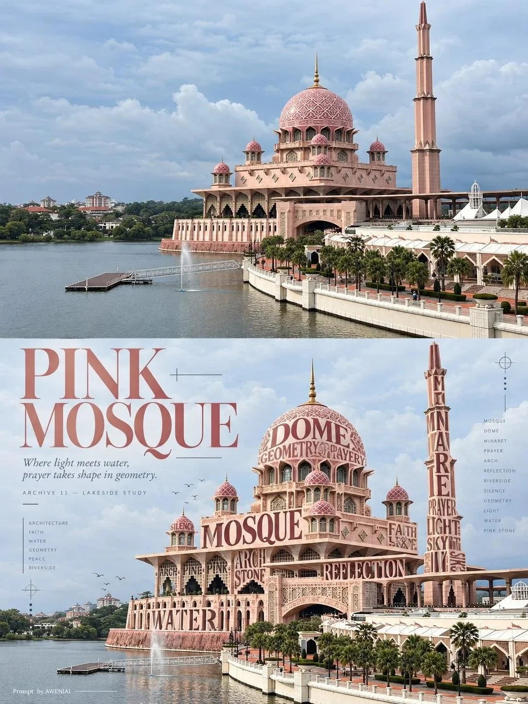

# Photo to 3D Typographic Sculpture Diptych Poster

**中文标题：** 照片→3D 文字雕塑上下双联海报  
**ID:** `gi25-x-1198` · **Mode:** `edit`  
**Categories:** `edit-change-preserve`, `poster-typography`  
**Tags:** `x-twitter`, `community`, `gpt-image-2.5`, `x-direct`, `en`



### Photo to 3D Typographic Sculpture Diptych Poster

```text
Transform each uploaded real photograph into a separate, independent 3:4 vertical experimental typography art diptych poster. Each photograph must be processed individually. Do not combine multiple images. The concept must adapt intelligently to any photographic subject.

Overall Composition

Divide the canvas into two perfectly equal horizontal sections, with an exact 50/50 split along the horizontal centerline. Both sections must occupy precisely half of the total canvas height.

- No borders, cards, frames, or transition strips.
- No newly designed elements may enter the upper half.
- Maintain a seamless visual relationship between both halves.

TOP HALF — Original Photography

Preserve the original photograph with absolute fidelity.

Maintain the subject's identity, number of subjects, silhouette, facial features, expression, posture, movement, materials, composition, perspective, background, original colors, and lighting.

Permitted adjustments:

- Very subtle photographic color grading.
- Natural background extension when necessary to fill the canvas.

Strict restrictions:

- Never crop essential parts of the subject.
- Never redraw, regenerate, or replace the subject.
- Never introduce additional objects.
- Never alter the original scene or its visual identity.
- No typography, graphic elements, annotations, or decorative overlays.

The original photograph must extend fully to the top, left, right, and central dividing edges. The entire upper half must remain purely photographic.

BOTTOM HALF — Semantic Typography Sculpture

Recreate the exact same photographic scene in the lower half, maintaining precise correspondence with the upper image in terms of subject placement, posture, proportions, perspective, spatial relationships, and original background.

The defining artistic technique is typographic reconstruction through physical subtraction and replacement.

First, analyze the subject's anatomy, structure, contours, and negative spaces. Identify suitable areas and physically remove approximately 25–60% of the subject's original photographic material.

Allow the original background to become visible through these missing sections.

Then reconstruct the removed portions using meaningful English words, short phrases, and individual letters that relate directly to the photographic subject.

The typography must become an actual structural part of the subject, not text printed or pasted onto an intact photograph.

Adapt this technique naturally to the photograph:

- Clothing and fabric: typography follows folds, seams, and garment contours.
- Animals: letters reconstruct sections of fur, feathers, or body contours.
- Flowers and plants: typography replaces selected petals, leaves, or stems.
- Mountains and landscapes: words follow slopes, ridgelines, and terrain.
- Architecture: typography reconstructs selected facades, structural edges, and surfaces.
- Objects: letters replace sections of cups, walls, vehicles, or other physical forms.

Use your artistic judgment to determine the most visually compelling areas. Never apply a fixed template.

Preserve the subject's essential recognition features and maintain believable physical connections between the remaining photographic elements and typographic structures.

Typography as Physical Sculpture

Shape the typography along the original object's curvature, geometry, and perspective.

Create convincing three-dimensional structure through:

- Variations in letter size and scale.
- Contrasting font weights.
- Controlled spacing and density.
- Curved, rotated, and layered letterforms.
- Selective overlapping and occlusion.
- Perspective-aware positioning.
- Carefully designed negative spaces.

The letterforms must behave like tangible physical structures. Their strokes form the subject's missing material, while the gaps between letters reveal the original photographic background.

Use 2–3 complementary typefaces selected from:

- Delicate, high-contrast serif typography.
- Condensed sans-serif typography.
- Elegant italic or editorial display typography.

Choose one dominant keyword that is accurate, meaningful, visually striking, and clearly legible.

Extract the typography's color palette from the original photograph's dominant colors, ensuring sufficient contrast and visual harmony.

Avoid plastic-looking 3D lettering, neon effects, heavy drop shadows, excessive extrusion, and meaningless or corrupted text.

ART DIRECTION — Swiss Experimental Editorial Design

Design the lower half as a sophisticated, masterfully art-directed Swiss experimental editorial composition.

Use an asymmetric grid with five distinct levels of visual hierarchy.

Hierarchy:

1. Primary focal point: The typographically reconstructed photographic subject. This must remain the dominant visual element.
2. Editorial headline: A bold, visually striking English title that complements the subject.
3. Poetic description: One or two concise, evocative sentences that add conceptual depth.
4. Micro archival information: A small, refined editorial reference number or classification.
5. Decorative graphic details: Minimal, precisely positioned visual accents.

Possible graphic elements include:

- Ultra-thin rules and lines.
- Small geometric dots.
- Crosshair registration marks.
- Tiny directional arrows.
- Vertical typography.
- Minimal geometric symbols.
- Subtle alignment markers.

Create a confident balance between expressive typography and disciplined editorial structure.

Use bold composition, precise alignment, generous negative space, and excellent readability.

All graphic elements must remain within the lower half and must never obscure the reconstructed subject.

Required Signature

Include the following exact signature exactly once, positioned discreetly along the bottom edge or within the margins of the lower half:

Prompt by AWENIAI

Keep it small, elegant, and clearly readable. Preserve the exact wording and spelling.

FINAL QUALITY CONTROL

Before finalizing, verify every requirement:

- Exact 3:4 vertical aspect ratio.
- Perfect 50/50 horizontal division.
- Upper half preserves the original photograph without any graphic overlays or typography.
- Lower half depicts the same photographic scene, not a newly invented environment.
- Approximately 25–60% of selected subject material is genuinely removed.
- The missing photographic material is physically reconstructed using meaningful typography.
- Original background is visible through the removed sections and letter spacing.
- Subject identity, recognizable features, contours, perspective, and spatial relationships remain convincing.
- Typography follows the subject's actual geometry and three-dimensional form.
- Editorial headline, poetic description, archival details, and decorative elements remain entirely within the lower half.
- The signature appears exactly once.
- No elements cross the central dividing line.

ABSOLUTE CREATIVE DIRECTION: This must look like a high-end experimental typography art poster created by an award-winning Swiss editorial design studio. The upper half is an untouched photographic reference; the lower half is its typographic sculptural interpretation.

Never generate an entirely new scene, a full-page illustration, random typography scattered across the image, or a miniature version of the original photograph in the bottom-right corner.
```

- **Recommended model:** `gpt-image-2.5-sunburst`
- **Settings:** _(defaults)_
- **Source:** [community](https://x.com/Ciri_ai/status/2116038286779335029) — @Ciri_ai
- **License note:** Original public X post; quoted with attribution — remix with attribution
- **Notes:** Collected directly from X; original post https://x.com/Ciri_ai/status/2116038286779335029; post text names GPT Image 2.5; discovered via X search, prompt re-verified against the original X post via api.fxtwitter.com; verified=True
- **Preview:** `previews/gi25-x-1198.webp`
