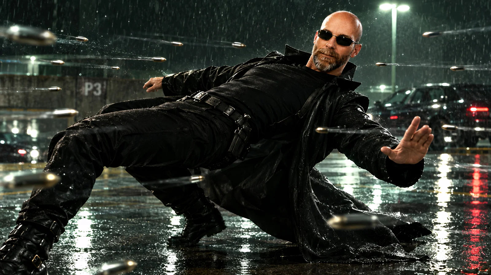

# Photo to Matrix Neo Bullet-Dodge Scene

**中文标题：** 照片→黑客帝国 Neo 躲子弹场景  
**ID:** `gi25-x-1220` · **Mode:** `edit`  
**Categories:** `edit-change-preserve`, `character-consistency`  
**Tags:** `x-twitter`, `community`, `gpt-image-2.5`, `x-direct`, `en`



### Photo to Matrix Neo Bullet-Dodge Scene

```text
Using my uploaded photo, turn me into a fun Neo-inspired version of myself. Keep my face and features recognizable. Dress me in a Matrix Neo-inspied outfit with Neo accessories, trench coat, sunglasses and a Neo dodging bullets Matrix vibe. Put me in a parking lot after a rainfall scenery, bent backwards dodging bullets. Make it realistic, intense, and high quality. 8k resolution, 16:9 format, octane render.
```

- **Recommended model:** `gpt-image-2.5-sunburst`
- **Settings:** _(defaults)_
- **Source:** [community](https://x.com/SethCritchley/status/2115781753508122867) — @SethCritchley
- **License note:** Original public X post; quoted with attribution — remix with attribution
- **Notes:** Collected directly from X; original post https://x.com/SethCritchley/status/2115781753508122867; post text names GPT Image 2.5; discovered via Bin0754/gpt-image-gallery index, prompt re-verified against the original X post via api.fxtwitter.com; verified=True
- **Preview:** `previews/gi25-x-1220.webp`
