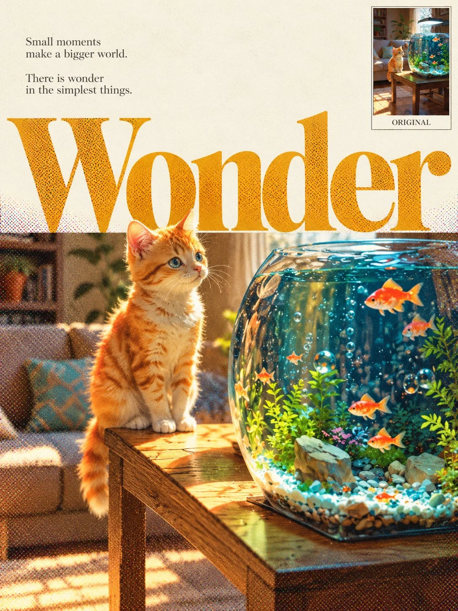

# Photo to Poetic Editorial Print Poster

**中文标题：** 照片→诗意杂志印刷海报  
**ID:** `gi25-x-1230` · **Mode:** `edit`  
**Categories:** `edit-change-preserve`, `poster-typography`  
**Tags:** `x-twitter`, `community`, `gpt-image-2.5`, `x-direct`, `en`



### Photo to Poetic Editorial Print Poster

```text
UNIVERSAL PROMPT - POETIC EDITORIAL PRINT POSTER | 3:4

Transform the uploaded photograph into a poetic 3:4 vertical editorial print poster.

First, analyse the photograph and identify its most distinctive element that can naturally extend upwards, such as a flower branch, an animal’s head and neck, a tree canopy, or another prominent subject. Preserve the original scene, key details, and spatial relationships.

COMPOSITION & TYPOGRAPHY:

Create one continuous composition. Reserve approximately the upper third of the poster as clean, warm-white negative space, featuring two short lines of English poetry that complement the photograph’s mood.

Choose one short English word that reflects the photograph’s theme. Display it in oversized serif typography, spanning the width of the composition. This large word should visually separate the upper negative space from the photograph below.

Keep the extracted subject photorealistic, extending naturally from the original scene, crossing the typography boundary and partially overlapping the letters as it enters the upper white space. Ensure realistic depth, natural continuity, balanced letter visibility, and believable occlusion. Do not create two separate images stacked together.

IMAGE TREATMENT & PRINT TEXTURE:

Apply a noticeable atmospheric treatment suited to the original photograph, using appropriate lighting and colour grading, such as golden sunset tones, soft spring light, serene twilight, or luminous aquatic hues. Enhance the emotional atmosphere while preserving the photograph’s recognisable details.

Integrate fine, clearly visible coloured halftone printing dots into the oversized typography and stylised photograph. Use slightly misaligned cyan, blue, magenta, and yellow dots, with denser patterns in darker areas and sparser patterns in highlights. Keep the main subject photographic in appearance and the upper warm-white space relatively clean.

ORIGINAL PHOTO INSET:

Place a small thumbnail of the untouched original photograph in the upper-right corner, occupying approximately 15–18% of the poster width. Display it completely unaltered, with a thin border and a small “ORIGINAL” label. Ensure it does not obstruct the main typography or the subject extending across the boundary.

FINAL AESTHETIC:

Maintain a restrained, poetic, vintage editorial magazine-print aesthetic. Ensure all text is accurate, legible, and thoughtfully positioned. No additional headlines, watermarks, or irrelevant decorative elements.
```

- **Recommended model:** `gpt-image-2.5-sunburst`
- **Settings:** _(defaults)_
- **Source:** [community](https://x.com/Goodmanprotocol/status/2116124342367179088) — @Goodmanprotocol
- **License note:** Original public X post; quoted with attribution — remix with attribution
- **Notes:** Collected directly from X; original post https://x.com/Goodmanprotocol/status/2116124342367179088; post text names GPT Image 2.5; discovered via Bin0754/gpt-image-gallery index, prompt re-verified against the original X post via api.fxtwitter.com; verified=True
- **Preview:** `previews/gi25-x-1230.webp`
