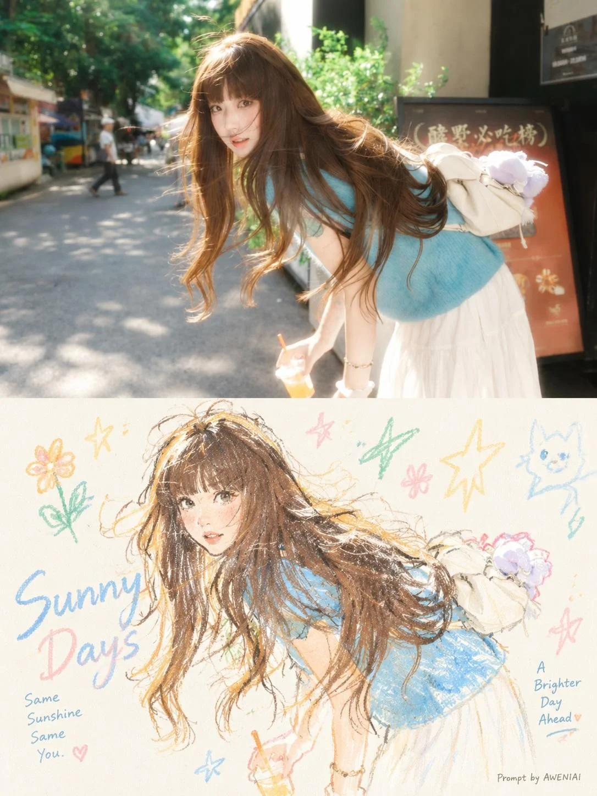

# Photo to Minimalist Pastel Crayon Art Poster

**中文标题：** 照片→极简粉彩蜡笔艺术海报  
**ID:** `gi25-x-1244` · **Mode:** `edit`  
**Categories:** `edit-change-preserve`, `poster-typography`  
**Tags:** `x-twitter`, `community`, `gpt-image-2.5`, `x-direct`, `en`



### Photo to Minimalist Pastel Crayon Art Poster

```text
Transform each uploaded photograph into a separate, independent, high-end editorial design poster. Process every photograph individually and generate one standalone poster per image. Never combine multiple photographs into a collage.

Overall Format & Composition

- Aspect ratio: 3:4 vertical portrait.
- Divide the canvas into two perfectly equal horizontal sections.
- The upper and lower sections must each occupy exactly 50% of the total canvas height.
- Maintain a precise 50/50 division with no borders, frames, or transition strips.

Upper Half — Original Photograph

Preserve the original photograph in the upper half, maintaining the subject's identity, structure, pose, proportions, realistic textures, natural lighting, shadows, and original color atmosphere.

Apply only subtle, sophisticated color grading to achieve the visual quality of an art magazine, independent publication, or contemporary photography exhibition.

You may naturally extend the surrounding environment or background to fit the composition, but never stretch, distort, reshape, or alter the original subject.

The photograph should remain authentic and recognizable, with an understated, refined editorial aesthetic.

Lower Half — Minimalist Pastel Crayon Illustration

First, interpret the photograph to identify its most memorable central subject, visual relationship, structural direction, emotional atmosphere, and underlying visual metaphor.

Reconstruct this visual memory as a minimalist pastel crayon doodle illustration on lightly textured vintage-style paper.

Do not reproduce every object in the photograph. Avoid literal, complete tracing or detailed conversion. Instead, retain only the most recognizable silhouettes, gestures, directions, proportions, and defining visual elements that establish a clear connection with the original photograph.

Use artistic simplification, selective exaggeration, reduction, and subtle recomposition to create an illustration that feels expressive, spontaneous, and visually distinctive.

Main Subject — Hand-Drawn Crayon Aesthetic

Draw the primary subject using bold, coarse-grained pastel chalk and crayon outlines.

The lines should feel:

- Slightly thick, loose, and naturally imperfect.
- Dry, grainy, and powdery, with visible pigment texture.
- Irregular, with occasional broken strokes, faded patches, and subtle hand-drawn wobble.
- Softly rounded at the ends, with naturally incomplete and open contours.

Inside the subject, introduce only a few minimal pastel color accents, simple grids, stripes, dots, or spontaneous scribbles to suggest its essential structure.

Avoid realistic shading, dimensional rendering, excessive detail, or fully filled-in shapes. The illustration should feel like an expressive hand-drawn study rather than a polished digital drawing.

Surrounding Doodles — Consistent Visual Language

Any small decorative elements surrounding the main subject must use exactly the same crayon and chalk drawing language.

Reduce secondary elements to simple, instantly recognizable symbols made with just one or a few loose strokes.

Stars, flowers, plants, objects, environmental details, and abstract symbols should appear:

- Simple, naive, playful, and spontaneous.
- Primarily constructed from single-line outlines.
- Slightly irregular, open, and imperfect.
- Minimally colored, with very limited pastel fills.

Avoid polished icons, decorative stickers, vector graphics, or separate miniature illustrations.

Composition — Negative Space as the Main Design Element

Maintain the visual relationship of a small-scale stamp-like illustration surrounded by generous negative space.

Arrange the main subject according to its natural direction, proportions, and visual center of gravity.

The illustration may be asymmetrically positioned, slightly off-center, suspended in space, placed near an edge, or partially cropped.

Allow the main subject and a very small number of supporting doodle symbols to form a loose but intentional visual cluster.

Leave the remaining space deliberately empty.

Negative space must function as a primary compositional element. Create visual rhythm through:

- Empty space versus concentrated detail.
- Clustering versus separation.
- Contrasts in scale and proportion.
- Asymmetry and visual imbalance.
- A sense of breathing room, distance, and intentional pauses.

Less is more. Never fill the entire lower section. Resist the temptation to add unnecessary decorative elements.

Background — Clean, Light Paper Texture

Use an extremely light, bright, clean paper background.

Suitable tones include:

- Creamy white.
- Ivory white.
- Pale warm white.
- Soft off-white.
- Very light almond white.
- Extremely pale neutral white.

Intelligently match the paper's subtle undertone to the overall color temperature of the original photograph.

The paper should retain only a very subtle natural fiber texture and fine grain.

Avoid backgrounds that appear brown, yellow, muddy, dark gray, heavily aged, stained, or excessively vintage.

The background must remain significantly brighter than the illustration's outlines and color accents, ensuring that every crayon stroke, doodle, and decorative element remains crisp, distinct, and clearly visible.

Never allow the illustration to blend into the background.

Color Palette — Extracted from the Original Photograph

Extract 2–4 of the most vibrant, appealing, and emotionally representative colors from the original photograph.

Reinterpret these colors into a bright, soft, harmonious pastel crayon palette.

Depending on the photograph, the palette may naturally include:

- Peach pink.
- Apricot orange.
- Butter yellow.
- Mint green.
- Sky blue.
- Soft lavender.

Prioritize light, cheerful, warm, and visually friendly pastel tones.

The main subject's outlines should use clearly distinguishable colors that contrast against the light paper background, such as coral pink, soft blue, turquoise green, warm orange, lavender, or deeper creamy pastel tones.

Maintain a restrained and cohesive palette. Every color should feel intentional and connected to the original photograph.

Final Artistic Direction

The final poster should feel like a sophisticated experimental art publication combining authentic photography with spontaneous, minimalist, hand-drawn pastel illustration.

The upper half should communicate realism, atmosphere, and photographic depth.

The lower half should communicate memory, emotion, abstraction, and artistic interpretation.

The relationship between both halves should be immediately recognizable without requiring a literal reproduction of the photograph.

Prioritize artistic intelligence, visual restraint, expressive imperfections, delicate textures, and generous negative space.

The result should feel curated, contemporary, playful, poetic, and gallery-worthy — like a limited-edition art print from an independent creative studio.
```

- **Recommended model:** `gpt-image-2.5-sunburst`
- **Settings:** _(defaults)_
- **Source:** [community](https://x.com/oggii_0/status/2116418536684109990) — @oggii_0
- **License note:** Original public X post; quoted with attribution — remix with attribution
- **Notes:** Collected directly from X; original post https://x.com/oggii_0/status/2116418536684109990; post text names GPT Image 2.5; discovered via Bin0754/gpt-image-gallery index, prompt re-verified against the original X post via api.fxtwitter.com; verified=True
- **Preview:** `previews/gi25-x-1244.webp`
