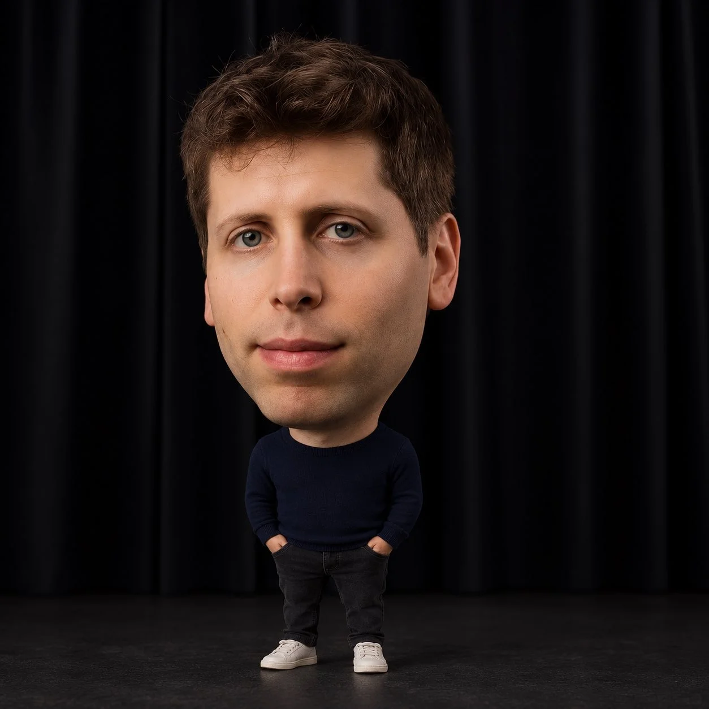

# Hyper-Realistic Big-Head Miniature Portrait Edit

**中文标题：** 超写实大头小身人像改图  
**ID:** `gi25-x-1250` · **Mode:** `edit`  
**Categories:** `edit-change-preserve`, `character-consistency`  
**Tags:** `x-twitter`, `community`, `gpt-image-2.5`, `x-direct`, `en`



### Hyper-Realistic Big-Head Miniature Portrait Edit

```text
Hyper Realistic Big Head Miniature Portrait using GPT Image 2.5

Prompt:
Strictly edit the uploaded photo. Only change head-to-body proportions — keep the original face, identity, expression, pose, clothing, accessories, background, lighting, and framing completely unchanged.
•Enlarge the head so it is 2.5–3× wider than the shoulders.
•Make shoulders very narrow with a short neck.
•Shrink the body, arms, hands, legs, and feet dramatically (body roughly the same height as the head or smaller; limbs 25–35% of normal size).
•Scale clothing naturally to fit the tiny body without changing its design.
•Keep everything photorealistic with seamless blending and natural textures. No cartoon, anime, or doll style.
```

- **Recommended model:** `gpt-image-2.5-sunburst`
- **Settings:** _(defaults)_
- **Source:** [community](https://x.com/MrDasCreates/status/2116458133031882922) — @MrDasCreates
- **License note:** Original public X post; quoted with attribution — remix with attribution
- **Notes:** Collected directly from X; original post https://x.com/MrDasCreates/status/2116458133031882922; post text names GPT Image 2.5; discovered via Bin0754/gpt-image-gallery index, prompt re-verified against the original X post via api.fxtwitter.com; verified=True
- **Preview:** `previews/gi25-x-1250.webp`
