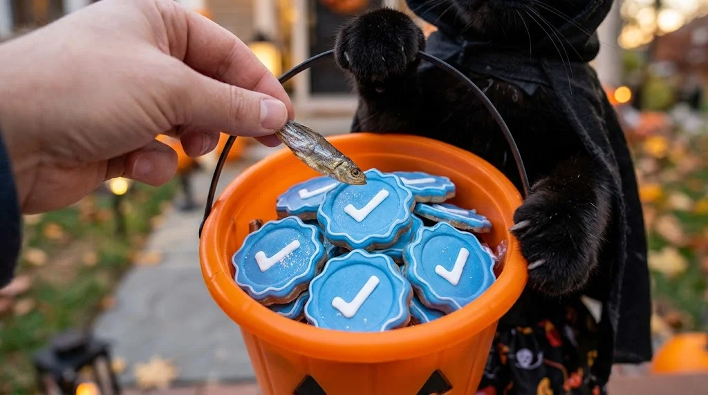

# Halloween Cat Candy Bucket Edit

**中文标题：** 万圣节猫咪糖果桶改图  
**ID:** `gi25-x-1288` · **Mode:** `edit`  
**Categories:** `edit-change-preserve`  
**Tags:** `x-twitter`, `community`, `gpt-image-2.5`, `x-direct`, `en`



### Halloween Cat Candy Bucket Edit

```text
The person adds one small dried fish as a special Halloween treat, placing it directly into the pumpkin candy bucket held by the cat, which is filled with blue wavy-edged coin-shaped candies featuring a white checkmark in the center, resembling X verification badge icons.
```

- **Recommended model:** `gpt-image-2.5-sunburst`
- **Settings:** _(defaults)_
- **Source:** [community](https://x.com/cjppv42129/status/2116757386748985775) — @cjppv42129
- **License note:** Original public X post; quoted with attribution — remix with attribution
- **Notes:** Collected directly from X; original post https://x.com/cjppv42129/status/2116757386748985775; post text names GPT Image 2.5; discovered via X search, prompt re-verified against the original X post via api.fxtwitter.com; verified=True
- **Preview:** `previews/gi25-x-1288.webp`
