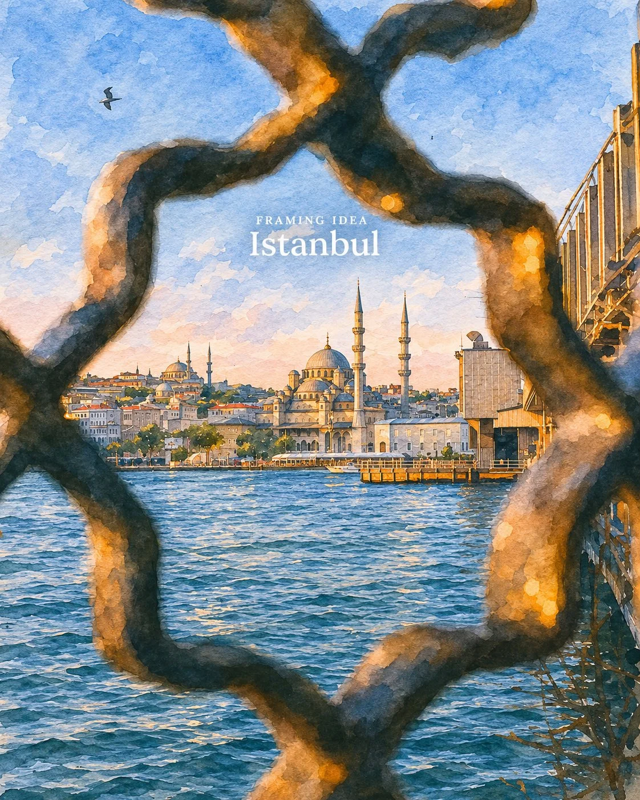

# Photo to Traditional Watercolor Illustration (JSON)

**中文标题：** 照片→传统水彩插画（JSON）  
**ID:** `gi25-x-1301` · **Mode:** `edit`  
**Categories:** `edit-change-preserve`  
**Tags:** `x-twitter`, `community`, `gpt-image-2.5`, `x-direct`, `en`



### Photo to Traditional Watercolor Illustration (JSON)

```text
{
"task": "Transform the uploaded image into a beautiful, detailed traditional watercolor illustration.",

"input": {
"reference_image": "Use the uploaded image as the ONLY source of visual content."
},

"generation": {
"style": "Traditional hand-painted watercolor illustration",
"medium": "Watercolor on cold-pressed textured paper with delicate ink detailing",
"aspect_ratio": "Preserve original image aspect ratio",
"quality": "High-detail fine-art illustration",
"realism": "Painterly realism with recognizable original details"
},

"style_direction": {
"watercolor_texture": "Visible natural watercolor pigments, soft color bleeding, translucent washes, subtle pigment granulation and organic brush strokes.",
"paper_texture": "Authentic cold-pressed watercolor paper texture, subtly visible throughout the image.",
"outlines": "Fine, delicate hand-drawn ink outlines with slightly imperfect natural edges.",
"shading": "Layered transparent watercolor washes with soft gradients and atmospheric depth.",
"color_palette": "Harmonious muted colors, warm ochre highlights, soft blues, natural greens, earthy browns and gentle pastel tones.",
"lighting": "Preserve the original lighting direction, shadows, highlights and overall atmosphere.",
"artistic_finish": "Sophisticated travel-journal illustration, architectural watercolor painting and premium editorial travel artwork."
},

"preservation_rules": {
"composition": "Preserve the exact original framing, camera angle, perspective and spatial arrangement.",
"subjects": "Maintain all original people, buildings, landscapes, animals, vehicles and objects.",
"architecture": "Preserve architectural structures, proportions, windows, doors and intricate details.",
"background": "Retain the complete original environment and background.",
"colors": "Translate original colors into natural watercolor pigments without changing the scene's identity.",
"lighting": "Maintain the original time-of-day atmosphere and lighting conditions.",
"details": "Preserve recognizable small details rather than simplifying or replacing them.",
"text": "Preserve all existing typography, signage, lettering and text in their original positions, spelling, alignment and visual hierarchy.",
"aspect_ratio": "Do not crop, zoom in, extend or recompose the original image."
},

"artistic_enhancement": {
"depth": "Use layered watercolor washes to create natural atmospheric perspective.",
"highlights": "Introduce subtle translucent highlights and delicate light reflections.",
"shadows": "Render shadows using soft layered pigments rather than artificial gradients.",
"organic_imperfections": "Allow subtle watercolor blooms, pigment variations and natural paper interactions.",
"detail_balance": "Keep important structural details crisp while allowing distant backgrounds to remain softly painterly."
},

"negative_prompt": [
"Photorealistic output",
"3D rendering",
"Digital painting appearance",
"Anime or cartoon style",
"Oil painting texture",
"Plastic-looking surfaces",
"Excessive blur",
"Overly simplified objects",
"Distorted architecture",
"Changed facial features",
"Extra people or objects",
"Missing original elements",
"Invented scenery",
"Incorrect text",
"Random typography",
"Watermarks",
"Unnatural oversaturation",
"Cropping or reframing"
],

"final_output": {
"format": "Single finished illustration",
"appearance": "Authentic premium watercolor travel artwork",
"priority": "Maximum fidelity to the uploaded photograph combined with beautiful traditional watercolor aesthetics."
}
}
```

- **Recommended model:** `gpt-image-2.5-sunburst`
- **Settings:** _(defaults)_
- **Source:** [community](https://x.com/Maercihh/status/2116863994917199996) — @Maercihh
- **License note:** Original public X post; quoted with attribution — remix with attribution
- **Notes:** Collected directly from X; original post https://x.com/Maercihh/status/2116863994917199996; post text names GPT Image 2.5; discovered via X search, prompt re-verified against the original X post via api.fxtwitter.com; verified=True
- **Preview:** `previews/gi25-x-1301.webp`
