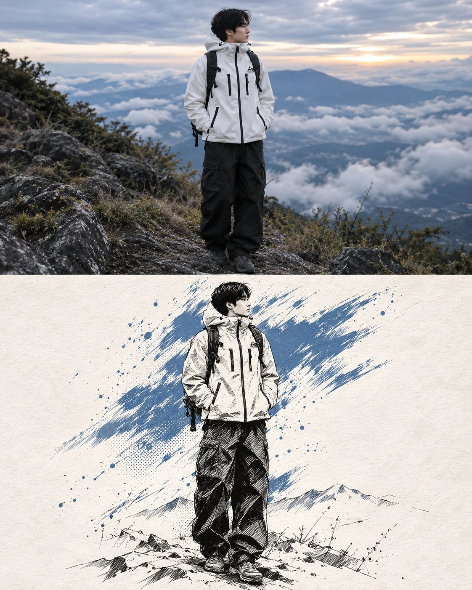

# Restyle a Photo From a Style Reference (Two-Image Edit)

**中文标题：** 双图改图：按风格参考重绘照片  
**ID:** `gi25-x-1311` · **Mode:** `edit`  
**Categories:** `edit-change-preserve`  
**Tags:** `x-twitter`, `community`, `gpt-image-2.5`, `x-direct`, `en`



### Restyle a Photo From a Style Reference (Two-Image Edit)

```text
img1. Everything in the result comes from here — the person, their face, hair, body, pose, clothing, equipment and setting.
img2= THE STYLE REFERENCE. Use this ONLY as inspiration for the artistic technique: the ink linework, the hatching and halftone shading, the rough accent-colour brush strokes and splatters, the paper background and the overall graphic treatment.
Do NOT take the person, face, body, pose, clothing, objects, setting or accent colour from @image2. Nothing visible in @upload-1793347670928-cpgnoei may appear in the result — it is a look, not content.
OUTPUT: one single unified image, 4:5 vertical, split into two panels of exactly equal height — 50% top, 50% bottom — divided by one clean straight horizontal edge. Not a collage.
TOP PANEL — BEFORE: the photograph @upload-1793347676165-hgzb72w exactly as provided, unedited apart from a subtle grade. Crop intelligently to fill the landscape panel edge to edge without distorting the subject, keeping the face and the main action clearly visible. Full bleed, no margins, no border.
BOTTOM PANEL — AFTER: the same subject transformed into a mixed-media ink and paint illustration on textured off-white paper, in the artistic style of @image2.
Nothing runs continuously across the dividing edge — the two panels are separate images of the same subject, not one picture with its lower half stylised.
THE SUBJECT IN THE LOWER PANEL
Keep the subject clearly recognisable — the same face, features, expression, hairstyle, body proportions, pose and gesture, and the same clothing and equipment. Keep anything they are riding, holding or playing rendered in full detail.
Redraw them entirely in BLACK INK: confident varied-weight contour lines, dense cross-hatching in the shadows, bold solid black fills in the darkest areas, and halftone dot patterns for the mid-tones. Faces are drawn with finer, more restrained linework so the likeness stays clear; clothing, hair and hard surfaces carry the heavier hatching and black fills. Render mechanical detail precisely where it exists — spokes, frames, strings, hardware, laces, stitching — in clean ink line.
THE ACCENT COLOUR
Identify the single most dominant or meaningful colour in @upload-1793347676165-hgzb72w — a red garment, a blue sky, a yellow jacket — and make it the ONE accent colour. Do not copy the accent colour from @image2; take it from the subject photo. Everything else is strictly black and white.
Apply it as rough, energetic PAINT: wide dry-brush strokes slashing diagonally behind and across the subject, torn-edged patches, hard-edged streaks, and scattered splatters, flecks and droplets flung outward. The strokes are gestural and imperfect, with visible brush texture and dry gaps where the bristles skipped.
Let the accent fill whatever actually carried that colour in @image1, but let it break out of those shapes into loose strokes beyond their edges. Cluster the colour mass behind one side of the subject so it reads as a burst of energy, thinning out toward the opposite side.
THE BACKGROUND OF THE LOWER PANEL
Delete the original background almost entirely. Bare off-white paper with a faint natural grain — no scene, no sky, no architecture, no crowd.
Keep only a few simplified sketched elements from @image1's setting, drawn small, loose and incomplete near the base of the figure — a suggestion of ground, a ramp, a stage edge, a few distant figures — fading into the paper with no hard boundary.
FINISH
The subject's outer edges dissolve into brush strokes, hatching and splatters rather than ending in a clean outline. Scatter loose ink flecks, drips and spray marks around the figure, heaviest near the accent colour. Leave generous empty paper around everything.
High contrast, graphic and bold — a hand-made screenprint or ink-and-wash poster, not a digital filter.
Avoid: unequal panel heights, a visible gap or border between panels, a side-by-side layout, the lower panel continuing the upper photo, a subject sliced across the dividing edge, mismatched subjects between panels, the person or accent colour from @image2, photorealism in the lower panel, a photographic background, a full detailed scene, grey airbrushed shading, soft gradients, a clean vector look, smooth flat fills, more than one accent colour, a clean cut-out silhouette, a hard outline around the figure, a changed face, a different person, an altered outfit, a changed pose, text, logos, watermark.
```

- **Recommended model:** `gpt-image-2.5-sunburst`
- **Settings:** _(defaults)_
- **Source:** [community](https://x.com/harboriis/status/2116903510432506040) — @harboriis
- **License note:** Original public X post; quoted with attribution — remix with attribution
- **Notes:** Collected directly from X; original post https://x.com/harboriis/status/2116903510432506040; post text names GPT Image 2.5; discovered via X search, prompt re-verified against the original X post via api.fxtwitter.com; verified=True
- **Preview:** `previews/gi25-x-1311.webp`
