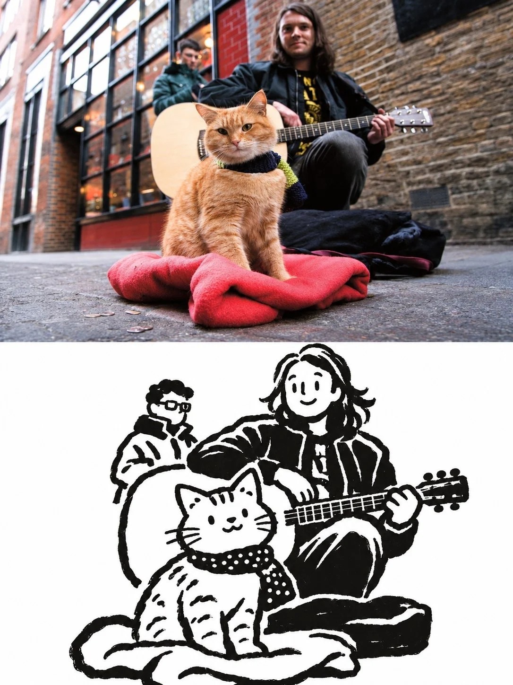

# Photo-to-Illustration 50/50 Comparison Poster

**中文标题：** 照片→插画上下对照海报  
**ID:** `gi25-x-1312` · **Mode:** `edit`  
**Categories:** `edit-change-preserve`, `poster-typography`  
**Tags:** `x-twitter`, `community`, `gpt-image-2.5`, `x-direct`, `en`



### Photo-to-Illustration 50/50 Comparison Poster

```text
PREMIUM EDITORIAL PHOTO-TO-ILLUSTRATION COMPARISON POSTER | 3:4

Create a premium, full-bleed 3:4 vertical editorial poster using the uploaded photograph as the sole reference. Divide the canvas into exactly two equal horizontal halves (50/50), without borders, dividers, text, or labels.

TOP HALF — ORIGINAL PHOTOGRAPH

Preserve the photograph faithfully, maintaining the subjects' identities, facial features, expressions, hairstyles, clothing, poses, important objects, natural colors, lighting, and atmosphere. Allow only minimal cropping to fit the composition. Do not reconstruct, stylize, or alter the original image.

BOTTOM HALF — HAND-DRAWN ILLUSTRATION

Recreate the same scene as a playful, minimalist, hand-inked screen-print illustration using strictly two colors: pure white (#FFFFFF) for the background and near-black (#080807) for outlines and solid shapes.

Use bold, broad, imperfect marker or brush strokes with organic contours, visible hand-drawn wobble, and natural pressure variations. Avoid thin, smooth, vector-like lines.

Simplify people into expressive cartoon-like characters with rounded irregular heads, minimal facial features, friendly expressions, mitten-shaped hands, and chunky limbs. Preserve recognizable hairstyles, glasses, accessories, poses, and interactions. Apply the same playful simplification to animals and other subjects.

Retain the original scene's main subjects, important objects, visual story, and relationships while removing 70–90% of unnecessary background details. Use bold silhouettes, flat shapes, and generous white negative space. Add small, dense, irregular black dots to no more than one suitable garment or textile area.

STYLE & RESTRICTIONS

Maintain a warm, spontaneous, handcrafted editorial aesthetic. The illustration must remain flat, graphic, and expressive.

Avoid photorealism, 3D effects, gradients, gray tones, shadows, realistic shading, additional colors, excessive details, corporate icon aesthetics, mechanical symmetry, malformed anatomy, extra fingers, and detached hands.

Do not introduce unrelated characters, objects, or activities. No text, letters, numbers, logos, signatures, watermarks, decorative frames, or additional panels.

FINAL COMPOSITION

The finished poster must present the exact same visual story twice: the authentic original photograph in the upper half and its expressive black-ink, hand-drawn interpretation against a pure white background in the lower half. Maintain a precise 50/50 division, consistent composition, and premium editorial finish.
```

- **Recommended model:** `gpt-image-2.5-sunburst`
- **Settings:** _(defaults)_
- **Source:** [community](https://x.com/Goodmanprotocol/status/2116907552021905488) — @Goodmanprotocol
- **License note:** Original public X post; quoted with attribution — remix with attribution
- **Notes:** Collected directly from X; original post https://x.com/Goodmanprotocol/status/2116907552021905488; post text names GPT Image 2.5; discovered via X search, prompt re-verified against the original X post via api.fxtwitter.com; verified=True
- **Preview:** `previews/gi25-x-1312.webp`
