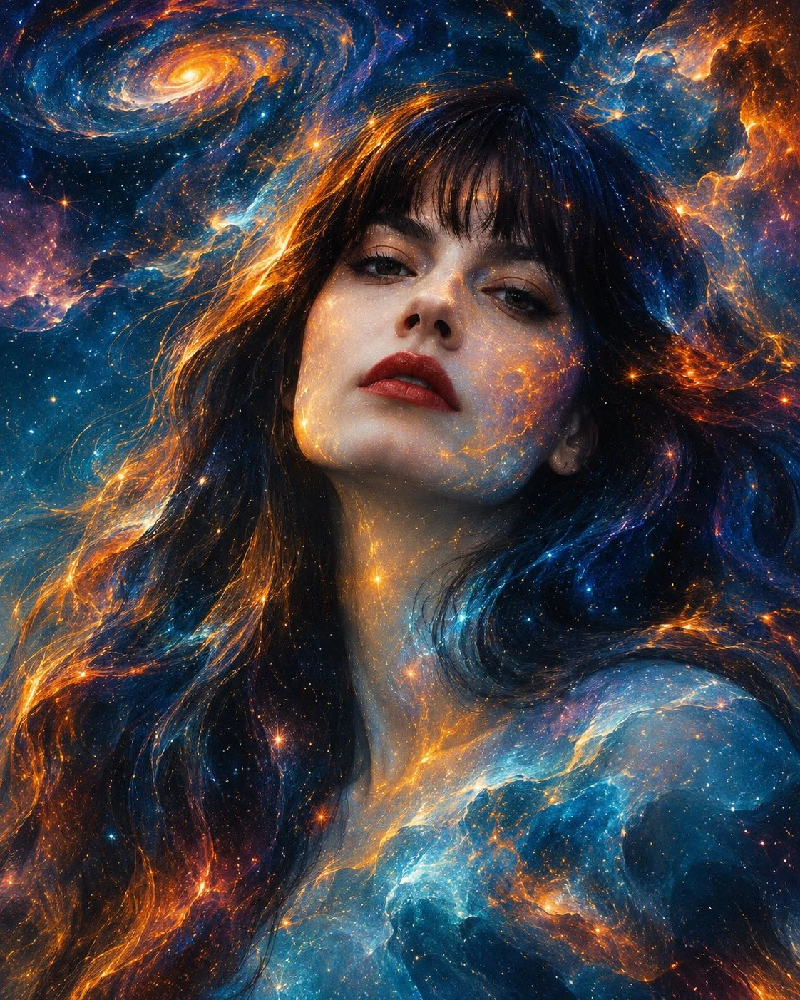

# Face-as-Universe Surreal Cosmic Portrait

**中文标题：** 人脸即宇宙·超现实宇宙肖像  
**ID:** `gi25-x-1327` · **Mode:** `edit`  
**Categories:** `edit-change-preserve`, `general`  
**Tags:** `x-twitter`, `community`, `gpt-image-2.5`, `x-direct`, `en`



### Face-as-Universe Surreal Cosmic Portrait

```text
Using the uploaded reference photograph of the person as the primary facial identity reference, create an extraordinary surreal cosmic fine-art portrait that transforms the person’s face into a living universe.

1. Facial identity and composition

* Preserve the person’s exact facial identity, recognizable facial structure, eyes, nose, lips, skin tone and natural features.
* Create an intimate, dramatic close-up portrait, with the face occupying most of the composition.
* Maintain the person’s original identity rather than creating a different or idealized face.
* Give the portrait a thoughtful, mysterious and emotionally expressive atmosphere.

2. The cosmic transformation

* Transform the surrounding face and skin into an extraordinary celestial landscape.
* Blend deep midnight blue, electric turquoise, sapphire, violet, fiery orange and luminous golden yellow.
* Allow swirling nebulae, distant galaxies, tiny stars and glowing cosmic particles to flow organically across the face.
* Create the illusion that an entire universe exists within the person’s skin.
* Let portions of the portrait dissolve into interstellar clouds and abstract celestial textures.

3. Artistic details

* Add intricate hand-painted textures, delicate luminous brushstrokes and subtle watercolor-like blending.
* Scatter tiny golden stars and glowing cosmic dust across the composition.
* Introduce miniature celestial explosions and flowing galaxy formations.
* Keep the eyes exceptionally detailed, expressive and realistic, acting as the emotional centre of the artwork.
* Blend photorealistic facial details with expressive surrealist painting.

4. Lighting and atmosphere
Use dramatic golden illumination against deep cosmic blues. Create luminous contrasts, mysterious shadows and an almost dreamlike atmosphere.

5. Artistic direction
Inspired by visionary surrealism, cosmic expressionism, mixed-media fine art, intricate watercolor textures and celestial oil painting.

Final output: A breathtaking vertical 4:5 fine-art portrait, highly detailed, rich in texture, visually immersive and gallery-worthy.

The final artwork should look like a masterpiece in which a human being and the universe have become one. Avoid cartoon aesthetics, generic AI faces, plastic skin, excessive facial distortion and flat digital effects.
```

- **Recommended model:** `gpt-image-2.5-sunburst`
- **Settings:** _(defaults)_
- **Source:** [community](https://x.com/Naiknelofar788/status/2117172838792888353) — @Naiknelofar788
- **License note:** Original public X post; quoted with attribution — remix with attribution
- **Notes:** Collected directly from X; original post https://x.com/Naiknelofar788/status/2117172838792888353; post text names GPT Image 2.5; discovered via X search, prompt re-verified against the original X post via api.fxtwitter.com; verified=True; needs an uploaded reference photo
- **Preview:** `previews/gi25-x-1327.webp`
