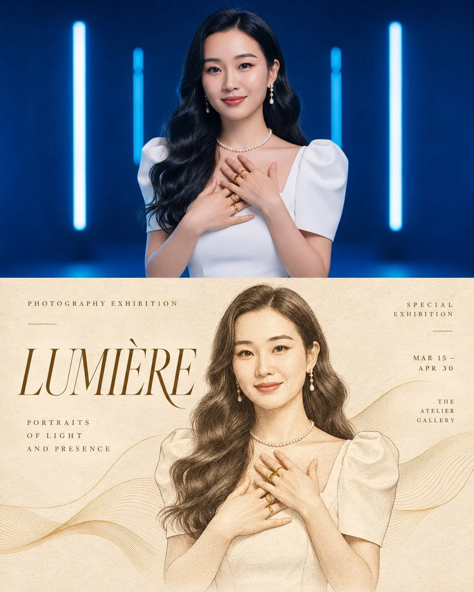

# Photo + Hand-Drawn Contour Editorial Art Poster

**中文标题：** 照片+手绘轮廓线编辑艺术海报  
**ID:** `gi25-x-1333` · **Mode:** `edit`  
**Categories:** `edit-change-preserve`, `poster-typography`  
**Tags:** `x-twitter`, `community`, `gpt-image-2.5`, `x-direct`, `en`



### Photo + Hand-Drawn Contour Editorial Art Poster

```text
Transform the provided reference photograph into a sophisticated, premium editorial art poster while preserving the original subject exactly as shown.

Composition: Create a vertical 4:5 editorial layout divided into two sections. The upper section features the original photograph in full color, maintaining the exact face, identity, pose, clothing, objects, proportions, and natural details. Do not beautify, retouch, or alter the subject.

The lower section transforms the same photograph into an elegant, artistic illustration on a warm ivory, textured paper background. Recreate the subject using delicate flowing contour lines, fine engraved linework, subtle crosshatching, and elegant hand-drawn strokes. Preserve the subject’s original silhouette, facial features, pose, and recognizable details.

Typography: Add a large, refined editorial headline on the lower section, positioned to the left with generous spacing. Use sophisticated high-contrast serif typography inspired by luxury fashion magazines. Choose a short, meaningful title that matches the photograph. Add small uppercase supporting text on the left and right, with wide letter spacing and minimalist editorial details.

Art direction: Minimalist luxury magazine aesthetic, Japanese editorial design influence, vintage printmaking, fine-line illustration, warm cream paper grain, subtle natural imperfections, delicate flowing wave patterns surrounding the subject, muted earthy accents, restrained color palette, balanced negative space, elegant visual hierarchy, museum-quality art direction.

Color palette: Warm ivory, soft beige, muted gold, dusty brown, or subdued green, selected to complement the original photograph.

Important requirements: Keep the upper photograph realistic and unchanged. The lower illustration must depict the exact same subject and scene, not a different interpretation. Maintain accurate anatomy, original colors where appropriate, and recognizable details. Text should be clean, correctly spelled, and professionally typeset. No extra subjects, no distorted features, no excessive effects, no artificial facial enhancement, no watermarks.

Final result: A premium, collectible editorial art poster combining an authentic photograph with a delicate, hand-drawn contour illustration, resembling a high-end photography exhibition poster
```

- **Recommended model:** `gpt-image-2.5-sunburst`
- **Settings:** _(defaults)_
- **Source:** [community](https://x.com/WanderingC76/status/2117193790326996992) — @WanderingC76
- **License note:** Original public X post; quoted with attribution — remix with attribution
- **Notes:** Collected directly from X; prompt posted as the author's own reply https://x.com/WanderingC76/status/2117193790326996992 to https://x.com/WanderingC76/status/2117193711977464112, which carries the images; GPT Image 2.5 is named in the parent post; discovered via X search, prompt re-verified against the original X post via api.fxtwitter.com; verified=True
- **Preview:** `previews/gi25-x-1333.webp`
