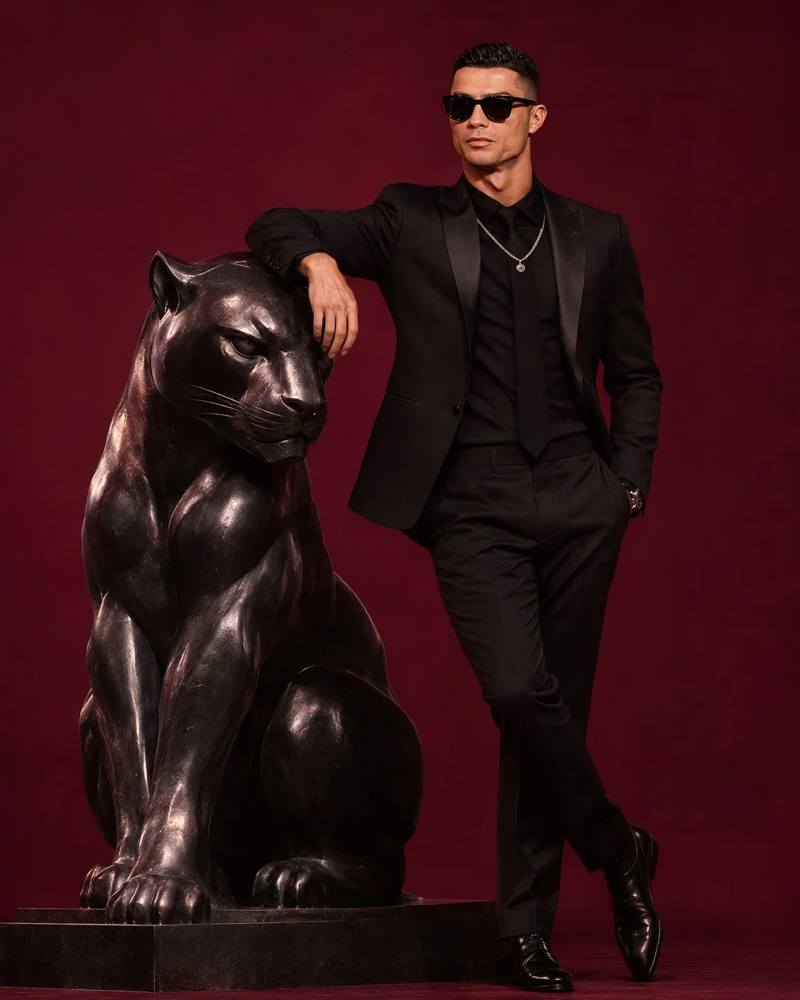

# Universal Editorial Studio Fashion Photoshoot (4:5)

**中文标题：** 通用编辑级棚拍时尚大片（4:5）  
**ID:** `gi25-x-1334` · **Mode:** `edit`  
**Categories:** `edit-change-preserve`, `character-consistency`  
**Tags:** `x-twitter`, `community`, `gpt-image-2.5`, `x-direct`, `en`



### Universal Editorial Studio Fashion Photoshoot (4:5)

```text
UNIVERSAL AI EDITORIAL STUDIO PHOTOSHOOT - 4:5

Using the uploaded photograph as the sole identity reference, create a premium, photorealistic, luxury studio fashion campaign.

First, analyse the person in the photograph, including their appearance, age, personality, clothing, and overall aesthetic. Automatically develop a creative concept that best suits them.

CREATIVE DIRECTION:

- Choose a distinctive, oversized, imaginative studio prop that complements the person, such as a giant plush teddy bear, miniature house, toy vehicle, oversized flower, animal sculpture, or another unexpected object.
- Automatically select a beautiful monochromatic colour palette, coordinating the background, outfit, footwear, and oversized prop.
- Style the person in fashionable, coordinated clothing that suits their age, appearance, and the chosen concept.
- Create a natural, confident editorial pose, interacting with or leaning against the oversized prop.
- Use a seamless coloured studio background, professional softbox lighting, subtle shadows, and carefully composed framing.

IDENTITY PRESERVATION:
Maintain the person's exact facial identity, facial features, skin tone, hairstyle, age, and natural proportions. Do not change their identity or create an unrelated person.

VISUAL QUALITY:
Ultra-photorealistic commercial fashion photography, premium children's fashion campaign aesthetic when appropriate, realistic fabric textures, detailed props, sophisticated colour grading, crisp focus, and professional studio production quality.

IMPORTANT: Make all creative decisions automatically based on the uploaded person. Every generation should have a unique, thoughtfully matched concept rather than repeating the same prop, colour, or composition.

FORMAT: 4:5 vertical portrait, high resolution, polished professional advertising photography. No text, logos, watermarks, or unnecessary elements.
```

- **Recommended model:** `gpt-image-2.5-sunburst`
- **Settings:** _(defaults)_
- **Source:** [community](https://x.com/Goodmanprotocol/status/2117194174751817841) — @Goodmanprotocol
- **License note:** Original public X post; quoted with attribution — remix with attribution
- **Notes:** Collected directly from X; original post https://x.com/Goodmanprotocol/status/2117194174751817841; post text names GPT Image 2.5; discovered via X search, prompt re-verified against the original X post via api.fxtwitter.com; verified=True
- **Preview:** `previews/gi25-x-1334.webp`
