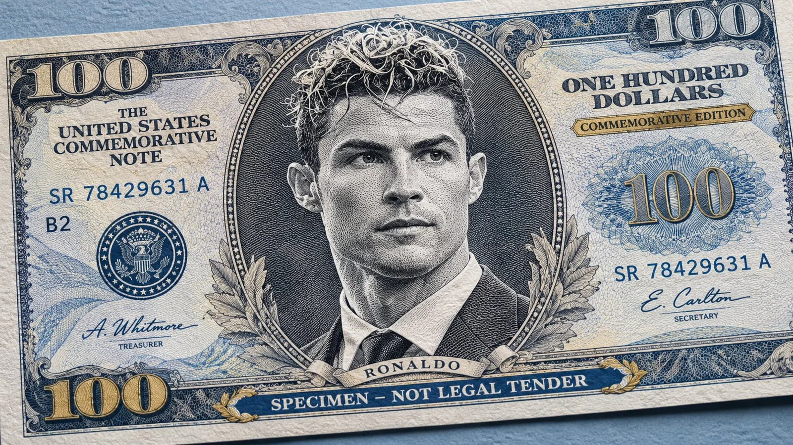

# Engraved Banknote Portrait from Your Photo (Specimen Note)

**中文标题：** 照片转钞票雕版肖像（样钞）  
**ID:** `gi25-x-1350` · **Mode:** `edit`  
**Categories:** `edit-change-preserve`, `poster-typography`  
**Tags:** `x-twitter`, `community`, `gpt-image-2.5`, `x-direct`, `en`



### Engraved Banknote Portrait from Your Photo (Specimen Note)

```text
HYPERREALISTIC BANKNOTE ENGRAVED PORTRAIT - UNIVERSAL AI PROMPT

Using the uploaded photograph as the sole identity reference, transform the person into a highly detailed, traditional banknote-style engraved portrait, presented on an elegant, fictional American-inspired $100 commemorative banknote.

1. PORTRAIT & IDENTITY

Carefully analyse the uploaded photograph and preserve the person's exact identity, facial structure, hairstyle, eyes, nose, lips, facial hair, expression, and distinctive features. Recreate their face as an intricate black-and-white engraved illustration, similar to traditional currency engraving.

2. ENGRAVING STYLE

- Extremely fine, realistic cross-hatching and intaglio engraving.
- Intricate parallel lines, stippling, and delicate etched details.
- Authentic monochrome banknote portrait aesthetic.
- Natural facial proportions with exceptional detail and sharpness.
- Professional hand-engraved appearance, not a cartoon, painting, or ordinary pencil sketch.

3. BANKNOTE DESIGN

Position the engraved portrait prominently in the centre of a sophisticated fictional $100 banknote. Include intricate ornamental borders, fine guilloche patterns, decorative typography, subtle blue security-inspired accents, serial numbers, signatures, and traditional currency-inspired detailing.

Use a refined combination of off-white engraved paper, charcoal-black ink, muted blue accents, and subtle golden details.

4. COMPOSITION & REALISM

Show the banknote at a slightly diagonal angle, resting on a softly textured light-blue surface. Capture realistic paper texture, delicate engraved lines, natural shadows, and premium macro-photography detail.

5. FINAL QUALITY

Ultra-photorealistic, exceptionally detailed currency engraving, crisp facial features, sophisticated financial-document aesthetic, professional studio lighting, 8K-quality detail.

IMPORTANT: The uploaded person must remain immediately recognizable. Do not change their identity or introduce another face. Create a fictional collectible banknote with clearly visible "SPECIMEN – NOT LEGAL TENDER" markings, rather than reproducing an authentic circulating currency note.
```

- **Recommended model:** `gpt-image-2.5-sunburst`
- **Settings:** _(defaults)_
- **Source:** [community](https://x.com/Goodmanprotocol/status/2117280367405367562) — @Goodmanprotocol
- **License note:** Original public X post; quoted with attribution — remix with attribution
- **Notes:** Collected directly from X; original post https://x.com/Goodmanprotocol/status/2117280367405367562; post text names GPT Image 2.5; discovered via X search, prompt re-verified against the original X post via api.fxtwitter.com; verified=True
- **Preview:** `previews/gi25-x-1350.webp`
