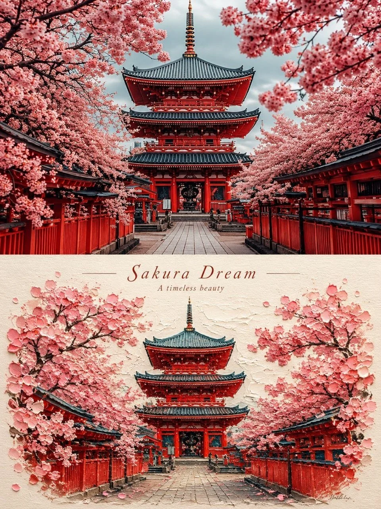

# Photo + Artistic Rendition 3:4 Comparison Poster

**中文标题：** 照片+艺术演绎 3:4 对照海报  
**ID:** `gi25-x-1366` · **Mode:** `edit`  
**Categories:** `edit-change-preserve`, `poster-typography`  
**Tags:** `x-twitter`, `community`, `gpt-image-2.5`, `x-direct`, `en`



### Photo + Artistic Rendition 3:4 Comparison Poster

```text
Create a vertical 3:4 comparison poster using the uploaded photo. Divide it into two equal horizontal halves.

Top half: Preserve the original photograph, subject identity, pose, proportions, details, lighting, and natural colors. Apply subtle premium color grading. No text or decorations.

Bottom half: Reimagine the same subject as a beautiful miniature landscape in thick impasto oil painting style, with rich palette-knife textures, sculptural paint layers, and handcrafted details. Use colors inspired by the original photo, warm-white negative space, and elegant minimal composition.

Add a short, meaningful English title and one tiny subtitle within the bottom half. Use delicate typography and subtle paper texture.

Style: Minimal, sophisticated, artistic, collectible editorial poster.

Avoid: Changing the subject, collages, extra objects, cartoon style, plastic 3D, messy colors, excessive text.
```

- **Recommended model:** `gpt-image-2.5-sunburst`
- **Settings:** _(defaults)_
- **Source:** [community](https://x.com/MissDelulu9/status/2117486725308322253) — @MissDelulu9
- **License note:** Original public X post; quoted with attribution — remix with attribution
- **Notes:** Collected directly from X; original post https://x.com/MissDelulu9/status/2117486725308322253; post text names GPT Image 2.5; discovered via X search, prompt re-verified against the original X post via api.fxtwitter.com; verified=True
- **Preview:** `previews/gi25-x-1366.webp`
