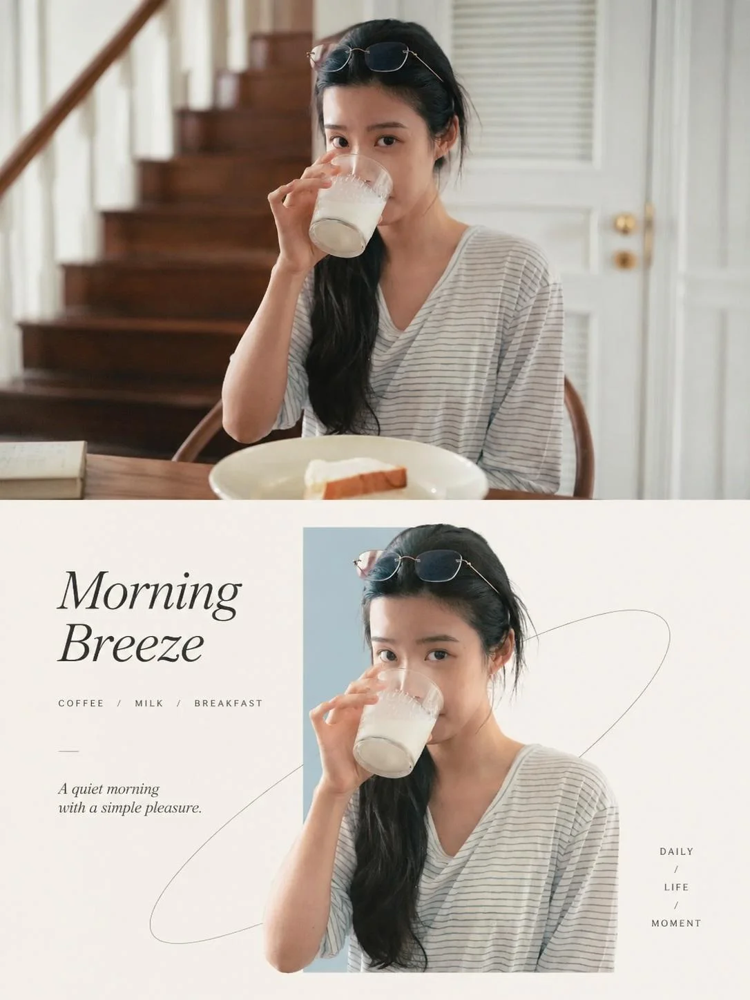

# Premium Editorial Poster: Photography Meets Geometric Art

**中文标题：** 高级编辑海报·摄影与几何艺术  
**ID:** `gi25-x-1377` · **Mode:** `edit`  
**Categories:** `edit-change-preserve`, `poster-typography`  
**Tags:** `x-twitter`, `community`, `gpt-image-2.5`, `x-direct`, `en`



### Premium Editorial Poster: Photography Meets Geometric Art

```text
PREMIUM EDITORIAL POSTER DESIGN — PHOTOGRAPHY MEETS GEOMETRIC ART

OVERALL INSTRUCTION

Transform each uploaded photograph into a separate, standalone premium design poster. Do not combine multiple photographs into a collage or create a multi-image composition. Each original photograph must produce its own independent poster.

Canvas: Vertical 3:4 aspect ratio.

Layout: Divide the canvas into two perfectly equal horizontal sections:

- Top section: Exactly 50% of the total canvas height.
- Bottom section: Exactly 50% of the total canvas height.

The transition between the two sections must be clean, precise, and perfectly aligned.

---

TOP HALF — ORIGINAL PHOTOGRAPH

Preserve the original photograph as faithfully as possible.

- Maintain the original subject, structure, proportions, pose, perspective, and spatial relationships.
- Preserve realistic textures, natural lighting, shadows, and the original color atmosphere.
- Apply only subtle, sophisticated photographic color grading to achieve the visual quality of a luxury brand campaign, fine-art editorial magazine, or contemporary art exhibition.
- Enhance tonal depth, highlight roll-off, contrast, and color harmony without making the image look artificially processed.
- If necessary, naturally extend the sky, ground, or surrounding environment to fit the composition.
- Never alter, distort, replace, or unnecessarily regenerate the original subject.

The upper section should feel like a beautifully art-directed original photograph rather than an AI-generated reinterpretation.

---

BOTTOM HALF — MINIMALIST GEOMETRIC EDITORIAL POSTER

Extract the most recognizable visual elements from the original photograph, including its subject, silhouette, posture, defining contours, movement, and narrative relationships.

Reinterpret these elements into a sophisticated minimalist commercial-art composition.

Core Visual Concept: "REAL OBJECTS THROUGH GEOMETRIC EMOTIONAL WINDOWS"

Introduce one narrow, restrained, low-saturation geometric color block that acts as the primary visual anchor and spatial container.

The geometric element should not follow a fixed orientation. Depending on the subject's visual weight, movement, silhouette, direction, and overall composition, it may be:

- Horizontal.
- Vertical.
- Diagonal.
- Slightly tilted or asymmetrically positioned.

The original subject should appear within or emerging through this geometric window, maintaining a realistic photographic appearance or highly refined photorealistic rendering.

Create an elegant interaction between the subject and the geometric boundary:

- Allow selected parts of the subject to extend beyond the geometric shape.
- Introduce subtle overlapping and intentional boundary-breaking.
- Let parts of the subject emerge, cross through, or extend outside the color block.
- Create a convincing sense of depth, spatial penetration, and natural movement.

The result should feel as though a real physical object is passing through an abstract geometric space, creating a beautiful relationship between reality and graphic design.

Avoid excessive decoration or unnecessary visual complexity.

---

COMPOSITION & SPATIAL BALANCE

Maintain an exceptionally clean, minimal, and balanced composition.

Use three primary elements to establish the visual hierarchy:

1. The geometric color window.
2. The realistic subject interacting with and extending beyond its boundaries.
3. Generous negative space.

The subject may be centered, asymmetrically positioned, vertically elongated, or horizontally extended, depending on what best complements the original photograph.

However, always maintain a single dominant visual focal point.

Keep the background predominantly white, soft grey, or an extremely light warm neutral.

Optional subtle supporting elements may include:

- Delicate cultural patterns.
- Fine linear graphics.
- Topographic contour lines.
- Gentle water-wave patterns.
- Soft shadow silhouettes.
- Minimal abstract symbols.
- Subtle architectural or organic outlines.

These elements must remain extremely understated, functioning only as secondary visual layers.

---

COLOR PALETTE & ART DIRECTION

Extract the most distinctive and expressive colors from the original photograph and translate them into a cohesive premium design system.

The overall color language should combine:

- A soft, light-toned geometric window.
- The original subject's authentic colors and textures.
- Minimal neutral typography and graphic accents.

Choose the geometric color according to the mood and identity of the photograph.

Possible tones include:

- Muted mist blue.
- Pale aqua.
- Soft ivory.
- Dusty blush pink.
- Warm grey.
- Subtle champagne gold.
- Muted beige.
- Other delicate tones naturally derived from the original photograph.

Keep the palette sophisticated, restrained, airy, and harmonious.

Avoid excessive saturation, harsh contrasts, unnecessary gradients, or overly decorative colors.

---

TYPOGRAPHY & EDITORIAL DESIGN

Integrate typography naturally as part of the overall composition rather than treating it as an afterthought.

Derive a short, meaningful English title from the photograph's subject, atmosphere, emotion, movement, condition, or symbolic meaning.

The title should feel poetic, memorable, and editorial.

Complement it with a small amount of secondary information, such as:

- A short descriptive subtitle.
- A location or geographical reference.
- A mood or status word.
- A minimal editorial annotation.
- A small collection or edition reference.

Typography may be arranged horizontally, vertically, or along the geometric shape and subject's visual direction.

Use:

- Elegant modern sans-serif or refined editorial serif fonts.
- Small, carefully balanced text sizes.
- Lightweight typography.
- Generous letter spacing.
- Precise alignment and spacing.
- Minimal neutral colors.

The typography should evoke the visual language of luxury real estate campaigns, high-end fashion publications, contemporary art magazines, and sophisticated seasonal editorial posters.

Keep all text legible, intentional, and visually subordinate to the main subject.

---

OVERALL ARTISTIC DIRECTION

The final design should communicate a sophisticated fusion of:

- Eastern minimalism and negative space.
- Modern geometric order.
- Natural energy and organic movement.
- Premium commercial art direction.
- Contemporary editorial design.
- Photorealistic visual storytelling.

Regardless of whether the original photograph contains a person, animal, plant, building, object, food, vehicle, or natural landscape, preserve the distinctive identity of the subject.

The visual relationship between the original photograph and the geometric reinterpretation must remain clear, elegant, and consistent.

---

STRICT OUTPUT REQUIREMENTS

1. Generate one independent poster for every uploaded photograph.
2. Never combine multiple photographs into a single image.
3. Maintain a precise vertical 3:4 aspect ratio.
4. Divide each poster into two perfectly equal horizontal sections (50% / 50%).
5. Preserve the original photograph in the upper section.
6. Create a sophisticated geometric editorial reinterpretation in the lower section.
7. Maintain photorealistic subject details and natural proportions.
8. Use a single dominant focal point and generous negative space.
9. Ensure typography is minimal, refined, and correctly spelled.
10. Maintain a consistent premium design language across all posters while allowing each photograph to determine its own colors, geometric orientation, composition, and editorial identity.

FINAL CREATIVE GOAL: Every output should look like a collectible art-direction poster designed by a world-class creative studio — combining authentic photography, minimalist geometric intervention, refined typography, Eastern-inspired negative space, and premium luxury editorial aesthetics.
```

- **Recommended model:** `gpt-image-2.5-sunburst`
- **Settings:** _(defaults)_
- **Source:** [community](https://x.com/oggii_0/status/2117631318465060906) — @oggii_0
- **License note:** Original public X post; quoted with attribution — remix with attribution
- **Notes:** Collected directly from X; original post https://x.com/oggii_0/status/2117631318465060906; post text names GPT Image 2.5; discovered via X search, prompt re-verified against the original X post via api.fxtwitter.com; verified=True; needs uploaded photos
- **Preview:** `previews/gi25-x-1377.webp`
