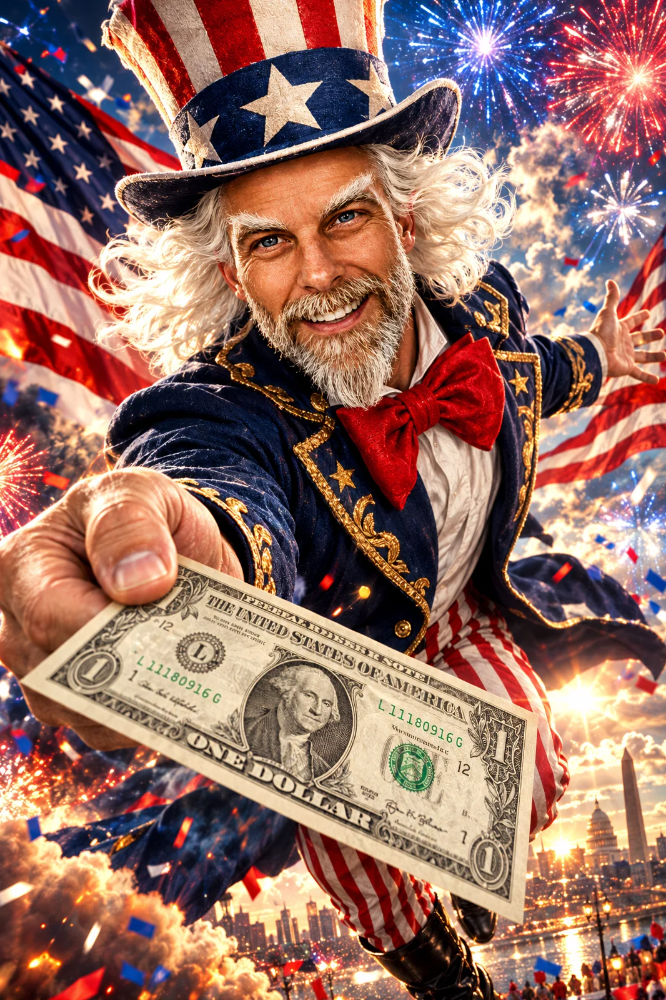

# Uncle Sam Handing You One Dollar Blockbuster Poster

**中文标题：** 山姆大叔递一美元·好莱坞大片海报  
**ID:** `gi25-x-1380` · **Mode:** `edit`  
**Categories:** `edit-change-preserve`, `character-consistency`  
**Tags:** `x-twitter`, `community`, `gpt-image-2.5`, `x-direct`, `en`



### Uncle Sam Handing You One Dollar Blockbuster Poster

```text
Transform the subject in the uploaded reference image into a spectacular, larger-than-life, hyperrealistic UNCLE SAM in an explosive Hollywood-blockbuster patriotic masterpiece. Preserve recognizable facial features, identity, and unique characteristics. Adapt naturally to ANY person, character, or avatar.

CHARACTER: Legendary American showman with outrageous charisma, electrifying confidence, HUGE mischievous grin, thick WAVY WHITE HAIR flowing beneath an extravagant stars-and-stripes top hat, and prominent BUSHY WHITE EYEBROWS. Turn ALL existing facial hair snowy white, preserving its original shape and length; clean-shaven subjects remain clean-shaven. Luxurious navy-blue tailcoat with gold embroidery, crisp white shirt, oversized red bow tie, red-and-white striped trousers, polished black boots. Hair and clothing billow in powerful winds.

THE MONEY SHOT: Uncle Sam lunges toward the camera, thrusting EXACTLY ONE realistic U.S. ONE-DOLLAR BILL directly at the viewer as if handing it through the screen! EXTREME forced perspective makes the bill MASSIVE in the foreground, displaying George Washington's portrait, authentic green ink, and accurate proportions. Fingers naturally grip one corner without obscuring the design. Other arm sweeps outward theatrically. Anatomically correct hands, five fingers each. NO additional money.

EXPRESSION: Enormous infectious grin, dramatically arched bushy white eyebrows, sparkling eyes, playful manic enthusiasm, and DIRECT eye contact. Flowing white hair frames the recognizable face.

BACKGROUND: EXPLOSIVE red, white, and blue fireworks, enormous American flags whipping in cinematic winds, golden sparks, swirling patriotic confetti, glowing embers, atmospheric smoke, spectacular lens flares, and dramatic golden sunlight piercing storm clouds above a monumental American city skyline.

COMPOSITION: EXTREME 18mm wide-angle lens, dramatic low-angle perspective, dynamic diagonal framing, breathtaking 3D depth, and exaggerated foreshortening. Uncle Sam appears to BURST THROUGH THE SCREEN! Massive foreground dollar bill without covering the face. Face and bill razor-sharp; layered cinematic background. Entire top hat, flowing white hair, and eyebrows clearly visible.

STYLE: Jaw-dropping Hollywood blockbuster poster meets premium commercial photography. Ultra-photorealistic skin, individually defined white hair and facial hair, luxurious fabric textures, metallic reflections, saturated patriotic colors, intense HDR contrast, volumetric lighting, cinematic ray tracing, and spectacular VFX.

FINAL IMPACT: An outrageously energetic, unforgettable, scroll-stopping patriotic spectacle of Uncle Sam EXPLODING THROUGH THE SCREEN to personally GIVE THE VIEWER ONE DOLLAR!

QUALITY: 8K, 2:3 vertical, Octane render, theatrical poster quality. NO text overlays, watermarks, extra dollar bills, duplicate limbs, or distorted hands.
```

- **Recommended model:** `gpt-image-2.5-sunburst`
- **Settings:** _(defaults)_
- **Source:** [community](https://x.com/SethCritchley/status/2117606421756096891) — @SethCritchley
- **License note:** Original public X post; quoted with attribution — remix with attribution
- **Notes:** Collected directly from X; original post https://x.com/SethCritchley/status/2117606421756096891; post text names GPT Image 2.5; discovered via X search, prompt re-verified against the original X post via api.fxtwitter.com; verified=True; needs an uploaded reference image; the post recommends ChatGPT or GPT Image 2.5; promo/referral text around the prompt omitted
- **Preview:** `previews/gi25-x-1380.webp`
