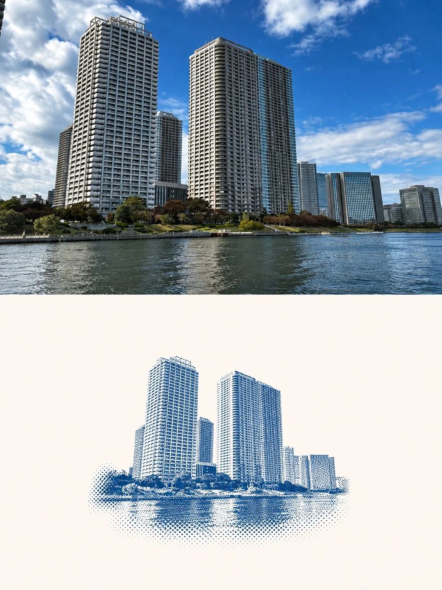

# Minimal Two-Split Photo + Halftone Graphic Poster (Japanese)

**中文标题：** 极简上下分屏照片+网点图形海报（日文）  
**ID:** `gi25-x-1381` · **Mode:** `edit`  
**Categories:** `edit-change-preserve`, `poster-typography`  
**Tags:** `x-twitter`, `community`, `gpt-image-2.5`, `x-direct`, `ja`



### Minimal Two-Split Photo + Halftone Graphic Poster (Japanese)

```text
添付写真を、アスペクト比3:4の縦型・ミニマルな2分割ポスターに変換する。

1. 全体のレイアウト
* 画面の中央で上下2つのエリアに分割する。
* 上下の比率はそれぞれ50%。
* 2つのエリアの間に境界線は設けない。

2. 上半分（オリジナル写真）
* 元の写真の主題、色彩、光と影の表現をそのまま維持する。
* 必要最小限のトリミングのみ行う。
* 文字は一切入れない。

3. 下半分（グラフィックデザイン）
* 元の写真から主題のみを切り抜き、背景を除去する。
* 背景色はオフホワイトとする。
* 主題のサイズは、下半分のエリアに対して以下の比率に縮小する。
    * 横幅：35〜45%
    * 高さ：30〜40%
* 主題を中央に配置し、周囲に十分な余白を確保する。

4. 仕上がり
* ミニマルで洗練されたエディトリアルデザインに仕上げる。
* 写真のリアリティと、ハーフトーンによるグラフィック表現の対比を際立たせる。
```

- **Recommended model:** `gpt-image-2.5-sunburst`
- **Settings:** _(defaults)_
- **Source:** [community](https://x.com/una_eight/status/2117598191248109833) — @una_eight
- **License note:** Original public X post; quoted with attribution — remix with attribution
- **Notes:** Collected directly from X; original post https://x.com/una_eight/status/2117598191248109833; post text names GPT Image 2.5; discovered via X search, prompt re-verified against the original X post via api.fxtwitter.com; verified=True; needs an uploaded photo
- **Preview:** `previews/gi25-x-1381.webp`
