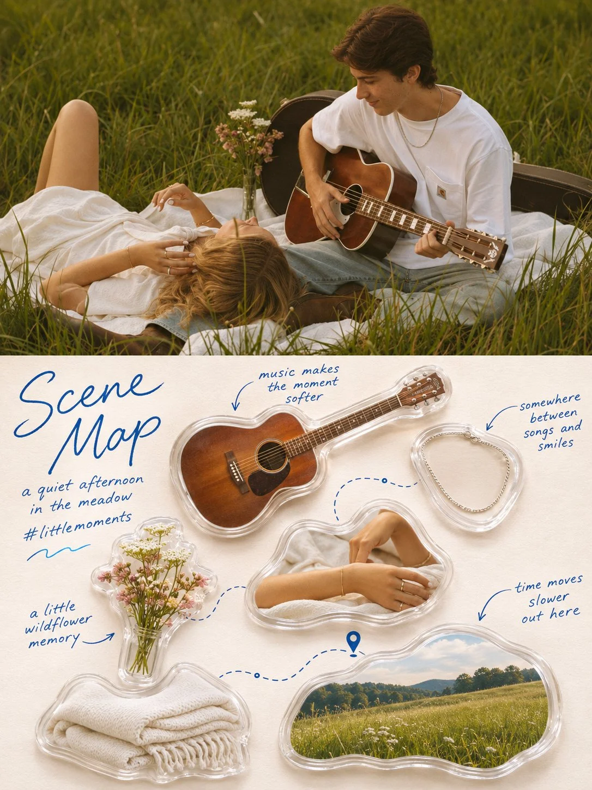

# Photo to High-End Split Design Poster with Handwritten Notes

**中文标题：** 照片转高端分屏设计海报·手写注释  
**ID:** `gi25-x-1386` · **Mode:** `edit`  
**Categories:** `edit-change-preserve`, `poster-typography`  
**Tags:** `x-twitter`, `community`, `gpt-image-2.5`, `x-direct`, `en`



### Photo to High-End Split Design Poster with Handwritten Notes

```text
image1 = MY PHOTO. Everything in the poster comes from here — the subject, the scene, the objects, the details and the setting.

Turn @image1 into a single high-end design poster. 3:4 vertical, split into two zones of strictly equal height, 1:1, each occupying 50% of the frame, divided by one clean horizontal edge. One poster only — no collage, no multi-image grid.

TOP HALF
The original photograph from @image1, preserving the subject's identity, structure, pose, real texture, natural light and shadow and original colour atmosphere, with only a subtle refined grade so it carries the quality of an art magazine, an independent publication or a lifestyle editorial. The environment may be naturally extended to fit the frame, but never stretch, distort or alter the subject. Full bleed, no border.

BOTTOM HALF — THE SCENE MAP
Extract the most recognisable subject relationships, object details, everyday details and narrative memory points from @image1, and rebuild them as a life-fragment Scene Map — an acrylic collectible catalogue laid out on paper.

Do not reproduce the photograph. Freely select roughly 4–7 of the most memorable elements from it: part of a person, food, a drink, an object, a plant, an animal, an architectural feature, a landmark, a vehicle, or a small detail carrying emotional value.

OBJECT TREATMENT
Each element is rendered as a real photographed object with crisp, tangible texture — never flattened into cartoon or vector style. Treat them with a soft lifestyle palette: natural light, clean highlights, creamy bright areas, a light soft haze, clear translucent shadows, a comfortable warm-cool balance. Reduce harsh contrast slightly and lift the colours so each object feels gentle, refined, clean and soothing, while still looking genuinely photographed.

Encase each one in a transparent rounded acrylic or resin shell that follows its silhouette with a soft rounded outline, like a sealed gel pouch or a clear collectible keepsake. Give the casing slight visible thickness, a delicate bright highlight along its upper edge, faint refraction where it meets the object, and a soft contact shadow beneath it on the paper. It should read as a real physical miniature collectible, not a plastic 3D toy and not a sticker.

LAYOUT
Do NOT use a fixed four-square grid, evenly spaced rows or uniform sizing. Organise the elements dynamically by their own size, orientation, shape and visual weight.

Choose one composition: diagonal flow, an S-shaped route, a circular enclosure, staggered vertical offsets, a stepped rhythm, radiating from a centre, two clustered groups, entering from the edge, or asymmetric floating. Elements may differ sharply in scale, rotate slightly, partially overlap, sit against the edge or be cropped.

Keep one clear reading path and generous white space on a warm off-white paper background with a faint natural grain — lively but not chaotic, relaxed but ordered.

CONNECTIONS
Between elements, add thin dashed lines in soft blue, curved arrows, small route nodes, location pins, dots, brackets and light hand-drawn strokes, following the flow of the composition. Not every element needs connecting. Lines may detour, skip, break off or form small local loops, so it reads like a carefully arranged private memory map rather than a flowchart or an infographic.

TEXT — ALL IN ENGLISH
Every piece of text in the poster is in ENGLISH. No Japanese, Chinese or Korean characters anywhere.

Write "Scene Map" as a large handwritten script title in the upper-left corner, in soft blue ink, loose and flowing across two lines. Beneath it, two small handwritten lines — a short poetic phrase naming the place or moment, and a hashtag. For example "fragments of a day in paris." and "#seine memory". Add a small hand-drawn wave or squiggle beneath them.
```

- **Recommended model:** `gpt-image-2.5-sunburst`
- **Settings:** _(defaults)_
- **Source:** [community](https://x.com/Ziha_ai/status/2117549975576174722) — @Ziha_ai
- **License note:** Original public X post; quoted with attribution — remix with attribution
- **Notes:** Collected directly from X; original post https://x.com/Ziha_ai/status/2117549975576174722; post text names GPT Image 2.5; discovered via X search, prompt re-verified against the original X post via api.fxtwitter.com; verified=True; needs an uploaded photo (image1)
- **Preview:** `previews/gi25-x-1386.webp`
