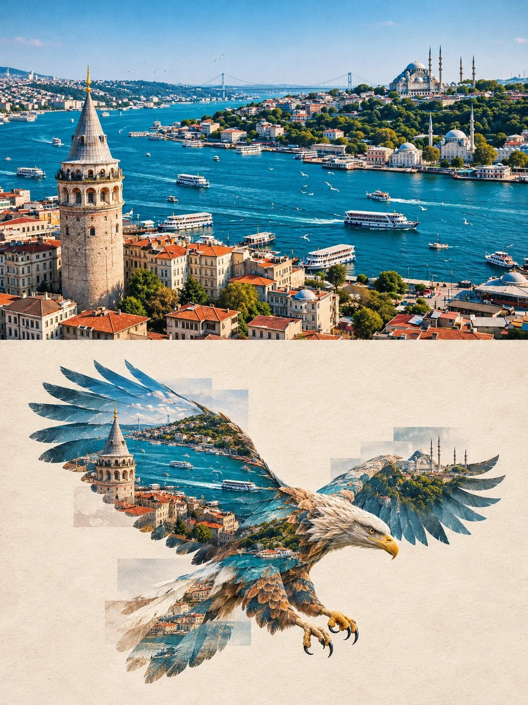

# Photo × Wild Animal Transformation Split Art Poster

**中文标题：** 照片×野生动物变身上下分屏艺术海报  
**ID:** `gi25-x-1404` · **Mode:** `edit`  
**Categories:** `edit-change-preserve`, `poster-typography`  
**Tags:** `x-twitter`, `community`, `gpt-image-2.5`, `x-direct`, `en`



### Photo × Wild Animal Transformation Split Art Poster

```text
ORIGINAL PHOTOGRAPHY × WILD ANIMAL TRANSFORMATION — ART POSTER

Using the uploaded photograph as the sole visual reference, create a sophisticated 3:4 vertical artistic poster divided into two perfectly equal horizontal sections (50% each). No text, logos, watermarks, or borders.

TOP HALF — ORIGINAL PHOTOGRAPH:

Preserve the original photograph faithfully, including its subject, composition, colours, lighting, textures, proportions, and perspective. Apply only subtle premium editorial colour grading and delicate film grain. No adding, removing, duplicating, or distorting elements.

BOTTOM HALF — WILD ANIMAL TRANSFORMATION:

On a warm ivory-white artistic paper background, intelligently analyse the original photograph and select the most suitable real wild animal based on its subject, shapes, textures, patterns, colours, and visual character.

Transform the photograph's visual elements into a complete, anatomically accurate, instantly recognizable wild animal, with clearly defined head, body, limbs, and distinctive species-specific features. The animal must look like a genuine wild species, not an abstract creature, fantasy hybrid, or generic silhouette. Never default to predetermined animals such as birds, deer, or wolves. The animal selection must depend entirely on the uploaded photograph.

Naturally integrate the original photograph's textures, colours, patterns, and lighting into the animal's body, making it appear as though the animal has emerged from the photograph. Extend 4–6 semi-transparent photographic fragments beyond its silhouette using layered slices, stepped edges, subtle offsets, and partial fading.

Keep the animal centrally positioned, occupying approximately 48–55% of the section's width and 55–62% of its height, with generous negative space.

VISUAL STYLE:

Minimalist contemporary editorial design, sophisticated photographic collage, subtle paper fibres, delicate film grain, refined print texture, and premium gallery-poster aesthetics. Use colours extracted exclusively from the original photograph.

AVOID: Unrelated animal choices, fictional creatures, incorrect anatomy, ordinary black silhouettes, generic icons, hard-edged photo masks, clutter, 3D, gradients, cartoon styling, text, logos, and watermarks.

FINAL RESULT: A visually compelling composition where the original photograph remains intact above, while its visual identity is intelligently transformed into a complete, unmistakable real wild animal below.
```

- **Recommended model:** `gpt-image-2.5-sunburst`
- **Settings:** _(defaults)_
- **Source:** [community](https://x.com/Goodmanprotocol/status/2117953333558386909) — @Goodmanprotocol
- **License note:** Original public X post; quoted with attribution — remix with attribution
- **Notes:** Collected directly from X; original post https://x.com/Goodmanprotocol/status/2117953333558386909; post text names GPT Image 2.5; discovered via X search, prompt re-verified against the original X post via api.fxtwitter.com; verified=True; needs an uploaded photo
- **Preview:** `previews/gi25-x-1404.webp`
