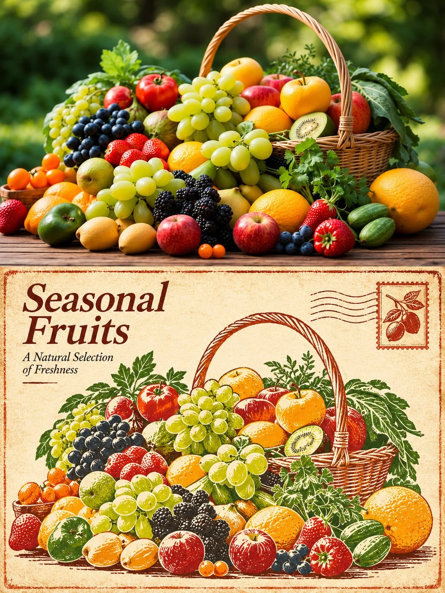

# Rubber Stamp Print Photo × Design Comparison Poster

**中文标题：** 橡皮章印刷·照片×设计对比海报  
**ID:** `gi25-x-1405` · **Mode:** `edit`  
**Categories:** `edit-change-preserve`, `poster-typography`  
**Tags:** `x-twitter`, `community`, `gpt-image-2.5`, `x-direct`, `en`



### Rubber Stamp Print Photo × Design Comparison Poster

```text
RUBBER STAMP PRINT - PHOTOGRAPHY × DESIGN POSTER

TASK: Transform each uploaded photograph into an individual 3:4 vertical comparison poster. Never combine multiple photographs. Adapt the design naturally to the original subject and scene.

COMPOSITION: Divide the canvas into two perfectly equal horizontal sections (50% each). The top half retains the original photograph; the bottom half presents its rubber stamp print interpretation. Both sections must meet at a clean, sharp horizontal boundary with no gaps, gradients or overlap. Keep all text and decorations inside the bottom half. Recommended resolution: 1200 × 1600 px.

TOP — ORIGINAL PHOTOGRAPH: Preserve the subject's identity, quantity, proportions, pose, silhouette, defining details, perspective, positioning, natural lighting and original colours. Apply only subtle colour correction. Minor background cropping or expansion is allowed, but never distort, duplicate, mirror, move or redraw the subject. No text, borders or decorative elements.

BOTTOM — RUBBER STAMP ART: Artistically reinterpret the same subject and composition as an authentic rubber stamp relief print. Use simplified engraved lines, bold ink shapes and balanced negative space while maintaining recognizability. Do not simply apply a printmaking filter to the photograph. Use warm, light-toned paper with a subtle distressed border, one small illustrative stamp and a minimal text-free postmark, all contained within this section.

COLOURS & TEXTURES: Derive a limited, harmonious colour palette from the original photograph. Preserve the subject's natural colour character. Use a deep tone from the photograph's shadows for engraved lines and its original colours for solid ink shapes. Add subtle ink imperfections, slight printing irregularities and delicate paper fibres for authentic printmaking texture.

TYPOGRAPHY: In the upper-left negative space of the bottom section, place a short, elegant English serif title with one brief complementary line underneath. Generate wording based on the subject and mood. Ensure correct spelling. Avoid invented locations, dates, coordinates, brands, signatures, usernames or placeholder text.

OVERALL STYLE: Quiet, refined and sophisticated, resembling a collectible fine-art editorial publication. Create visual hierarchy through thoughtful composition, paper texture, limited colours and negative space.

AVOID: Combining photographs, changing the subject, unrelated scenes, excessive decorations, separate title bars, duplicated or distorted text, new logos, signatures, watermarks, illustration effects in the photographic section, decorations crossing the dividing line, excessive distressing or large dirty areas.

Preserve original logos and markings as authentic details of the photograph.
```

- **Recommended model:** `gpt-image-2.5-sunburst`
- **Settings:** _(defaults)_
- **Source:** [community](https://x.com/Goodmanprotocol/status/2118002740312043824) — @Goodmanprotocol
- **License note:** Original public X post; quoted with attribution — remix with attribution
- **Notes:** Collected directly from X; original post https://x.com/Goodmanprotocol/status/2118002740312043824; post text names GPT Image 2.5; discovered via X search, prompt re-verified against the original X post via api.fxtwitter.com; verified=True; needs uploaded photos
- **Preview:** `previews/gi25-x-1405.webp`
