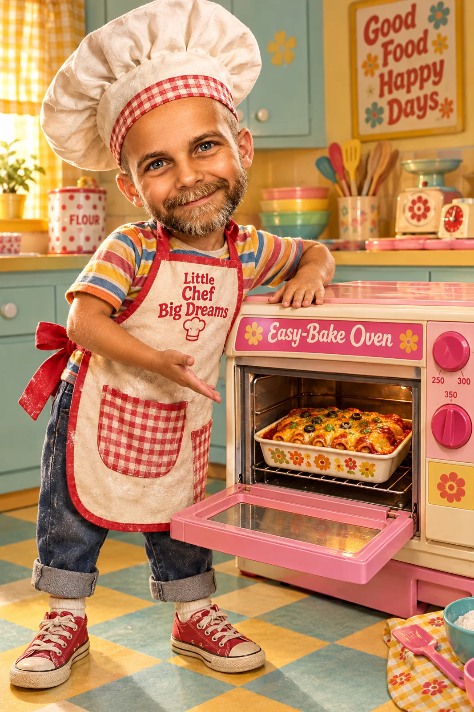

# Childlike You with Easy-Bake Oven Dish

**中文标题：** 童年版你与复古玩具烤箱  
**ID:** `gi25-x-1406` · **Mode:** `edit`  
**Categories:** `edit-change-preserve`, `character-consistency`  
**Tags:** `x-twitter`, `community`, `gpt-image-2.5`, `x-direct`, `en`



### Childlike You with Easy-Bake Oven Dish

```text
Using the uploaded reference image, transform the subject into an adorable, hilarious, childlike version of themselves, approximately 5–7 years old. Preserve their recognizable facial features, identity, hairstyle, hair color, facial hair characteristics (if present, naturally adapted to childhood), and distinctive traits. Adapt seamlessly to ANY person, character, avatar, or creature.

CHARACTER: Oversized expressive head, youthful rounded cheeks, bright sparkling eyes, mischievous grin, and exaggerated childlike proportions. Wearing a colorful, whimsical vintage baking outfit with an oversized apron and comically large chef's hat. Radiating playful excitement, silly confidence, and irresistible childhood charm.

SCENE: Standing proudly in front of a classic, cliché 1960s–1970s Easy-Bake Oven-style miniature toy oven, featuring nostalgic pastel colors, retro plastic construction, oversized toy controls, and charming vintage details. The oven door is WIDE OPEN, prominently displaying a freshly prepared, delicious-looking [INSERT ANY DISH HERE] inside. The dish must be clearly visible, instantly recognizable, beautifully detailed, and appropriately sized to fit inside the miniature oven. Add realistic textures, appetizing presentation, and whimsical culinary details.

POSE & EXPRESSION: Subject faces the camera directly, standing beside the open oven, enthusiastically presenting their culinary masterpiece with an exaggerated, proud, hilariously mischievous expression. One hand gestures dramatically toward the dish while the other rests naturally on the oven.

ENVIRONMENT: Colorful, nostalgic retro kitchen with playful baking accessories, miniature utensils, pastel cabinetry, and charming vintage decorations. Warm cinematic lighting, vibrant colors, whimsical atmosphere, and exceptional visual clarity.

STYLE & COMPOSITION: Hyperrealistic, premium cinematic character design, realistic skin and fabric textures, exaggerated comedic proportions, extraordinary detail, professional studio lighting, shallow depth of field. Full-body portrait, eye-level perspective. Keep the subject, entire miniature oven, open door, and featured dish completely visible and unobstructed.

TECHNICAL: 8K resolution, 2:3 vertical format, Octane render, photorealistic materials, razor-sharp focus, vibrant cinematic color grading, masterpiece quality.
```

- **Recommended model:** `gpt-image-2.5-sunburst`
- **Settings:** _(defaults)_
- **Source:** [community](https://x.com/SethCritchley/status/2117964723224477986) — @SethCritchley
- **License note:** Original public X post; quoted with attribution — remix with attribution
- **Notes:** Collected directly from X; original post https://x.com/SethCritchley/status/2117964723224477986; post text names GPT Image 2.5; discovered via X search, prompt re-verified against the original X post via api.fxtwitter.com; verified=True; needs an uploaded reference image; fill-in [INSERT ANY DISH HERE]; the post recommends ChatGPT or GPT Image 2.5; promo/referral text after the prompt omitted
- **Preview:** `previews/gi25-x-1406.webp`
